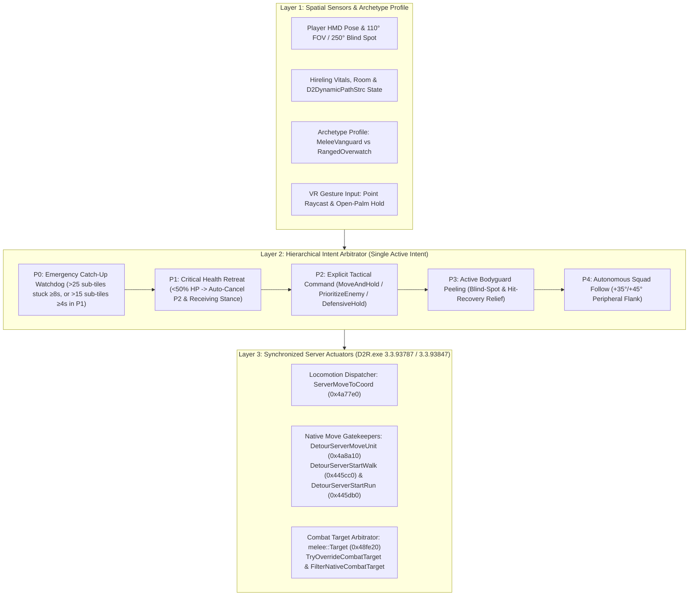

# VR Companion AI: Unified Architecture, True Ally Behaviors & Spatial Combat Arbitrator

> Español: [docs/es/VR_COMPANION_AI.md](es/VR_COMPANION_AI.md) | Tactical Commands Specification: [docs/VR_COMPANION_TACTICAL_COMMANDS.md](VR_COMPANION_TACTICAL_COMMANDS.md)

## 1. Overview & Motivation

In flat *Diablo II: Resurrected*, mercenaries (hirelings) serve primarily as passive aura providers trailing behind the player via a rigid, stateless AI callback (`AITHINK_Fn061_Hireable` at RVA `0x5c1610`).

In Virtual Reality (VR), your mercenary is a **physically present 1:1 human-scale companion** standing beside you in dark corridors and chaotic combat. When an AI ally crowds your face, blocks narrow doorways, ignores flankers in your 250° rear blind spot, suicides into elite packs while you hold a healing potion in your hand, or oscillates between player tactical orders and native follow-player AI, immersion is broken.

This document specifies the **Unified 3-Layer Companion AI Architecture** in `d2r-pcvr` ([`steamvr/companion_ai.h`](../steamvr/companion_ai.h), [`vr/companion_ai.cpp`](../vr/companion_ai.cpp), [`vr/companion_ai_signatures.h`](../vr/companion_ai_signatures.h), [`vr/melee.h`](../vr/melee.h), and [`vr/melee.cpp`](../vr/melee.cpp)), designed both to eliminate state/locomotion conflicts and to serve as the extensible foundation for future mercenary capabilities.

---

## 2. Unified 3-Layer Architecture

To prevent competing subsystems (or vanilla `AITHINK_Fn061_Hireable`) from issuing contradictory movement and combat targets on alternating frames, the VR Companion AI is organized into three strict layers:

### Layer 1: Spatial Sensors & Archetype Profile (`Archetype`)

Every decision is parameterized by the hireling's combat archetype (`GetHirelingArchetype(classId)`):

| Archetype | Hireling Classes (`MonStats` Row) | Optimal Combat Range | Hold Engage Radius | Native AI Constraint |
| :--- | :--- | :--- | :--- | :--- |
| **`MeleeVanguard`** | Act 2 Desert Guard (`338`), Act 5 Barbarian (`560`, `561`) | `<= 3.5` sub-tiles (melee contact) | `6.0` sub-tiles from anchor | Closes directly onto target unit (`moveMode = 15`). |
| **`RangedOverwatch`** | Act 1 Rogue Scout (`271`), Act 3 Iron Wolf (`359`) | `5.0 .. 14.0` sub-tiles (optimal stand-off `10.0`) | `24.0` sub-tiles from anchor | Native `AITHINK_Fn061_Hireable` triggers a panic-flee walk if forced within `< 4` sub-tiles of a monster. Never force ranged hirelings into melee coordinates. |

### Layer 2: Hierarchical Intent Arbitrator

Only **one** high-level intent owns the companion's locomotion and target selection on any tick:

1. **`P0 — EmergencyCatchUp` (`StuckWatchdog`):** Transversal locomotion watchdog that triggers only when the companion is stuck in `MONMODE_WALK (2)` making `< 0.5` sub-tiles progress while no tactical order (`P2`) is active. Uses standard thresholds (`> 25.0` sub-tiles for `8000 ms`) during normal follow, or tightened thresholds (`> 15.0` sub-tiles for `4000 ms`) when `P1 (SurvivalRetreat)` is active. Executes transactional `RelocateUnit` (`0x491ca0`).
2. **`P1 — SurvivalRetreat` (`TacticalRetreatController`):** Triggers when companion HP drops below `50%` (`CriticalHealthRatio = 0.50f`, synchronized with the red low-health indicator). Immediately cancels any active `P2` tactical order (`HealthRetreat`), disables tactical move gatekeepers, plays an archetype distress voice cue, suppresses combat target acquisition, and relocates to the **Receiving Stance** (`6.5` sub-tiles ahead at `+20°` flank) so the player can physically toss a healing potion from their VR belt.
3. **`P2 — TacticalCommand` (`TacticalOrderController`):** Executes explicit player VR gesture commands (`MoveAndHold`, `PrioritizeEnemy`, `DefensiveHold`) until cancelled by `ExplicitCancel` (`Regroup`), elastic leash break (`LeashExceeded` at `40` sub-tiles), hold expiration (`HoldExpired`), level transition, target defeat, or critical health retreat (`P1`).
4. **`P3 — BodyguardPeel` (`BodyguardController`):** When no tactical command or retreat is active, scores nearby hostiles (`EvaluateThreat`), dispatches an intercept walk (`DispatchServerMoveToCoord`), and routes the companion's combat target (`TryOverrideCombatTarget`) to intercept monsters in the player's 250° blind spot or striking the player during `PLRMODE_GETHIT`.
5. **`P4 — AutonomousFollow`:** Default peripheral formation (`+35°` Vanguard / `+45°` Overwatch) with dynamic detection range (`ComputeCompanionDetectRange`, scaling `aidist` in `MonStats` from `25` up to `48` sub-tiles based on `enemy_sight_pct`).

### Layer 3: Synchronized Locomotion & Combat Target Actuators

Reverse engineering of `D2R.exe` (`3.3.93787 / 3.3.93847`) revealed that `AITHINK_Fn061_Hireable` (`0x5c1610`) initiates movement through **two** server code paths and acquires targets through `0x48fe20`. Synchronizing all three prevents oscillation ("walking back toward the player and then returning to the hold spot"):

| Engine Function | Verified RVA (`3.3.93787 / 3.3.93847`) | Role in Unified Architecture |
| :--- | :--- | :--- |
| `ServerMoveToCoord` | `0x4a77e0` | **Primary Commanded Walk Dispatcher:** `int __fastcall(uintptr_t game, uintptr_t unit, int x, int y)`. Populates the server movement struct (`pathType = 1`) and invokes `0x4a8a10 -> 0x4475c0`, building a valid `D2DynamicPathStrc` A* path and transitioning the hireling to `MONMODE_WALK (2)` without teleporting. For destinations `> 16` sub-tiles where single-hop A* fails, `DispatchServerMoveToCoord` steps a `16`-sub-tile intermediate waypoint. |
| `ServerMoveUnit` | `0x4a8a10` | **High-Level Move Gatekeeper (`DetourServerMoveUnit`):** Intercepts coordinate/unit moves routed through `0x4a8a10`. Suppresses native wander when `Arrived` at a hold anchor (while allowing `MeleeVanguard` to engage hostiles within `6.0` sub-tiles) and redirects unauthorized native moves back to the active tactical target. |
| `ServerStartWalk` / `ServerStartRun` | `0x445cc0` / `0x445db0` | **Low-Level Mode-Transition Gatekeepers (`DetourServerStartWalk` / `DetourServerStartRun`):** `AITHINK_Fn061_Hireable` also calls `0x4a87e0` (`0x4a88fd`), which bypasses `0x4a8a10` and calls `0x4475c0` directly to walk/run back toward the player. `0x4475c0` invokes `0x445cc0` (walk) or `0x445db0` (run) at `0x4477c9`. When our detour returns `0` (`ShouldAllowNativeMoveStruct == false`), `0x4475c0` automatically clears the rogue path (`call 0x34f430`) and keeps the hireling in `MONMODE_NEUTRAL (1)` (`call 0x445b80`) at its hold position. |
| `CombatTarget` | `0x48fe20` | **Combat Target Arbitrator (`TryOverrideCombatTarget` & `FilterNativeCombatTarget` in `vr/melee.cpp`):** Suppresses target acquisition (`return 0`) during `SurvivalRetreat` and while `MoveAndHold` is `Moving` to its destination; forces the marked enemy during `PrioritizeEnemy` or `BodyguardPeel`; and filters native `originalTarget` candidates during `MoveAndHold (Arrived)` and `DefensiveHold (Arrived)` so the hireling only engages enemies within its archetype hold radius (`6.0` sub-tiles melee, `24.0` sub-tiles ranged). |
| `RelocateUnit` & `RoomPoint` | `0x491ca0` & `0x38dfb0` | **Transactional Relocation & Walkability Check:** `RoomPoint` validates target room reachability prior to dispatching walks; `RelocateUnit` is reserved strictly for emergency unstuck catch-up (`P0`) and initial critical-health disengage (`P1`). |

---

## 3. Core Behavioral Systems

### 3.1. Survival, Tactical Retreat & Physical Potion Synergy
- **Critical Health Trigger (`< 50%` HP):** Synchronized with `MercLowHealth` (`0.50f`). Upon dropping below 50% life, `TacticalRetreatController` enters retreat, auto-cancels any active tactical order (`HealthRetreat`), and plays the archetype's native high-priority *"Help!"* emote (`2937` Amazon, `3171` Paladin, `3093` Necromancer, `3015` Barbarian).
- **Receiving Stance (`CalculateReceivingStancePosition`):** Positions the companion `6.5` sub-tiles (~2.6m) ahead of the player at a `+20°` forward flank angle and suppresses combat targeting via `TryOverrideCombatTarget`, providing a stable target for physical 3D belt potion throws.
- **Instant Potion Recovery (`OnPotionReceived`):** Hitting the companion with a thrown healing/rejuvenation potion (`Action::FeedMerc`) immediately exits retreat and restores offensive AI.

### 3.2. Active Bodyguard Instinct ("Peeling" & Blind-Spot Coverage)
- **VR Blind-Spot Threat Scoring (`EvaluateThreat`):** Hostiles outside the headset's 110° forward cone (evaluated against the 55° half-angle: $\cos(55^\circ) \approx 0.5735764$, i.e., `cosAngle < 0.5735764f`) or attacking the player during `PLRMODE_GETHIT` (`mode == 4 || mode == 18`) receive top priority (`Score 500..1000`).
- **Combat Target & Locomotion Routing:** Rather than snapping path coordinates via client-side `0x381890`, the selected threat ID is stored in `g_activePeelTargetId`, injected into the server combat target hook (`0x48fe20`), and paired with a server walk dispatch (`DispatchServerMoveToCoord`) toward `interceptPos` so the companion intercepts the flanker smoothly even from `MONMODE_NEUTRAL`.

### 3.3. Gesture-Based Tactical Commands
See [docs/VR_COMPANION_TACTICAL_COMMANDS.md](VR_COMPANION_TACTICAL_COMMANDS.md) for the complete specification of `MoveAndHold`, `PrioritizeEnemy`, `DefensiveHold`, and `Regroup` gestures, state machine transitions, and archetype stand-off math.

---

## 4. Extensibility Roadmap for Future Mercenary Features

Because all companion behavior now flows through the **3-Layer Arbitrator** (`Layer 1 Sensors -> Layer 2 Intent Arbitrator -> Layer 3 Locomotion & Target Actuators`), new mercenary capabilities can be added modularly without refactoring existing hooks:

1. **Tactical Skill & Aura Triggers (Commanded Abilities):**
   - Add a `TacticalSkillRequest` slot in Layer 2 (e.g., commanding Act 1 Rogue *Inner Sight / Slow Missiles*, Act 2 *Aura Pulse / Jab*, Act 3 *Enchant / Static Field*, or Act 5 *Battle Cry / Taunt*) dispatched on the game thread once `TacticalCommandState::Arrived` is reached.
2. **Environmental Cover & Chokepoint Anchoring:**
   - Extend Layer 1 room collision sensors (`RoomPoint`) to snap `MoveAndHold` destinations in narrow corridors/doorways to the exact threshold center for `MeleeVanguard` (shield wall) or behind pillar cover for `RangedOverwatch`.
3. **Cooperative Player-Mercenary Combos:**
   - Use `TryOverrideCombatTarget` (`0x48fe20`) to detect stunned/frozen monsters created by the player's VR spells or shield bash and prioritize shatter/finisher attacks.
4. **Multi-Companion & Summon Group Arbitration:**
   - Generalize `g_lastHirelingId` into a per-unit `CompanionContext` map keyed by `unitId`, enabling the same `DetourServerStartWalk`/`Run` and `FilterNativeCombatTarget` actuators to coordinate Necromancer Golems, Druid Grizzlies, Amazon Valkyries, and Assassin Shadows alongside the mercenary.

---

## 5. Safety & Verification Guarantees

- **Signature Verification Before Hook Installation:** Every RVA in [`vr/companion_ai_signatures.h`](../vr/companion_ai_signatures.h) is validated against its expected machine-code prologue via `d2rsig::Check` before any function pointer is invoked or detoured. If a game update alters a function signature, the hook gracefully aborts and logs a diagnostic without crashing.
- **Offline VR Exclusivity:** All hooks and table syncs execute strictly when `mode() == 0` (local offline game).
- **Zero Save Modification:** Character `.d2s` save files and disk assets are never modified.
- **Automated Test Coverage:** Verified by [`steamvr/companion_ai_test.cpp`](../steamvr/companion_ai_test.cpp) (`ctest -R companion-ai`), covering `MonStats` scaling, stuck watchdog, retreat hysteresis, blind-spot threat scoring, explicit command state machine transitions, archetype stand-off math, `0x4a77e0`/`0x4a8a10`/`0x445cc0`/`0x445db0` locomotion gatekeepers, and `0x48fe20` combat target filtering.