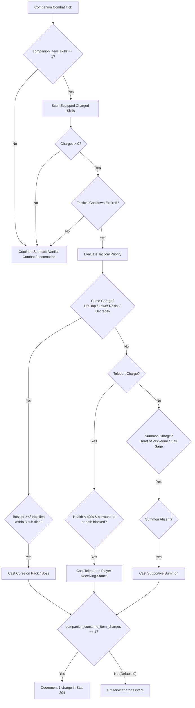
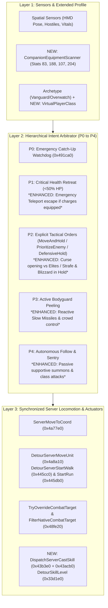
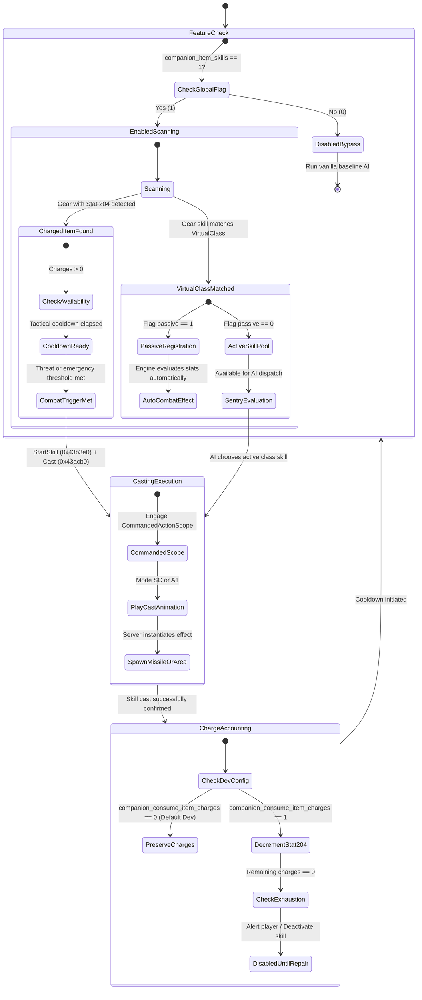

# VR Companion AI: Virtual Player Classes, Matching Item Skills & Charged Skill Mechanics

> Español: [docs/es/VR_COMPANION_CLASSES_AND_CHARGES.md](es/VR_COMPANION_CLASSES_AND_CHARGES.md) | Core AI Architecture: [docs/VR_COMPANION_AI.md](VR_COMPANION_AI.md) | Tactical Commands: [docs/VR_COMPANION_TACTICAL_COMMANDS.md](VR_COMPANION_TACTICAL_COMMANDS.md)

---

## 1. Overview & Motivation

In flat *Diablo II: Resurrected*, mercenaries (hirelings) suffer from severe architectural limitations inherited from the original year 2000 game engine:
1. **Class Isolation:** Mercenaries are strictly monster units (`dwType == 1`, `UNIT_MONSTER`) and lack a player character class (`pPlayerData == nullptr`). Consequently, they never benefit from class-specific skill bonuses on equipped gear (for example, `+2 to Amazon Skill Levels` on a bow equipped by an Act 1 Rogue, or `+3 to Sorceress Skill Levels` on a sword/shield equipped by an Act 3 Iron Wolf). Furthermore, they cannot learn or trigger class skills granted via item *staffmods* or *oskills*.
2. **Total Inability to Use Charged Skills:** Even if a mercenary equips an item granted with active charged spells (such as a tiara or staff with *Teleport* charges, wands with *Life Tap* or *Lower Resist*, or rings with *Heart of Wolverine*), the native hireling AI (`AITHINK_Fn061_Hireable` at RVA `0x5c1610`) is 100% blind to charges. The native engine has no decision tree to inspect, select, or cast charged skills.

In Virtual Reality (VR), where your mercenary is a physically present, human-scale 1:1 tactical ally fighting alongside you, these constraints severely restrict loadout depth, strategic synergy, and immersion.

This specification details the complete engineering architecture to:
* **Virtually assign player classes in runtime memory** to each mercenary without modifying game data tables (`.txt`), allowing companions to unlock and scale matching passive and active skills from gear.
* **Empower companion AI to tactically cast charged skills from equipped items**, evaluated autonomously with strict situational cooldowns.
* **Provide Complete Feature Governance:** A user-facing master toggle in the in-VR Settings menu (`companion_item_skills = 1 | 0`) to enable or completely disable the feature (reverting to baseline vanilla AI).
* **Maintain Internal Developer Charge Accounting:** The `companion_consume_item_charges` setting is confined strictly to the internal `[dev]` INI section, hidden from the VR Settings UI, and defaults to `0` (infinite/zero-wear charges for testing and casual play).
* **Seamlessly Integrate into the Unified 3-Layer AI Architecture** defined in [`docs/VR_COMPANION_AI.md`](VR_COMPANION_AI.md) and the gesture command system in [`docs/VR_COMPANION_TACTICAL_COMMANDS.md`](VR_COMPANION_TACTICAL_COMMANDS.md).

---

## 2. Core Engineering Rules & "Zero Data Table Mutation" Principle

Following repository collaboration guidelines and engine invariants in `d2r-pcvr`:
1. **Zero Data Table Modification:** No modification or redistribution of `hireling.txt`, `skills.txt`, `itemstatcost.txt`, or `monstats.txt`. All logic executes dynamically in runtime memory via non-destructive hooks and memory queries.
2. **Zero Save Corruption (`.d2s`):** Character save files and hireling records remain 100% untouched. If the mod is uninstalled or launched in desktop mode, the save file behaves completely vanilla.
3. **Offline & Safe Mode Exclusivity:** All hooks operate exclusively when `mode() == 0` (local offline play).
4. **Rig & Animation Mode Compatibility:** No skill is dispatched unless the hireling's 3D skeleton and animation tokens (`MonStats2.txt`) possess the necessary animation mode (e.g. `A1` bow shot for Rogues, `SC` special cast for Iron Wolves), preventing T-poses or skeletal crashes.

---

## 3. Pillar 1: Virtual Player Class Assignment & Matching Item Skills

### 3.1. Virtual Player Class Mapping by Archetype

Each hireling possesses a `MonStats.txt` row index (`dwClassId` in the unit header). We assign a deterministic C++ virtual class (`VirtualPlayerClass`) matching their lore, 3D rig, and baseline skill identity:

```cpp
namespace framevr::companionai {

enum class VirtualPlayerClass : int8_t {
    None = -1,
    Amazon = 0,     // Act 1 Rogue Scout (MonStats 271)
    Sorceress = 1,  // Act 3 Iron Wolf (MonStats 359)
    Paladin = 3,    // Act 2 Desert Guard (MonStats 338)
    Barbarian = 4   // Act 5 Barbarian (MonStats 560, 561)
};

inline VirtualPlayerClass GetVirtualPlayerClass(uint16_t monStatsClassId) {
    switch (monStatsClassId) {
        case MonStatsIndex::Rogue:      return VirtualPlayerClass::Amazon;
        case MonStatsIndex::Desert:     return VirtualPlayerClass::Paladin;
        case MonStatsIndex::IronWolf:   return VirtualPlayerClass::Sorceress;
        case MonStatsIndex::Barbarian1:
        case MonStatsIndex::Barbarian2: return VirtualPlayerClass::Barbarian;
        default:                        return VirtualPlayerClass::None;
    }
}

} // namespace framevr::companionai
```

### 3.2. Equipment Skill Bonus Mechanics

In *Diablo II*, item skill modifiers are encoded via statistical properties (`ItemStatCost.txt`):
* **`Stat 83` (`item_addclassskills`):** Adds `+X` to all skills of a given class (`param = ClassId`).
* **`Stat 188` (`item_addskill_tab`):** Adds `+X` to a specific class skill tree tab (`param = TabId`).
* **`Stat 107` (`item_singleskill`):** Adds `+X` to an individual class-restricted skill (*staffmods* on staves, orbs, bows, barbarian helms).
* **`Stat 97` (`item_nonclassskill`):** Adds `+X` to cross-class skills (*oskills*, e.g., *Teleport* on *Enigma*).

In vanilla, the engine discards these bonuses on hirelings because it evaluates `unit->pPlayerData->nPlayerClass == targetClass`. Because a hireling is a monster, this check fails immediately.

#### Runtime Intercept in `SKILLS_GetSkillLevel` (`SkillLevelRva 0x33d1e0`):
In [`vr/spell_signatures.h`](../vr/spell_signatures.h), we verify the native skill level evaluation function:
```cpp
// SkillLevelRva = 0x33d1e0;
using SkillLevelFn = int(*)(uintptr_t unit, uintptr_t skillNode, int bIncludeBonuses, int unk);
```
When detouring this entry point for mercenary units:
1. Verify master enablement (`g_companionItemSkillsEnabled.load() == true`). If disabled, execute original code path immediately.
2. Check if the unit is a hireling via `IsHireling(header[1])`.
3. Resolve their `VirtualPlayerClass`.
4. Read the `skillId` from the skill node (`skillNode->row->id`).
5. Scan equipped items for `Stat 83` matching the virtual class, `Stat 188` matching the skill's tab, or `Stat 107` matching the specific skill ID, and add these bonuses to the effective skill level returned.
6. **Result:** A bow with `+2 to Amazon Skill Levels` immediately scales the Rogue's *Fire Arrow* or *Cold Arrow*; a sword or shield with `+3 to Fire Skills` directly scales the Iron Wolf's *Fire Ball*.

### 3.3. Matching Passive and Active Skills Granted by Equipment

When an equipped item grants a skill matching the companion's virtual class:

#### A. Passive Skills
Passive skills possess `passive = 1` in `Skills.txt`. When linked into the companion's skill list (`hireling + 0x100`), the native engine automatically evaluates their passive stats during combat damage and defense routines:

| Companion / Virtual Class | Granted Passive Skill | Native Combat Effect |
| :--- | :--- | :--- |
| **Rogue (Amazon)** | *Critical Strike* (ID 9) | Evaluated in `SUnitDmg.cpp`: chance to **double total physical arrow damage**. |
| **Rogue (Amazon)** | *Penetrate* (ID 23) | Grants massive passive percentage Attack Rating bonus (`tohit_percent`). |
| **Rogue (Amazon)** | *Pierce* (ID 33) | Evaluated in `MissileDmg.cpp`: arrows pierce cleanly through lines of enemies. |
| **Iron Wolf (Sorceress)** | *Warmth* (ID 37) | Accelerated native mana regeneration (`mana_recovery_bonus`). |
| **Iron Wolf (Sorceress)** | *Fire Mastery* (ID 61) | Direct percentage scaling to fire attack and spell damage. |
| **Iron Wolf (Sorceress)** | *Cold Mastery* (ID 65) | Percentage pierce against enemy cold resistance. |
| **Iron Wolf (Sorceress)** | *Lightning Mastery* (ID 63) | Massive percentage scaling to lightning damage. |
| **Desert Guard (Paladin)** | Additional Passive Auras | Secondary auras activated while wielding Paladin shields or polearms. |
| **Barbarian (Barbarian)** | *Iron Skin* / *Masteries* | Passive defense multipliers and critical strike chance with swords. |

#### B. Active Skills & Animation Compatibility
To execute active skills, the companion's 3D rig must possess the required animation mode in `MonStats2.txt`:
* **Act 1 Rogue Scout (`A1` Mode - Bow Attack):**
  * Fully compatible: *Multiple Shot* (ID 12), *Guided Arrow* (ID 22), *Strafe* (ID 26), *Immolation Arrow* (ID 27).
  * Dispatches standard `A1` arrow launch animations without skeletal hitching.
* **Act 3 Iron Wolf (`SC` Mode - Special Cast):**
  * Fully compatible: *Blizzard* (ID 59), *Meteor* (ID 56), *Nova* (ID 48), *Chain Lightning* (ID 53), *Hydra* (ID 62).
  * Uses the existing `SC` casting animation already used for vanilla *Fire Ball* and *Glacial Spike*.

---

## 4. Pillar 2: Equipped Item Charged Skills

### 4.1. Internal Representation of Charges (`Stat 204`)

`Stat 204` (`item_charged_skill`) encodes in a 32-bit integer:
* Bits `0..8`: `SkillId` (0 to 511).
* Bits `9..14`: `Level` (1 to 63).
* Bits `15..22`: `CurrentCharges` (0 to 255).
* Bits `23..30`: `MaxCharges` (Maximum capacity).

### 4.2. Companion Equipment Scanner

Using verified accessors in [`vr/combat.cpp`](../vr/combat.cpp):
* `InventoryRva (0x34a360)`: Retrieves unit `pInventory`.
* `EquippedRva (0x3886d0)`: Retrieves items by body location:
  * Location `1`: Helm / Tiara.
  * Location `2`: Torso Armor.
  * Location `4`: Mainhand Weapon (Right Hand).
  * Location `5`: Offhand Shield / Weapon (Left Hand).

`CompanionEquipmentScanner` indexes active charges on game thread ticks:

```cpp
struct CompanionChargedSkill {
    uint32_t itemId = 0;
    int bodyLocation = 0;
    uint16_t skillId = 0;
    uint8_t level = 0;
    uint8_t currentCharges = 0;
    uint8_t maxCharges = 0;
    uint64_t lastCastMs = 0;
};
```

### 4.3. Tactical Intent & Decision Logic

To prevent companions from dumping all charges in seconds, the AI uses situational triggers with strict internal cooldowns:



#### Tactical Engagement Policies:
1. **Survival & Assistance Curses (*Life Tap*, *Decrepify*, *Lower Resist*):**
   * Trigger: Presence of an Elite/Boss (`IsBoss || IsChampion`) or enemy pack $\ge 3$ within 8 sub-tiles lacking active curse.
   * Cooldown: `20.0 seconds`.
2. **Emergency Mobility (*Teleport*):**
   * Trigger: Companion health $< 40\%$ (`CriticalHealthRatio`), cornered by $\ge 2$ melee attackers (`< 2.5` sub-tiles), or severe path trap.
   * Destination: Player receiving stance on rear flank (`CalculateReceivingStancePosition`).
   * Cooldown: `12.0 seconds`.
3. **Supportive Summons (*Heart of Wolverine*, *Oak Sage*, *Spirit Wolf*):**
   * Trigger: No active allied summon detected upon entering combat state.
   * Cooldown: `45.0 seconds`.
4. **Projectile Suppression (*Slow Missiles*):**
   * Trigger: Enemy missile shooters (*Gloams*, archers) detected $> 12$ sub-tiles away targeting squad.
   * Cooldown: `15.0 seconds`.

### 4.4. Native Server Dispatch Execution

Skill execution runs on the game thread (`runOnGameThread`) via verified server entry points:
* `StartRva (0x43b3e0)`: `SKILLS_StartSkill(game, hireling, skillId, level, 0)`.
* `DispatchRva (0x43acb0)`: `SKILLS_Cast(game, hireling, skillId, level, 1, targetX, targetY)`.
* For physical weapon/bow attacks: `AttackRva (0x42feb0)`.

Both entry points natively accept the hireling unit as the caster, producing correct visual effects, sounds, and server-side missile/AoE damage.

### 4.5. User Configuration & Developer Parameters

Configuration is structured into two clean tiers:

#### 1. Visible VR Settings Master Toggle (Global Feature Governance):
Allows players to disable the entire feature if they prefer vanilla companion behaviors:
* **INI Section:** `[gameplay]` in `d2r_pcvr.ini`
* **Key:** `companion_item_skills = 1` (default `1` = Enabled, `0` = Disabled).
* **VR Settings Row:** Under **Combat / Survival**:
  * **Label:** *"Mercenary Item Skills & Charges"*
  * **Help Text:** *"Allows your mercenary to benefit from matching class skills on gear and cast tactical charged skills. Disabled: mercenary operates purely on baseline hireling skills."*
  * **Disabled Behavior (`0`):**
    * AI skips charged skill scanning and casting completely.
    * `SkillLevelRva` hook bypasses class bonus additions.
    * Mercenary behaves 100% identically to vanilla baseline.

#### 2. Internal Developer Parameter (`[dev]`, Hidden from VR Settings UI):
Controls whether casting decrements item charges. **Never displayed in the VR Settings UI**:
* **INI Section:** `[dev]` in `d2r_pcvr.ini`
* **Key:** `companion_consume_item_charges = 0`
* **Default Value:** **Always `0`** (Zero-Wear Mode: casting executes freely without depleting item charges).
* **Realistic Consumption Mode (`1`):** When manually set to `1` by developers, each cast decrements 1 charge in `Stat 204`. Reaching 0 charges disables the skill until repaired at town blacksmiths (Charsi, Fara, Hratli, Halbu, Larzuk) or via Horadric Cube recipes.

```ini
; d2r_pcvr.ini

[gameplay]
; Master user-facing toggle in VR Settings (1 = Enabled by default, 0 = Fully disabled)
companion_item_skills = 1

[dev]
; Internal developer parameter (hidden from VR Settings UI)
; 0 = Zero-wear charges (default)
; 1 = Decrement 1 charge per cast until blacksmith repair
companion_consume_item_charges = 0
```

---

### 4.6. Corpse Recognition and Detonation Skills (Corpse Skills)

In *Diablo II*, certain Necromancer and Barbarian skills require a valid monster corpse on the ground (`TargetCorpse`). If `SKILLS_StartSkill` (RVA `0x43b3e0`) is called without a valid corpse unit (`dwMode == 12`), the native check `srvstfunc` rejects the cast with `startRes = 0`.

1. **Corpse Skill Indexing (`SkillRequiresCorpse`):**
   * Skills 74 (*Corpse Explosion*), 83 (*Poison Explosion*), 95 (*Revive*), 131 (*Find Potion*), 138 (*Find Item*), and 150 (*Grim Ward*).
   * Guarded by `HasCorpseSkills(skills)` so non-corpse loadouts incur 0 CPU overhead.
2. **Corpse Scanning (`melee::CorpsesAround`):**
   * Traverses local server unit buckets filtering for dead monsters (`dwType == 1`, `MONMODE_DEATH == 12`), skipping NPCs and already-consumed corpses (`STATE_CORPSE_NODRAW`, `STATE_REVIVE`, `STATE_CORPSE_EXPLODE`).
   * Selects the corpse closest to the active hostile target for maximum explosive coverage.
3. **Target Override & Backoff:**
   * Overrides `g_commandedActionTargetUnit` with the corpse unit pointer and sets `(destX, destY)` to the corpse coordinates.
   * If casting fails due to race conditions, `lastCastMs` is stamped immediately to avoid spam retries.

### 4.7. Integration of Equipment-Granted Active Skills (Staffmods and Oskills)

Beyond item charges (`Stat 204`), companions can equip gear conferring direct single skills (`Stat 107`, e.g. `+3 to Strafe` on Amazon bows) or all-class skills (`Stat 97`, oskills, e.g. `+1 to Teleport` or `+1 to Fire Blast`).

In vanilla D2R, hireling AI strictly ignores these skills because it only executes abilities hardcoded in `hireling.txt`.

#### Mechanics of Combat Integration:
1. **Detection and Identification (`ScanCompanionChargedSkills` & `CollectMercenarySkillBadges`):**
   * Detects `Stat 107` and `Stat 97`, instantiating skill entries with `isEquipmentSkill = true`, `maxCharges = 0`, and `currentCharges = 255` (unlimited).
   * **Passive Skill Filter (`IsSkillPassive`):** Passive masteries (e.g. Critical Strike, Dodge, Penetrate, Warmth, Weapon Masteries) are excluded from active spellcasting, remaining as passive modifiers.
   * **Virtual Class Usability (`IsSkillUsableByCompanion`):** For `Stat 107`, only skills matching the companion's virtual class and native animation tokens are enabled (e.g. *Strafe* (ID 26), *Multiple Shot* (ID 12), *Immolation Arrow* (ID 27) for Act 1 Rogue / Amazon).
2. **Tactical Pacing and Cooldowns:**
   * Handled by tactical cooldowns (`DamageSpell` ~4.0s cooldown) rather than charge depletion, preventing animation lock while blending basic attacks with heavy Strafe volleys.
3. **Wear Exemption (`companion_consume_item_charges`):**
   * Excluded from charge depletion (`if (consumeCharges && !s.isEquipmentSkill && s.maxCharges > 0)`), ensuring equipment skills never degrade or require repair.

---

## 5. Integration with Existing Companion AI Architecture

This feature is not an isolated subsystem: **it integrates directly into the Unified 3-Layer Companion AI Architecture** ([`docs/VR_COMPANION_AI.md`](VR_COMPANION_AI.md)) and the **Gesture Tactical Command State Machine** ([`docs/VR_COMPANION_TACTICAL_COMMANDS.md`](VR_COMPANION_TACTICAL_COMMANDS.md)):



### 5.1. Integration with Intent Priorities (P0 to P4)

1. **`P0 — EmergencyCatchUp` (Unchanged):**
   * Transversal stuck watchdog (`StuckWatchdog`) retains absolute authority. If the hireling is trapped in geometry (`dist > 25.0` for $\ge 8\text{ s}$), `RelocateUnit (0x491ca0)` rescues them immediately.
2. **`P1 — SurvivalRetreat` (Enhanced with Teleport Charges):**
   * *Existing behavior:* Dropping below 50% HP triggers retreat, cancels active tactical orders (`HealthRetreat`), plays distress cues, and walks to the receiving stance (`6.5` sub-tiles ahead at $+20^\circ$) for potion tosses.
   * *Enhanced behavior:* If `companion_item_skills == 1` and the companion equips **Teleport** charges while surrounded by $\ge 2$ melee hostiles, the AI dispatches an immediate `Teleport` to the receiving stance instead of risking a lethal foot retreat through enemy hitboxes.
3. **`P2 — TacticalCommand` (Synergy with `PrioritizeEnemy` and `MoveAndHold`):**
   * **In `PrioritizeEnemy`:** If the target marked via *Grip Raycast* is a Boss or Champion (`isBoss == true`):
     * The AI evaluates opening combat with a charged curse (*Life Tap*, *Decrepify*, *Lower Resist*) on frame 1 before executing standard strikes.
     * If the Rogue possesses *Guided Arrow* or *Strafe*, she holds her optimal stand-off distance (`10.0` sub-tiles) and launches rapid arrow volleys.
   * **In `MoveAndHold` / `DefensiveHold` (Active Sentry):**
     * Commit `9128f5f` resolved hold-state deadlock via `g_activeHoldTargetId` and `originalServerMoveUnit(game, hireling, enemy, 4, ...)`.
     * *Enhanced sentry:* The hold sentry alternates between basic attack mode 4 and casting class skills or charges (`DispatchServerCastSkill`):
       - An Iron Wolf on hold sentry channels *Blizzard*, *Meteor*, or *Chain Lightning* against enemies entering his 24-sub-tile guard zone without drifting from his anchor.
       - A Rogue on hold sentry fires *Multiple Shot* or *Guided Arrow* at all hostiles in line-of-sight.
4. **`P3 — BodyguardPeel` (Reactive Blind-Spot Defense):**
   * When intercepting threats in the player's 250° rear/flank blind spot or during hit recovery (`PLRMODE_GETHIT`):
     * Companions equipped with crowd control or projectile defense (*Slow Missiles*, *Frost Nova*, *Glacial Spike*) trigger them reactively to protect the player before closing to melee.
5. **`P4 — AutonomousFollow` (Passive Summon Management):**
   * Outside active combat, if supportive summons (*Heart of Wolverine*, *Oak Sage*) are equipped and missing, the companion casts them proactively to buff the squad.

### 5.2. Coexistence with Locomotion Gatekeepers & Anti-Oscillation

Reverse engineering of `D2R.exe` (`3.3.93847`) proved that vanilla `AITHINK_Fn061_Hireable` (`0x5c1610`) triggers return-to-player walks if server movement paths are not arbitrated:
* `DetourServerMoveUnit (0x4a8a10)`
* `DetourServerStartWalk (0x445cc0)` and `DetourServerStartRun (0x445db0)`

#### Safe Skill Casting Coexistence:
1. **Authorized Action Sentinel (`CommandedActionScope`):**
   * Similar to `CommandedMoveScope`, all skill and charge dispatches execute within an RAII scope:
     ```cpp
     struct CommandedActionScope {
         CommandedActionScope() noexcept { g_inCommandedAction = true; }
         ~CommandedActionScope() noexcept { g_inCommandedAction = false; }
     };
     ```
   * Ensures locomotion detours recognize `MONMODE_CAST (5)` transitions and attack calls as authorized tactical actions, preventing them from being treated as rogue vanilla movement.
2. **Animation Cadence & Mode Protection:**
   * Casting is strictly gated by hireling animation state:
     $$\text{hirelingMode} == 1 \ (\text{MONMODE\_NEUTRAL}) \quad \land \quad (\text{nowMs} - \text{s\_lastCastMs} \ge 400\text{ ms})$$
   * Prevents interrupting active attacks or hit recoveries (`MONMODE_GETHIT`).
3. **Target Arbitrator Separation (`CombatTarget 0x48fe20`):**
   * Directed missiles (*Fireball*, *Guided Arrow*) feed through `TryOverrideCombatTarget`. AoE ground spells (*Blizzard*, *Meteor*, *Life Tap*) pass coordinates `{targetX, targetY}` directly to `SKILLS_Cast (0x43acb0)`, leaving physical combat target locks undisturbed.

### 5.3. Specific Codebase Touchpoints

| File Path | Component | Planned Modification |
| :--- | :--- | :--- |
| [`steamvr/companion_ai.h`](../steamvr/companion_ai.h) | `VirtualPlayerClass` | Virtual class enum and resolver `GetVirtualPlayerClass(classId)`. |
| [`steamvr/companion_ai.h`](../steamvr/companion_ai.h) | `CompanionEquipmentScanner` | Inventory scanner for slots `1, 2, 4, 5` resolving stats `83`, `188`, `107`, `204`. |
| [`steamvr/companion_ai.h`](../steamvr/companion_ai.h) | `TacticalCastPolicy` | Tactical decision matrix (cooldowns, pack density, HP thresholds). |
| [`vr/companion_ai_signatures.h`](../vr/companion_ai_signatures.h) | Signatures | Export `SkillLevelRva (0x33d1e0)`, `StartRva (0x43b3e0)`, `DispatchRva (0x43acb0)`. |
| [`vr/companion_ai.cpp`](../vr/companion_ai.cpp) | `DetourSkillLevel` | Hook `0x33d1e0` to evaluate matching virtual class skill bonuses when `companion_item_skills == 1`. |
| [`vr/companion_ai.cpp`](../vr/companion_ai.cpp) | `CompanionGameThreadTick` | Integrate tactical cast evaluation in sentry mode (`g_activeHoldTargetId`) and combat loop. |
| [`vr/companion_ai.cpp`](../vr/companion_ai.cpp) | Settings & Dev INI | Parse `companion_item_skills` (`[gameplay]`) and `companion_consume_item_charges` (`[dev]`). |

---

## 6. State Machine & Tactical Lifecycle



---

## 7. Phased Implementation Plan & Automated Test Strategy

### Phase 1: Virtual Class Mapping & Level Interception (`companion_skills.h`)
* Implement `VirtualPlayerClass` and deterministic mapping to `MonStatsIndex`.
* Hook `SkillLevelRva (0x33d1e0)` to aggregate matching class bonuses (`Stat 83`), tree tabs (`Stat 188`), and single skills (`Stat 107`) when `companion_item_skills == 1`.
* Unit tests in CTest verifying level math for Rogue (Amazon), Iron Wolf (Sorceress), Desert Guard (Paladin), and Barbarian.

### Phase 2: Equipment Charge Scanner (`companion_charges.h`)
* Implement `CompanionEquipmentScanner` across slots `1, 2, 4, 5` querying `Stat 204`.
* Track active charged skills, levels, charges, and last cast timestamps.
* Verify charge detection across magic, rare, and unique equipment items.

### Phase 3: Tactical AI Orchestration (`companion_ai.cpp`)
* Integrate tactical cast selector inside `CompanionGameThreadTick`.
* Implement cooldown gates and threat triggers (elites, dense packs, low-health retreat).
* Dispatch transactional server casts via `StartRva` and `DispatchRva` protected by `CommandedActionScope`.

### Phase 4: VR Settings & Dev Parameters Integration
* Add user toggle `companion_item_skills` in `d2r_pcvr.ini` (`[gameplay]`) and register in VR Settings (`vr_settings.h` / `vr_settings_content.h`).
* Parse `companion_consume_item_charges` in `[dev]` (defaulting to `0`, unlisted in VR Settings UI).
* Automated CTest regression suites (`companion_skills_test.cpp` and `companion_charges_test.cpp`).

---

## 8. Safety Guarantees & Engine Invariants

1. **Save File Invariant:** All modifications exist solely in server runtime memory. No altered bytes are ever written to `.d2s` character files.
2. **Thread Safety:** Inventory queries and skill dispatches execute strictly on the game thread (`runOnGameThread`), eliminating race conditions.
3. **Visual & Skeletal Stability:** Skills conflicting with native hireling animation tokens are rejected, guaranteeing zero skeletal glitches.
4. **Clean Baseline Fallback:** Setting `companion_item_skills = 0` immediately bypasses all level adjustments and charge evaluations, returning companion behavior 100% to Blizzard's vanilla AI.

---

## 9. In-Game Testing Guide and Developer Buttons

To streamline hands-on gameplay verification without needing to farm or search for rare charged items in long playthroughs, two dedicated developer buttons have been integrated into the **DEV** tab (**HERO** page) of the VR interaction menu:

### 9.1 Developer Buttons on the DEV Menu

1. **`Merc charged item` (Slot 9 on HERO page):**
   * **Function:** Generates and deposits into the player's inventory a random/cycling unique equipment item with charged skills (`Stat 204`) spanning every equipment slot mercenaries can use.
   * **Covered slots & items:**
     * **Head:** *Darksight Helm* (Level 5 *Cloak of Shadows* charges), *Wolfhowl* (Level 3-6 *Feral Rage / Werewolf* charges).
     * **Body:** *Corpsemourn* (Level 5 *Corpse Explosion* charges).
     * **Shield (Iron Wolf):** *Radament's Sphere* (Level 6 *Poison Nova* charges), *Stormchaser* (Level 5 *Tornado* / Level 4 *Blizzard* charges).
     * **Weapons (all mercenary-compatible weapon types):**
       * **Bows (Act 1 Rogue):** *Magewrath* (Level 5 *Guided Arrow* charges), *Witchwild String* (Level 20 *Magic Arrow* charges).
       * **Polearms (Act 2 Desert Guard):** *Pierre Tombale Couant* (Level 3 *Iron Maiden* charges).
       * **Spears (Act 2 Desert Guard):** *Arioc's Needle*, *Spire of Honor*.
       * **1-Hand Swords (Act 3 Iron Wolf / Act 5 Barbarian):** *Hexfire* (Level 6 *Hydra* charges), *Ginther's Rift*.
       * **2-Hand Swords (Act 5 Barbarian):** *Todesfaelle Flamme* (Level 10 *Enchant* and Level 10 *Fire Wall* charges), *Flamebellow* (Level 16 *Inferno* charges).
       * **Multi-Skill Utility Tools:** *Spellsteel* (Bearded Axe with Level 1 *Teleport [20/20]*, Level 3 *Decrepify [30/30]*, Level 12 *Firestorm [60/60]*, Level 10 *Holy Bolt [100/100]*), *Demon Limb* (Level 23 *Enchant [20/20]*).
   * Successive presses cycle through all items in the pool, ensuring quick access to test any slot.

2. **`Merc class gear` (Slot 10 on HERO page):**
   * **Function:** Real-time inspection of the currently hired mercenary, depositing a full kit of level 99 unique gear providing matching virtual class bonuses (`+ClassSkills`, `+TabSkills`, `+SingleSkill`):
     * **Act 1 Rogue (Amazon):** Amazon-tailored bow (*Lycander's Aim* with +2 Amazon / +2 Bow & Crossbow), helm (*Valkyrie Wing* with +1-2 Amazon), armor (*Skin of the Vipermagi* with +1 All Skills).
     * **Act 2 Desert Guard (Paladin):** Paladin-tailored spear (*Arioc's Needle* with +2-4 All Skills), helm (*Harlequin Crest* with +2 All Skills), armor (*Guardian Angel* with +1 Paladin Skills).
     * **Act 3 Iron Wolf (Sorceress):** 1H Sword (*Hexfire* with +3 Fire Skills), shield (*Lidless Wall* with +1 All Skills), helm (*Harlequin Crest* with +2 All Skills), armor (*Skin of the Vipermagi* with +1 All Skills).
     * **Act 5 Barbarian (Barbarian):** 2H Sword (*The Grandfather* with +2 All Skills), helm (*Arreat's Face* with +2 Barbarian / +2 Combat Skills), armor (*Arkaine's Valor* with +2 All Skills).

---

### 9.2 Step-by-Step Test Protocol

#### Step 1: Session & Environment Setup
1. Launch D2R via D2RLoader in isolated mod mode `pcvr-dev` (offline local game).
2. Open the DEV menu on your VR interaction hand wheel (`DEV` tab -> `HERO` page).
3. Optionally press `Unlock Quests & Waypoints` and `Level 90` to instantly unlock all Acts and hireling vendors.

#### Step 2: Virtual Class Skill Bonuses Verification (Phase 1)
1. Hire the desired mercenary (Rogue in Act I, Desert Guard in Act II, Iron Wolf in Act III, Barbarian in Act V).
2. Open the wheel menu and press `Merc class gear`. The class equipment kit will appear in your inventory.
3. Open the mercenary inventory screen (native `O` key or VR gesture) and equip the items.
4. Step outside town into combat (e.g. *Blood Moor* or *River of Flame*):
   * Monitor `framevr.log` for level interception confirmations:
     `Frame companion AI: computed effective skill level for companion...`
   * Observe increased projectile potency and damage numbers from the Rogue, Iron Wolf spells, and Desert Guard / Barbarian combat strikes.

#### Step 3: Tactical Charged Casting Verification (Phases 2 & 3)
1. With your mercenary hired, press `Merc charged item` until you obtain key tactical pieces:
   * e.g., *Spellsteel* (*Teleport* and *Decrepify*), *Darksight Helm* (*Cloak of Shadows*), or *Corpsemourn* (*Corpse Explosion*).
2. Equip the charged piece on the companion.
3. Perform the following situational combat tests:
   * **P1 Emergency Teleport:** Allow companion health to drop below 40% (or get surrounded by 2+ melee attackers). The companion triggers `P1 Emergency Teleport retreat`, casting Teleport and snapping immediately to your player position.
   * **P2 Threat Suppression:** Engage distant ranged attackers (archers or gloams > 12 sub-tiles away). The companion casts *Cloak of Shadows* or *Slow Missiles* to protect the squad.
   * **P3 Debuff Curse:** Engage a Boss, Champion, or pack (>3 enemies). The companion casts *Decrepify*, *Life Tap*, or *Lower Resist*.
   * **P5 Summon / Buff:** Equipping a summon item (e.g. *Heart of Wolverine* or *Oak Sage*) prompts the companion to cast the spirit immediately upon engaging combat.

#### Step 4: Charge Wear vs. Zero-Wear Accounting Verification
1. By default, `companion_consume_item_charges = 0` under `[dev]` in `d2r_pcvr.ini` operates in **Zero-Wear** mode:
   * After repeated casts, inspect the item in the companion's inventory. Confirm charges remain unchanged (e.g. 20/20).
2. To test realistic charge wear:
   * Set `companion_consume_item_charges = 1` in `[dev]` in `d2r_pcvr.ini` and restart the session.
   * After each confirmed cast, verify the charge count decrements by 1 (20 -> 19 -> 18) via native `SetStatRva (0x2f7d10)`.

#### Step 5: Master Feature Toggle Verification
1. In the VR Settings menu under the **GAMEPLAY** page, toggle off `Companion Item Skills` (or set `companion_item_skills = 0` in `d2r_pcvr.ini`).
2. Verify:
   * Companion stops casting charged spells completely.
   * Skill levels revert strictly to unaugmented baseline values from `hireling.txt`.

