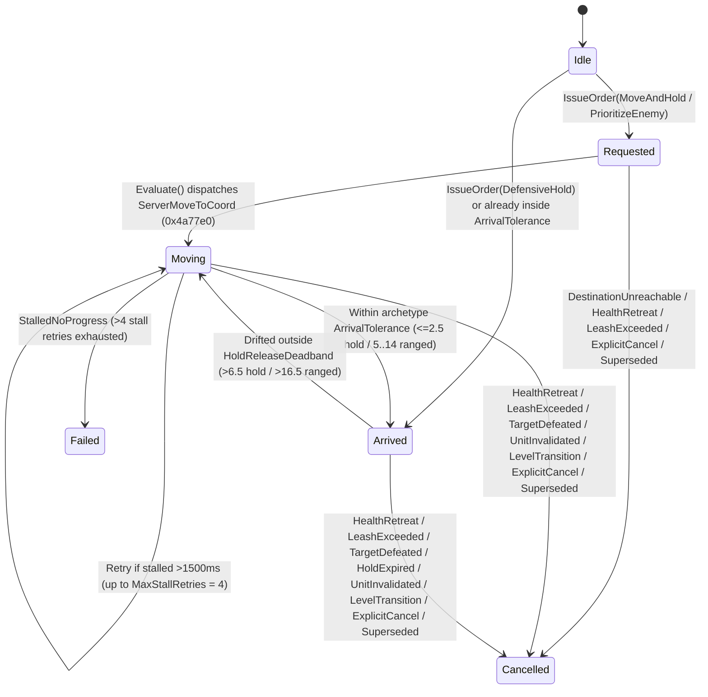

# VR Companion AI: Gesture-Based Tactical Commands (Point, Focus, Hold & Regroup)

> Español: [docs/es/VR_COMPANION_TACTICAL_COMMANDS.md](es/VR_COMPANION_TACTICAL_COMMANDS.md) | Core AI Architecture: [docs/VR_COMPANION_AI.md](VR_COMPANION_AI.md)

## 1. Overview & Motivation

In flat *Diablo II: Resurrected*, mercenaries are passive followers with no mechanism for the player to command them to hold a doorway, step onto a specific tile, or focus down a dangerous shaman/boss from a safe stand-off distance.

In Virtual Reality (VR), `d2r-pcvr` gives players natural hand-gesture agency over their companion through the **Explicit Tactical Command State Machine** (`TacticalOrderController` in [`steamvr/companion_ai.h`](../steamvr/companion_ai.h) and [`vr/companion_ai.cpp`](../vr/companion_ai.cpp)). To avoid accidental triggers during combat or inventory interactions, Grip-based orders use a **Select Companion First (Grab -> Aim -> Release)** flow:
- **Move & Hold (`MoveAndHold`):** Point at your companion (`<= 3.5` sub-tiles or 3D body cylinder) and hold **Grip** to latch, redirect your aim to a walkable ground coordinate, and release **Grip** to command the mercenary to walk there and hold position without oscillating back toward the player.
- **Focus Enemy (`PrioritizeEnemy`):** Latch onto your companion with **Grip**, aim directly at a hostile monster (`<= 2.5` sub-tiles or 3D cylinder), and release **Grip** to focus attacks on that target using archetype-aware engagement distances (`MeleeVanguard` closes to melee; `RangedOverwatch` engages from a `10.0`-sub-tile stand-off window).
- **Defensive Hold (`DefensiveHold`):** Hold an upright open palm facing forward for `400 ms` (or quick-click **Grip** on the companion while following normally) to freeze the mercenary at their current position as a defensive turret/vanguard.
- **Regroup / Cancel (`ExplicitCancel`):** Point at the companion itself (`<= 3.5` sub-tiles or 3D body cylinder) and click/release **Grip** while an order is active to cancel the hold and return to normal squad follow.

---

## 2. Explicit Command State Machine & Lifecycle

Every tactical order transitions deterministically through `TacticalCommandState` and logs every state transition to `d2r-vr-frame.log` (`LogTacticalTransition`):

### Cancellation Reasons (`TacticalCommandCancelReason`)
- `None`: Order active or idle.
- `Superseded`: Replaced by a newer player tactical command.
- `ExplicitCancel`: Player pointed at the companion + Grip release to regroup.
- `HealthRetreat`: Companion HP dropped below `50%` (`CriticalHealthRatio = 0.50f`); self-preservation takes priority.
- `LeashExceeded`: Player or companion exceeded `ElasticCombatLeashDistance` (`40.0` sub-tiles / ~16m).
- `HoldExpired`: Hold duration timer expired.
- `TargetDefeated`: Marked `PrioritizeEnemy` monster died (`animMode == 0 || animMode == 12`) or despawned.
- `DestinationUnreachable`: Target coordinate failed `RoomPoint` (`0x38dfb0`) walkability validation.
- `StalledNoProgress`: Companion made `< 1.0` sub-tile progress across `4` consecutive `1500 ms` stall windows (transitions state to `Failed`).
- `UnitInvalidated` / `LevelTransition`: Companion died, was replaced, or player changed dungeon levels/rooms.

---

## 3. Archetype-Aware Engagement & Anti-Oscillation Architecture

A critical finding from live runtime analysis in `D2R.exe` (`3.3.93787 / 3.3.93847`) is that vanilla `AITHINK_Fn061_Hireable` (`0x5c1610`) causes two severe conflicts if not arbitrated by archetype and low-level move gatekeepers:
1. **Ranged Panic-Flee Conflict:** If an Act 1 Rogue (`271`) or Act 3 Iron Wolf (`359`) is ordered to walk to a monster's exact coordinate (`dist < 4` sub-tiles), `AITHINK_Fn061_Hireable` immediately triggers a hardcoded `< 4` sub-tile panic-flee walk back toward the player.
2. **Dual Native Move Paths & Target Distraction:** Even when `ServerMoveUnit` (`0x4a8a10`) is hooked, `AITHINK_Fn061_Hireable` also calls `0x4a87e0` (`0x4a88fd -> 0x4475c0 -> 0x445cc0/0x445db0`) to walk back to the player once `MONMODE_NEUTRAL (1)` is reached, and `melee::Target` (`0x48fe20`) acquires distant monsters up to `48` sub-tiles away.

### 3.1. Archetype Tolerances (`TacticalOrderController::GetOrderTolerances`)

| Order Type & Archetype | `minDist` | `arrivalTol` | `releaseDeadband` | Effective Move Target (`ComputeEffectiveMoveTarget`) |
| :--- | :--- | :--- | :--- | :--- |
| **`MoveAndHold` / `DefensiveHold` (All)** | `0.0` | `2.5` sub-tiles | `6.5` sub-tiles | Exact ground coordinate `order.targetPos`. |
| **`PrioritizeEnemy` (`MeleeVanguard`)** | `0.0` | `3.5` sub-tiles | `7.5` sub-tiles | Monster coordinate `order.targetPos`. |
| **`PrioritizeEnemy` (`RangedOverwatch`)** | `5.0` sub-tiles | `14.0` sub-tiles | `16.5` sub-tiles | Stand-off point at `RangedOptimalStandOff = 10.0` sub-tiles from monster along companion-to-enemy vector. |

### 3.2. Synchronized Locomotion & Target Lock While Holding Position
1. **While `Moving` to `MoveAndHold`:**
   - `TryOverrideCombatTarget` (`0x48fe20`) returns `outTarget = 0` (`true`), preventing the mercenary from getting distracted by ambient monsters before reaching the commanded position.
   - `DetourServerStartWalk` (`0x445cc0`) and `DetourServerStartRun` (`0x445db0`) reject (`return 0`) any native AI move not aimed at `order.targetPos` and trigger an immediate next-frame re-dispatch if interrupted.
2. **Once `Arrived` at `MoveAndHold` or `DefensiveHold`:**
   - **Active Sentry Target Acquisition (`g_activeHoldTargetId`):** Vanilla `AITHINK_Fn061_Hireable` only searches for monsters when near the player; when stationed far away, vanilla AI tries to return to the player and fails to find targets. The sentry targeting loop continuously scans for hostiles with direct line-of-sight inside the archetype engagement radius (`melee::HostilesAround`) and feeds the target to the engine via `TryOverrideCombatTarget` (`0x48fe20`).
   - **Continuous Sticky Focus:** Focuses continuous attacks on the chosen target until defeated before switching to the next nearest hostile, eliminating target thrashing and premature idling after 1-2 shots.
   - **Point-Blank Attack Freedom:** Removed the artificial minimum range constraint in `canEngageHostileWithinHold` and `ShouldAllowNativeMoveStruct`. Ranged companions can engage and shoot any enemy inside their 24 sub-tile guard zone, even at point-blank range if an enemy approaches.
   - `DetourServerMoveUnit` (`0x4a8a10`), `DetourServerStartWalk` (`0x445cc0`), and `DetourServerStartRun` (`0x445db0`) block all native attempts to abandon the post to follow the player (`return 0` in `0x445cc0`/`0x445db0`, causing `0x4475c0` to clear the rogue path via `0x34f430` and keep the unit in `MONMODE_NEUTRAL (1)`), while permitting `MeleeVanguard` to step into melee contact against hostiles inside `MeleeHoldEngageRadius` (`6.0` sub-tiles).
   - `FilterNativeCombatTarget` (`0x48fe20`) arbitrates native target candidates so `MeleeVanguard` only attacks monsters within `6.0` sub-tiles of the hold anchor, and `RangedOverwatch` fires at any enemy within `24.0` sub-tiles of the anchor.

---

## 4. Gesture Recognition & Disambiguation (`steamvr/transport.cpp`)

### 4.1. Select Companion First: Grab, Aim & Release (`Grip Hold` on Companion -> Aim -> `Grip Release`)
To prevent accidental tactical commands when using the Grip button for belt potions, weapon holsters, or world interactions, every Grip-based tactical order must **begin by pointing at the companion first**:
- **Step 1 — Latch Companion (`Grip Press` on Companion):**
  - Evaluated via 3D vertical cylinder intersection (`hitsUnitCylinder3D` in sheared `coordinates::RenderGround` world metres, radius `0.95m`, height `[-0.45m, 2.00m]`) or ground foot radius (`<= 3.5` sub-tiles).
  - Pressing Grip anywhere else when not pointing at the companion is ignored by the tactical system.
  - Engaging Grip on the companion triggers a short confirmation haptic pulse (`0.30f`) and places a Gold/Green ring (`color = 2`) under the companion's feet.
- **Step 2 — Live Aim Preview & Reactive Leash Threshold (`Grip Held`):**
  - While holding Grip and redirecting your hand:
    - **Within Leash Boundary (`dist <= 40.0` sub-tiles / ~16m from player):**
      - Aiming at a **hostile monster** (3D cylinder `1.25m` or ground radius `4.0` sub-tiles) previews a **Cold Blue ring** (`color = 1`).
      - Aiming at **walkable ground** previews a **Tactical Green ring** (`color = 3`, radius `1.8`) at `{ gx, gy }`.
    - **Beyond Leash Boundary (`dist > 40.0` sub-tiles / >16m):** The target ring instantaneously mutates at 90 Hz into **Warning Crimson Red** (`color = 4`, `{1.0f, 0.05f, 0.05f}`, radius `2.0`-`2.2`), clearly signaling that the destination is beyond companion command range.
    - **Refined Visual Styling:** The ReShade shader (`D2R_DepthFog.fx`) renders a crisp, narrow silhouette (`kCircleRim = 0.015`, glow `0.02`), clean hollow interior (no heavy disc fill), and increased transparency (`kCircleOpacity = 0.32`), keeping the ground surface clearly visible.
    - **Haptic Boundary Crossing:** Moving the aim across the 16m threshold in either direction delivers a subtle tactile boundary click (`0.20f` / `0.35f`).
    - Keeping aim on the **companion** previews the **Yellow/Gold ring** (`color = 2`) on the companion.
- **Step 3 — Execute on Release (`Grip Release`):**
  1. **Hostile Monster (`PrioritizeEnemy`):** If in range, releasing Grip issues `PrioritizeEnemy`. If out of leash range, the command is rejected with an error haptic buzz (`0.60f`) and the companion's *"Impossible"* voice cue.
  2. **Companion Toggle (`DefensiveHold` / `Regroup`):** Releasing Grip while still pointing at the companion (or after a quick click `<= 300 ms`) toggles:
     - If an order is currently active (`Requested`, `Moving`, or `Arrived`): calls `CancelTacticalOrder()` (`Regroup`) and actively dispatches a server walk (`DispatchServerMoveToCoord`) back to the player's flank.
     - If following normally (`Idle` / `Cancelled`): issues `DefensiveHold` at the companion's current coordinates.
  3. **Ground Coordinate (`MoveAndHold`):** Releasing Grip on walkable ground within range issues `MoveAndHold` at `{ gx, gy }`. If native A* stops at an obstacle edge within `NearObstacleArrivalTolerance` (`4.5` sub-tiles), it snaps to `Arrived`. If released beyond the 16m leash, the command is rejected with an error haptic buzz and *"Impossible"* vocal feedback.

### 4.2. Open-Palm Defensive Hold (`400 ms` Hold)
- **Posture Filter:** Hand open (`grip < 0.2f && trigger < 0.2f`), fingers pointing upward (`handUp.y > 0.82f`), and palm normal aligned with headset forward vector (`dot > 0.70f`) sustained for `400 ms`.
- **Action:** Issues `DefensiveHold` anchored at the companion's current sub-tile position (`compPos`).

---

## 5. Voice Cues & Configuration

| Tactical Event | `TacticalVoiceCue` | Act 1 Rogue (`271`) | Act 2 Desert (`338`) | Act 3 Iron Wolf (`359`) | Act 5 Barbarian (`560`/`561`) |
| :--- | :--- | :--- | :--- | :--- | :--- |
| **`MoveAndHold` Accepted** | `MoveConfirm` | `4294` / `4291` | `3952` | `4040` / `4041` | `4565` |
| **`PrioritizeEnemy` Accepted** | `AttackConfirm` | `2949` / `2950` | `3183` / `3184` | `3105` / `3106` | `3027` / `3028` |
| **`DefensiveHold` Accepted** | `HoldConfirm` | `2943` / `2944` | `3177` / `3178` | `3099` / `3100` | `3021` / `3022` |
| **Order Rejected / Failed** | `Impossible` | `2953` / `2954` | `3187` / `3188` | `3109` / `3110` | `3031` / `3032` |
| **Leash Break Auto-Cancel** | `RegroupLeash` | `2939`/`2940` (90%) or `2947`/`2948` (10% farewell) | `3173`/`3174` (90%) or `3181`/`3182` (10% farewell) | `3095`/`3096` (90%) or `3103`/`3104` (10% farewell) | `3017`/`3018` (90%) or `3025`/`3026` (10% farewell) |
| **Critical HP (`< 50%`)** | `Distress` | `2937` / `2938` | `3171` / `3172` | `3093` / `3094` | `3015` / `3016` |

- **INI Setting:** `[gameplay] companion_tactical_commands=1` in `d2r_pcvr.ini` (also toggleable live in the in-VR Settings menu under **Combat -> Tactical Commands**).