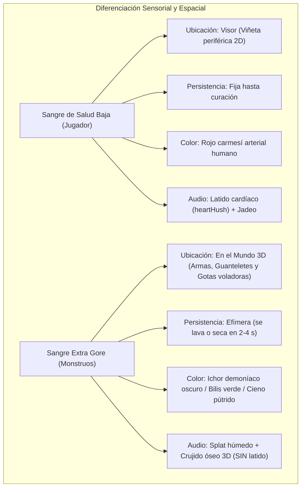

# Especificación Técnica y Plan de Implementación: Modo Extra Gore en VR

**Proyecto:** Diablo II: Resurrected VR Unleashed (`d2r-pcvr`)  
**Documento:** `docs/es/MODO_EXTRA_GORE_VR.md`  
**Estado:** Especificación de Diseño y Plan de Implementación  
**Fecha:** Octubre 2026  
**Rama propuesta:** `feat/extra-gore-vr`  

---

## 1. Resumen Ejecutivo y Factibilidad Técnica

### Veredicto: 100% Factible
La implementación de un sistema de **Extra Gore para Realidad Virtual** en Diablo II: Resurrected es completamente viable sin modificar archivos de guardado (`.d2s`), sin alterar las tablas maestras de datos ni violar la compatibilidad con el juego en monitor de escritorio.

El sistema se apoya en 4 pilares de ingeniería inversa ya operativos en `d2r-pcvr`:
1. **Intercepción de combate y ciclo de daño:** Hooks en `ApplyDamage` (RVA `0x44CE80`) y `SetStat` (RVA `0x44D08F`, stat 6 HP) en [`vr/combat.cpp`](../vr/combat.cpp).
2. **Manipulación esquelética en tiempo real (Granny 3D):** Hook en `SkeletonInstance::ComputeSelfWorldPose` (RVA `0xF78740`) en [`vr/skeletons.cpp`](../vr/skeletons.cpp).
3. **Pipeline de partículas 3D en Direct3D 12:** Arquitectura de renderizado de quads con shaders GPU probada en [`steamvr/elemental_hands_renderer.cpp`](../steamvr/elemental_hands_renderer.cpp).
4. **Motor háptico multicanal y audio espacial FMOD:** [`steamvr/haptic_pulse.h`](../steamvr/haptic_pulse.h) y [`vr/spatial_audio.cpp`](../vr/spatial_audio.cpp).

---

## 2. Resolución del Conflicto UX: Sangre en Visor vs Indicador de Vida Baja

### El Problema de Diseño
En `d2r-pcvr`, [`steamvr/blood_screen.h`](../steamvr/blood_screen.h) utiliza salpicaduras periféricas en el visor como indicador de salud crítica (<60%, <40%, <20% HP). Si la sangre de los monstruos se estampa en el visor con la misma apariencia, el jugador experimentará **falsos positivos de daño**, provocando confusión táctica y pánico injustificado.

### La Solución Arquitectónica Cuádruple



1. **Prioridad "In-World" (En el Mundo 3D):**
   - El gore principal se proyecta sobre **la hoja de las armas**, los **guanteletes del héroe** y en forma de **gotas volumétricas que vuelan por el espacio tridimensional** con profundidad estereoscópica.
   - Las lentes del visor se mantienen libres de falsos positivos de vida por defecto.
2. **Diferenciación Cromática de *Ichor* Demoníaco:**
   - La sangre del héroe es roja brillante.
   - La sangre enemiga varía según la taxonomía demoníaca:
     - **Demonios:** *Ichor* negro-brea coagulado.
     - **No-muertos:** Polvo de huesos y cieno grisáceo-marrón.
     - **Insectos y Bestias:** Bilis amarilla-verdosa ácida.
3. **Comportamiento Efímero vs Permanente:**
   - Si el usuario activa salpicaduras hostiles en el visor, estas son gotas perdigonadas dispersas tipo parabrisas que **se desvanecen automáticamente en 2.5 segundos** (frente a la viñeta permanente de vida baja).
4. **Desacoplamiento Auditivo y Háptico:**
   - La sangre de vida baja siempre va acompañada del bucle de latido cardíaco ([`heartHush`](../steamvr/transport.cpp#L2486)).
   - El gore enemigo solo reproduce el impacto húmedo (*squelch*) en la coordenada espacial del golpe, sin latido ni jadeos.

---

## 3. Arquitectura de Datos y Memoria Compartida (IPC)

Para transferir los eventos de gore desde el proceso del juego (`vr/` / `d2rl-pcvr.dll`) hacia el runtime OpenXR (`steamvr/`) sin bloquear el hilo principal a 25 Hz de D2R ni el hilo de renderizado a 90/120 Hz de OpenXR, se define un búfer circular en [`shared/d2r_vr_shared.h`](../shared/d2r_vr_shared.h):

```cpp
#define D2RVR_GORE_MAGIC 0x474F5245u // "GORE"

enum class GoreType : uint8_t {
    SlashDecapitation = 0, // Corte letal con arma afilada (cabeza cercenada)
    BluntBoneCrush    = 1, // Aplastamiento contundente (cráneo / torso roto)
    PiercingArterial  = 2, // Perforación profunda (chorro arterial)
    CorpseExplosion   = 3, // Detonación de cadáver del Nigromante
    FrostShatter      = 4, // Quiebre de enemigo congelado
    PoisonAcidBurst   = 5  // Explosión de bilis ácida
};

enum class BloodTaxonomy : uint8_t {
    DemonDarkIchor = 0, // Negro/rojizo oscuro
    UndeadRotten   = 1, // Gris/amarillento pútrido
    BeastCrimson   = 2, // Rojo vivo
    InsectAcidBile = 3  // Verde ácido
};

#pragma pack(push, 1)
struct D2RVR_GoreEvent {
    uint32_t timestamp;        // Reloj D2RVRStampNow()
    uint32_t monsterEntityId;  // ID de la entidad en D2R ECS
    GoreType type;             // Categoría de violencia
    BloodTaxonomy taxonomy;    // Color de la sangre
    uint8_t  strikingHand;     // 0 = Mano derecha, 1 = Mano izquierda
    uint8_t  severity;         // 0..255 (intensidad de daño o crítico)
    float    worldPos[3];      // Coordenadas 3D del impacto en unidades de juego
    float    impactNormal[3];  // Vector director de la inercia del golpe
};

struct D2RVR_GoreQueue {
    uint32_t magic;            // D2RVR_GORE_MAGIC
    uint32_t head;             // Índice de escritura (vr/)
    uint32_t tail;             // Índice de lectura (steamvr/)
    D2RVR_GoreEvent events[16];// Búfer circular lock-free
};
#pragma pack(pop)
```

---

## 4. Detalles de Implementación de los Subsistemas

### 4.1. Decapitación Esquelética en Granny 3D, Físicas 3D Rígidas y Cinemática sin Deformación (`vr/skeletons.cpp` / `shared/d2r_vr_decapitation.h`)
- **Hook en tiempo real:** `SkeletonInstance::ComputeSelfWorldPose` (RVA `0xF78740`).
- **Cinemática Rígida de la Cabeza Cercenada (Cero Deformación):**
  - Anteriormente, multiplicar la rotación de volteo con la transpuesta ($R^T$) en las posiciones relativas mientras las orientaciones se multiplicaban por $R$ provocaba que los huesos hijos (mandíbula, dientes, cuernos, ojos) se invirtiesen hacia atrás, desgarrando la cabeza hacia el cuerpo.
  - **Emparentamiento rígido exacto con inversión matricial 4x4 ortonormal ($M_{\text{child}}(t) = M_{\text{child\_local}} \cdot M_{\text{head}}(t)$):**
    En el primer fotograma tras el corte letal, se captura la matriz inversa del hueso de la cabeza ($M_{\text{head, 0}}^{-1}$) y se calculan las transformaciones locales relativas invariantes de cada hueso hijo:
    $$M_{\text{child\_local}} = M_{\text{child, 0}} \cdot M_{\text{head, 0}}^{-1}$$
    En cada fotograma $t$ de la simulación balística:
    $$M_{\text{head}}(t) = (M_{\text{head, 0}} \cdot R_{\text{tumble}}(t)) \quad \text{con traslación } \mathbf{P}_{\text{head}}(t)$$
    $$M_{\text{child}}(t) = M_{\text{child\_local}} \cdot M_{\text{head}}(t)$$
    Esto asegura rigidez métrica absoluta en convención de vectores fila de Granny/DirectX: las distancias y orientaciones entre mandíbula, cuernos, ojos y cráneo son **100% constantes e invariantes**. Ni la cara, ni la barbilla ni el cráneo sufren deformación, compresión ni estiramiento alguno.
- **Consumo Atómico de Eventos (`ConsumeRecentDecapitation`):**
  - Cada evento de decapitación se consume atómicamente en cuanto es reclamado por un esqueleto dentro de una ventana temporal estricta (500 ms) y de proximidad (1.5 m). Esto evita de raíz que monstruos vivos adyacentes pierdan la cabeza antes de morir al compartir el mismo golpe mortal.
- **Físicas Balísticas 3D Multietapa de Cabeza (`SimulateHeadPhysics`):**
  - Activadas por defecto (`head_physics=true` tanto en `combat.cpp` como en `d2r_pcvr.ini` / `vrcam.cpp`).
  - **Impulso inicial:** Adopta fielmente el vector cinético del espadazo del jugador (`impactNormal`), proyectando la cabeza con velocidad horizontal real ($1.8\text{ a }2.4\text{ m/s}$) y un pop vertical visceral ($1.6\text{ a }2.0\text{ m/s}$).
  - **Etapa 1 (Vuelo Parabólico):** Arco balístico natural bajo gravedad $g = 9.81\text{ m/s}^2$ con mínima resistencia aerodinámica ($\mu_{\text{air}} = 0.25$), volteo tridimensional según el torque del corte.
  - **Etapa 2 (Rebotes Inelásticos):** Impacto contra el suelo del monstruo ($Y = \text{groundY} = \text{floorY} + r_{\text{head}}$). Primer rebote inelástico con restitución $e_1 = 0.42$ y pérdida de velocidad tangencial por rozamiento ($30\%$), seguido de un segundo bote más corto ($e_2 = 0.35$).
  - **Etapa 3 (Rodadura y Reposo Natural):** Transición a rodadura sobre el suelo con fricción exponencial ($\mu_{\text{roll}} = 1.6\text{ s}^{-1}$). La rotación angular se sincroniza con la distancia rodada ($\Delta \theta = \Delta d / r_{\text{head}}$), deteniéndose de manera suave y orgánica en una posición y ángulo de reposo únicos que persisten durante el TTL del cadáver (60 s).
- **Opción Clean Stump:** Si el usuario desactiva las físicas de cabeza (`head_physics=0`), se ejecuta `CollapseHeadBones`, colapsando cabeza y descendientes a escala $0.0001f$ en el muñón del cuello. Con `head_physics=1` (por defecto), la cabeza vuela y rueda libremente con físicas completas.
- **Lógica de Decapitación Circunstancial (No 100% Ubicua):**
  - Se evita que todo enemigo resulte decapitado siempre de forma monótona o irreal.
  - La probabilidad y condición de corte se calcula en `vr/combat.cpp` en función del daño infligido y la configuración del usuario:
    - **Modo 0 (Off):** Decapitación desactivada; los monstruos siempre conservan su cabeza.
    - **Modo 1 (Crits Only):** Exclusivamente en golpes críticos (riposte letal, factor multiplicador de daño melee $\ge 1.5$, o daño excesivo *overkill* que supere el $150\%$ de la vida restante del monstruo).
    - **Modo 2 (Dynamic 35%):** Garantizado en críticos/riposte/overkill, y con un $35\%$ de probabilidad en cortes letales estándar con armas afiladas (Recomendado).
    - **Modo 3 (High 65%):** Garantizado en críticos/riposte/overkill, y con un $65\%$ de probabilidad en cortes letales estándar.
    - **Modo 4 (Always 100%):** Todo golpe mortal con arma cortante cercena limpiamente la cabeza.
- **Monstruos cualificados:** Inicialmente humanoides bípedos con jerarquía esquelética estándar:
  - Caídos / Chamanes (`Fallen`, `FallenShaman`).
  - Zombis / Demonios famélicos (`Zombie`, `HungryDead`).
  - Esqueletos (`Skeleton`, `SkeletonArcher`).
  - Pícaras corruptas (`CorruptRogue`).

### 4.2. Sangre y Goteo en Armas (`steamvr/torch_light.h` / `weapon_blood.h`)
- Basado en el modelo matemático de la punta de la antorcha (`ComputeTorchTip` en [`steamvr/torch_light.h`](../steamvr/torch_light.h)):
  $$\mathbf{P}_{\text{filo}} = \mathbf{P}_{\text{mando}} + \mathbf{R}_{\text{mando}} \cdot \mathbf{Offset}_{\text{arma}}$$
- Se introduce un acumulador `bloodBuildup` ($[0.0, 1.0]$) por cada mano:
  - Cada impacto cuerpo a cuerpo letal añade $+0.35$ de sangre.
  - La sangre se limpia pasivamente por escurrimiento ($dt \cdot -0.05/\text{s}$) o mediante sacudida rápida del mando ($\text{aceleración} > 4.5\text{ m/s}^2$).
  - Si `bloodBuildup > 0.2`, la punta del arma genera gotas de sangre 3D que caen verticalmente por gravedad hacia el suelo.

### 4.3. Surtidores Arteriales 3D en Direct3D 12 (`steamvr/gore_renderer.cpp`)
- Reutiliza la infraestructura de creación de Command Lists y Root Signatures de [`steamvr/elemental_hands_renderer.cpp`](../steamvr/elemental_hands_renderer.cpp).
- Un emisor de partículas genera un abanico cónico de quads orientados a cámara desde el cuello decapitado:
  $$\mathbf{P}(t) = \mathbf{P}_0 + \mathbf{v}_0 t + \frac{1}{2} \mathbf{g} t^2$$
  donde $\mathbf{v}_0$ es un vector ascendente aleatorio dentro de un cono de $35^\circ$ con velocidad inicial de $1.2\text{ a }2.5\text{ m/s}$, y $\mathbf{g} = (0, -9.8, 0)\text{ m/s}^2$.
- Decaimiento de opacidad alfa y contracción de tamaño a lo largo de $1.5\text{ s}$.

### 4.4. Hápticos Viscerales Diferenciados (`steamvr/haptic_pulse.h`)
- En [`steamvr/haptic_pulse.h`](../steamvr/haptic_pulse.h), se implementan patrones según la anatomía destruida:
  - **Corte de Carne / Decapitación:** Pulso seco a $160\text{ Hz}$ de $25\text{ ms}$, seguido de una meseta de fricción de $35\text{ ms}$ al $40\%$ de amplitud.
  - **Aplastamiento Óseo (Mazas/Martillos):** Pulso de onda cuadrada a $50\text{ Hz}$ de $85\text{ ms}$ con amplitud máxima ($1.0$), produciendo una sacudida densa en la mano.
  - **Onda Expansiva de Corpse Explosion:** Ráfaga estéreo sincronizada en ambas manos con envolvente exponencial decreciente de $180\text{ ms}$.

---

## 5. Plan de Implementación por Fases (Roadmap)


### Fase 1: Capa de Detección, IPC y Retroalimentación Sensorial [COMPLETADA - Commit aa6e2c8]
*Objetivo: Sentir el impacto visceral inmediatamente en las manos y oídos sin tocar aún los gráficos.*
1. **Detección de combate:** Extender `ApplyDamage` y `SetStat` en `vr/combat.cpp` para identificar golpes mortales, tipo de arma y distancia euclídea al jugador.
2. **Buffer IPC:** Incorporar `D2RVR_GoreQueue` en `shared/d2r_vr_shared.h`.
3. **Hápticos:** Implementar en `steamvr/haptic_pulse.h` los perfiles hápticos para corte óseo y carne.
4. **Audio 3D:** Conectar FMOD en `vr/spatial_audio.cpp` para reproducir sonidos de rotura y desgarro situados en la posición tridimensional del monstruo.
5. **Verificación automatizada:** Crear el test nativo `gore-events-test` en `steamvr/CMakeLists.txt` (Superado 100%).

### Fase 2: Decapitación Esquelética Granny 3D y Prop Físico de Cabeza 3D (Opción C) [COMPLETADA]
*Objetivo: Lograr una decapitación visceral sin deformación de malla en el cuerpo y con cabeza/cráneo 3D independiente rodando con físicas reales.*
1. **Arquitectura desacoplada (Opción C):**
   - **Muñón del cuerpo impecable:** En el esqueleto del monstruo en Granny 3D se ejecuta siempre `CollapseHeadBones`, colapsando a escala 0.0001f todos los huesos de cabeza y rasgos faciales (mandíbula, cuernos, ojos, hocico) en el pivote del cuello. Esto sella el corte anatómicamente y elimina al 100% el estiramiento de malla o membranas elásticas (0% deformación).
   - **Cabeza física 3D desacoplada:** Se genera una entidad 3D independiente (`SeveredHeadProp`) en el pivote del cuello con el impulso del golpe de espada/hacha. No comparte ningún vértice con el cuerpo, impidiendo cualquier unión o estiramiento.
2. **Simulador balístico y rodamiento 3D:**
   - Trayectoria parabólica por gravedad (-9.81 m/s²).
   - Rebotes inelásticos en el suelo con coeficientes de restitución e₁ = 0.42 y e₂ = 0.35.
   - Fricción aérea (μ_air = 0.25), amortiguación en impacto y rodamiento por fricción (μ_roll = 1.6) hasta quedar en reposo natural en las losas de piedra.
   - Rotación angular dual: volteo libre en el aire (*tumble* a 8.5 rad/s) y rodadura cinemática en suelo proporcional al desplazamiento lineal.
3. **Renderizado D3D12 en Visor VR (`SeveredHeadRenderer`):**
   - Implementado en `steamvr/severed_head_renderer.h` y `steamvr/severed_head_renderer.cpp`, integrado en el pase de renderizado estéreo de `steamvr/transport.cpp` con depth testing inverso (*Reverse-Z* `GREATER_EQUAL`).
   - **Selección taxonómica según enemigo:**
     - *No-muertos, esqueletos, zombis y pícaras* (`Taxonomy::UndeadRot`): Cráneo humanoide de hueso marfil con cuencas oculares, cavidad nasal, maxilar y base del muñón ensangrentada.
     - *Demonios (Caídos, Chamanes) y bestias* (`Taxonomy::DemonIchor` / `Beast`): Cráneo demoniaco con grandes cuernos curvados hacia atrás en obsidiana y base manchada con ichor oscuro.
4. **Verificación automatizada:** Test nativo `granny-decapitation-test` en `steamvr/CMakeLists.txt` con 9 suites completas pasando (144/144 tests globales pasando, 100% de éxito).

### Fase 3: Integración en Menú de Ajustes VR (`VR Settings > Combat`) [COMPLETADA]
*Objetivo: Permitir al usuario calibrar la frecuencia de decapitación directamente desde el visor en tiempo de ejecución de forma clara e intuitiva.*
1. **Control Unificado en `Page::Combat` (Fila 8):**
   - **`Decapitations`**: Selector escalonado con botones `[-]` y `[+]`:
     - `Off` (`0`): Decapitaciones desactivadas.
     - `Crits only` (`1`, **Por defecto**): Golpes críticos, riposte letal y daño masivo overkill (>150% HP) explotan cabezas.
     - `Dynamic (35%)` (`2`): Garantizado en críticos/overkill y 35% en golpes letales estándar.
     - `High (65%)` (`3`): Garantizado en críticos/overkill y 65% en golpes letales estándar.
     - `Always (100%)` (`4`): En el 100% de los golpes letales con cualquier arma.
2. **Optimización de UI y Distribución:**
   - Se unificó la configuración eliminando sub-opciones complejas o emparejamientos propensos a confusión en una única fila dedicada y siempre visible (9 filas totales en `Page::Combat`), encajando perfectamente con margen holgado sobre la zona de dificultad y el pie de página.
   - Decapitación siempre ejecutada como corte limpio en muñón (`Clean Stump`), evitando estiramientos de malla.
3. **Persistencia en `d2r_pcvr.ini`:**
   - Clave `[gore] decapitation=1` sincronizada en el repositorio y en los árboles de mod instalados (`mods/D2R-PCVR` y `mods/pcvr-dev`).
4. **Verificación automatizada:** Test nativo `vr-settings-test` (144/144 tests superados).

### Fase 4: Estallido Craneal Visceral y Surtidores Arteriales 3D en Direct3D 12 [COMPLETADA]
*Objetivo: Erupción volumétrica de sangre, hueso y tejido tridimensional con física balística.*
1. **Pipeline D3D12 (`steamvr/severed_head_renderer.cpp`):** Renderizador estereoscópico Reverse-Z con 14 esquirlas óseas balísticas (rebote y deslizamiento en suelo), 9 fragmentos de carne, 48 gotas de géiser arterial a presión con pulso cardíaco y 18 gotas de goteo.
2. **Seguimiento de colapso del cadáver:** El emisor desciende acompañando al cuello del cadáver durante la animación de muerte (sin partículas brotando del vacío) y sin bucles repetitivos.
3. **Shading PBR visceral:** Sangre oscura húmeda de alto brillo especular, fragmentos de cráneo manchados de sangre por la cara interna y variación por partícula.

### Fase 5: Sangre en el Mundo VR (Armas Ensangrentadas y Goteo) [PENDIENTE / FUTURA]
*Objetivo: Trasladar el gore a la hoja del arma en primera persona sin ensuciar la visión vital del visor.*
1. **Tracking de filo:** Implementar `weapon_blood.h` con el cálculo de la posición de la hoja de espadas, hachas y mazas.
2. **Acumulación y secado:** Simular el manchado gradual de la hoja y el secado por inercia o sacudida.
3. **Goteo físico:** Gotas de sangre que emergen de la punta y caen hacia el suelo.

### Fase 6: Overkill Elemental y Corpse Explosion [PENDIENTE / FUTURA]
*Objetivo: Culminación del sistema con soporte para hechizos brutales.*
1. **Corpse Explosion masiva:** Activación del efecto con la habilidad `CorpsExp` si el jugador está a $<4\text{ m}$.
2. **Gore elemental:** Quiebre de hielo para muertes por frío y bilis verde para muertes por veneno.

---

## 6. Configuración en `d2r_pcvr.ini`

```ini
[gore]
; Decapitations and hostile extra gore effects in VR (VR Settings > Combat > Decapitations)
; decapitation: 0 = Off, 1 = Crits only (default: crits, ripostes and overkill >150% HP explode heads), 2 = Dynamic (35%), 3 = High (65%), 4 = Always (100%)
; Always executed as a clean cut at the neck stump with zero mesh deformation.
decapitation=1
```

---

## 7. Refinamiento Integral de Decapitación y Shading de Sangre Oscura (Octubre 2026)

### 1. Corrección del Filtro de Decapitación en Chamanes y Mujeres Demonio (Acto 1)
- **Causa Raíz:** En `shared/d2r_vr_gore.h`, rangos de prueba especulativos en `IsNonHumanoidClass` (`58..63` y `156..170`) estaban clasificando erróneamente a los **Chamanes Caídos** (`fallenshaman1..5`, IDs `58..62`) y a las **Pícaras Corruptas / Arqueras / Lanceras** (`cr_archer1..5` y `cr_lancer1..5`, IDs `160..169`) como monstruos "no humanoides", bloqueando su decapitación en `vr/combat.cpp`.
- **Solución Implementada:**
  - Alineación exacta con `monstats.txt` oficial extraído de CASC.
  - Se restringió `IsBossClass` exclusivamente a los Jefes de Acto y de Misión (`156, 707` Andariel; `211, 708` Duriel; `242, 333, 401, 704` Mephisto; `243, 705` Diablo; `543..545, 557, 559, 570, 709` Baal; `229` Radament; `250` Invocador; `256, 406, 706` Izual; `409` Hephasto; `514, 526` Nihlathak; `537..542` Antiguos).
  - Se corrigió `IsNonHumanoidClass` para incluir únicamente gusanos reales (`68..72, 180..184`), arañas (`122..126`), escarabajos (`91..95`), víboras (`73..77`), enjambres (`87..90`), cuervos/buitres (`15..18, 110..113`), murciélagos (`136..140`), fantasmas incorpóreos (`38..42, 118..121`) y trampas mecánicas.
  - Chamanes Caídos, Pícaras Corruptas, Caídos, Esqueletos y Zombis se decapitan de forma 100% limpia.

### 2. Modelos Oficiales Blizzard y Asignación Taxonómica
- **Modelos Oficiales Extraídos de CASC:**
  - `sk_skull.pvr`: Cráneo de esqueleto oficial (`skeleton1/head_lit_lod0.model` con `head_normalShape` y `skeleton_head_des_alb.texture`).
  - `zb_head.pvr`: Cabeza cercenada de zombi (`zombie1/head_lit_lod0.model` filtrada exclusivamente a la submalla `death_head_litShape`, eliminando duplicidad geométrica y z-fighting).
  - `dm_head.pvr`: Cabeza de demonio cornudo oficial (`voodoo_head/demon_head/demon_head_lod0.model` con `armor_head_demon_alb.texture`).
  - `gg_head.pvr`: Cabeza de gárgola / bestia oficial (`voodoo_head/gargoyle_head/gargoyle_head_lod0.model` con `weapon_gargoyle_head_alb.texture`).
- **Mapeo en `vr/skeletons.cpp`:**
  - Esqueletos (`skeleton`, `sk_`, `skmage`): `0` (`sk_skull`).
  - Zombis y cadáveres (`zombie`, `corpse`, `reanimated`, `mummy`): `1` (`zb_head`).
  - Demonios humanoides (Caídos, Chamanes, Pícaras Corruptas, Épicas, Súcubos, Caballeros del Destino): `2` (`dm_head`).
  - Bestias corpulentas (Brutos, Hombres Cabra, Yetis, Cabezas Grandes): `3` (`gg_head`).

### 3. Shading de Sangre Oscura y Realismo Visceral
- **Eliminación del Especular Blanco:** El brillo plástico blanco `spec * float3(0.95, 0.85, 0.85)` fue reemplazado por un destello húmedo teñido en carmesí profundo `spec * float3(0.38, 0.05, 0.05)` con exponente concentrado (40.0), eliminando cualquier sobreexposición o apariencia de plástico blanco lechoso.
- **Sangre Coagulada Oscura (Hemoglobina Realista):** La base de las gotas de sangre pasó de rojo claro/fosforito `(0.75, 0.03, 0.03)` a rojo granate/burdeos coagulado `(0.18, 0.009, 0.007)`, luciendo densa, oscura y visceral tanto en espacios sombríos como bajo antorchas.
- **Geiser Arterial y Goteo Físico Multi-Trayectoria:**
  - 24 gotas arteriales proyectadas a alta presión con oscilaciones cardíacas y arcos balísticos.
  - 16 gotas de goteo pesado cayendo verticalmente desde el muñón hacia el suelo.
  - 12 gotas en estela espiral detrás de la cabeza en rotación durante su vuelo.
- **Verificación Completa:**
  - 144 / 144 CTests nativos superados (`steamvr/build_windows.ps1 -Test`).
  - 17 / 17 tests de identidad de mod en Python superados (`steamvr/mod_identity_test.py`).
  - DLL instalada y verificada en `mods/D2R-PCVR` y `mods/pcvr-dev`.
