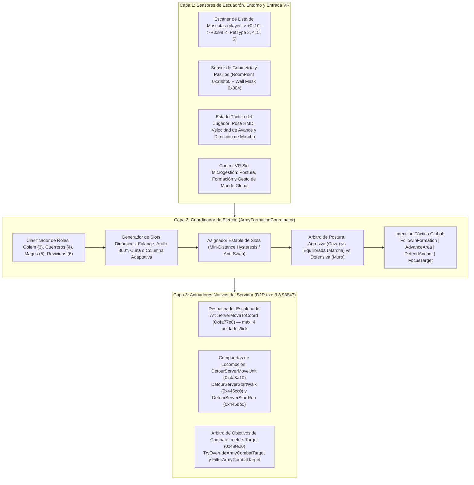

# Comandante de los Muertos en VR (*Commander of the Dead*): Plan Integral de Arquitectura, Formaciones y Posturas Tácticas

> **Issue de referencia:** [bearstonem/d2r-pcvr#399 — `[Feature]: Commander of the Dead`](https://github.com/bearstonem/d2r-pcvr/issues/399)
> **Sistemas base relacionados:** [docs/es/VR_COMPANION_AI.md](VR_COMPANION_AI.md) | [docs/es/VR_COMPANION_TACTICAL_COMMANDS.md](VR_COMPANION_TACTICAL_COMMANDS.md)

---

## 1. Filosofía de Diseño: Cero Micromanagement, Mando de Ejército a Nivel de Escuadrón

El objetivo central de esta especificación es transformar la experiencia pasiva del Nigromante Invocador (*Summoner*) en Realidad Virtual en la fantasía de **comandar un ejército de no-muertos a escala 1:1**, **eliminando por completo cualquier microgestión individual de esqueletos**.

### Principios Innegociables
1. **Prohibido seleccionar esqueletos individuales:** Con 8–16 guerreros, 6–12 magos, un Gólem y múltiples revividos en pantalla, apuntar a una unidad individual en VR es tedioso, propenso a errores de raycasting e impropio del ritmo de *Diablo II*. El jugador **jamás** da órdenes a un esqueleto aislado; **comanda al ejército como un único cuerpo táctico**.
2. **Separación entre Postura Táctica (*Stance*), Geometría de Formación (*Formation*) y Orden Puntual (*Order*):**
   - El jugador define **cómo se comporta el ejército** mediante **Posturas** (`Agresiva`, `Equilibrada / Marcha`, `Defensiva / Falange`) y **qué forma geométrica adopta** (`Falange Frontal`, `Anillo Protector 360°`, `Columna de Pasillo`, `Cuña de Asalto`).
   - El motor del mod traduce esa postura y formación en **slots espaciales asignados por rol** (`Frontline`, `RangedSupport`, `TacticalAnchor`, `FlexibleSupport`) y delega la locomoción y el combate en los actuadores nativos del servidor (`D2R.exe`).
3. **Adaptación Automática al Entorno:** Si el jugador entra en una puerta estrecha, cripta o pasillo del Acto II/III, el ejército **comprime automáticamente su formación en Columna** usando el sensor de celdas de pared del servidor (`wallcells` / `RoomPoint` `0x38dfb0` + máscara `0x804`) y vuelve a desplegarse al salir a campo abierto sin requerir intervención manual.
4. **Cero Modificación de Tablas o Archivos del Juego:** Todo se ejecuta en memoria dentro del plugin `d2rl-pcvr.dll` (exclusivamente en modo local offline `mode() == 0`), sin alterar `monstats.bin`, `skills.txt`, `pettype.txt` ni archivos de guardado `.d2s`.

---

## 2. Arquitectura del Sistema: Árbitro de Escuadrón de 3 Capas

Extendemos la probada **Arquitectura Unificada de 3 Capas** de `vr/companion_ai.cpp` (PR #371) desde una única unidad (`g_lastHirelingId`) hacia un **Coordinador de Escuadrón Multi-Unidad (`ArmyFormationCoordinator`)** que opera en armonía con el mercenario:

---

## 3. Roles de Unidad y Clasificación Automática (`SummonRole`)

El juego mantiene las invocaciones del jugador en listas enlazadas por tipo (`PetType`) colgando de `player + 0x10 -> +0x98` (ya auditado en [`steamvr/companions.h`](../../steamvr/companions.h) y [`vr/companions.cpp`](../../vr/companions.cpp) con firmas verificadas en `0x34b27a`, `0x4fe9a8`, `0x50148e` y `0x5014f6`).

Extraemos los `unitId` vivos de los tipos del Nigromante (y opcionalmente Druida/Asesina en el futuro) y los clasificamos en 4 roles tácticos:

| Rol Táctico (`SummonRole`) | `PetType` Nativo | Unidades Incluidas | Comportamiento Espacial en Formación |
| :--- | :---: | :--- | :--- |
| **`TacticalAnchor` (Ancla de Vanguardia)** | `3` | Gólem de Arcilla, Sangre, Hierro y Fuego (`skill 75, 85, 90, 94`) | Ocupa el vértice central de vanguardia (o tapona el cuello de botella en puertas) para absorber la primera oleada de agro. |
| **`FrontlineMelee` (Línea de Escudos)** | `4` | Guerreros Esqueleto (`skill 70`) | Se despliegan en el arco frontal y flancos cercanos, formando una pantalla física entre los monstruos y el Nigromante. |
| **`RangedSupport` (Batería de Retaguardia)** | `5` | Magos Esqueleto (`skill 80`) | Se posicionan en el arco periférico trasero o segunda fila abierta (`8.0 .. 13.0` sub-casillas), con línea de tiro despejada y prohibición de cerrar a melé. |
| **`FlexibleSupport` (Reserva Pesada)** | `6` | Monstruos Revividos (`skill 95`) | Se clasifican dinámicamente según su arquetipo en `MonStats` (melé pesado en los flancos exteriores para no bloquear a los esqueletos; lanzadores en segunda línea). |

---

## 4. Sistema de Posturas (*Stances*) y Formaciones (*Formations*)

Esta es la pieza clave para evitar el micromanagement: el jugador elige una **Postura** y una **Formación**, y todo el ejército ajusta automáticamente sus radios de enganche (`EngageRadius`), su correa táctica (`Leash`) y sus posiciones relativas.

### 4.1. Las 3 Posturas Tácticas (*Tactical Stances*)

| Parámetro / Regla | 1. Postura Defensiva (*Phalanx / Bastion*) | 2. Postura Equilibrada (*Marching / Escort*) | 3. Postura Agresiva (*Seek & Destroy*) |
| :--- | :--- | :--- | :--- |
| **Propósito de Juego** | Proteger al Nigromante en zonas letales (Stygian Dolls, Gloams, pasillos estrechos o lanzamiento de hechizos/maldiciones). | Navegación general fluida y combate ordenado alrededor del jugador. | Limpieza rápida de zonas abiertas (*Blood Moor*, *Cow Level*, *Chaos Sanctuary*). |
| **Radio de Enganche (`EngageRadius`)** | **Corto (`7.5` sub-casillas desde su slot)** para melé; `20.0` para magos sin moverse de su slot. | **Medio (`14.0` sub-casillas desde su slot)** para melé; `24.0` para magos. | **Amplio (`28.0 .. 36.0` sub-casillas)**; las unidades salen libremente a cazar hostiles visibles. |
| **Disciplina de Slot (`SlotTether`)** | **Estricta:** Prohibido perseguir enemigos lejanos. Los guerreros forman un muro físico; si matan a un enemigo cercano, regresan de inmediato a su slot en el muro. | **Elástica:** Los guerreros interceptan enemigos cercanos y regresan a su slot en cuanto termina la escaramuza local. | **Libre en Combate:** La formación solo aplica durante la marcha sin enemigos; al detectar hostiles, la IA nativa ataca sin restricción de slot y reagrupa al limpiar la sala. |
| **Intervención en `0x48fe20` (`Target`)** | Filtra (`return 0`) cualquier objetivo fuera de `7.5` sub-casillas del slot; prioriza absolutamente enemigos que ataquen al jugador o entren en el anillo interior. | Prioriza flanqueadores del jugador (`BodyguardPeel`) y enemigos en el cono de avance. | Permite el escaneo completo de `monstats.aidist` y prioriza el enemigo marcado o el grupo más cercano. |
| **Compuertas `0x445cc0` / `0x445db0`** | Bloquea movimientos de persecución que alejen al esqueleto `> 7.5` sub-casillas de su slot asignado. | Bloquea el amontonamiento sobre los pies del jugador (`PersonalSpaceRadius = 3.75`) y el deambuleo errático. | Permite todo movimiento de ataque; solo redirige hacia el slot cuando no hay hostiles en rango. |

---

### 4.2. Las 4 Geometrías de Formación (*Formation Templates*)

Todas las coordenadas de slot se calculan en el plano de sub-casillas respecto a la posición del jugador `P = (px, py)` y al vector director suavizado de marcha/mirada `F = (fx, fy)` (con filtro de histéresis angular de `22.5°` para que girar ligeramente la cabeza en VR **no** haga correr a los esqueletos en círculos):

#### A. Formación en Muro Falange con Alas de Caballería (*Phalanx Wall / Horse Wings* — Habilidad `3901` y por defecto en Marcha)
Inspirada en las formaciones de alas de caballería de estrategia militar clásica (ej. *Celtic Kings: Horse Wings*):
- **Posicionamiento respecto al jugador:**
  - El **Nigromante (Jugador)** actúa como comandante en el eje central de retaguardia (`anchorPos`), observando toda la estructura desplegada frente a él.
- **Bloque Central de Infantería (Guerreros y Magos):**
  - **Retaguardia de la Infantería (Magos Esqueleto / `RangedArtillery`):** Desplegados directamente frente al jugador (`forwardMages ~ 4.4 .. 5.6` sub-casillas) en filas de hasta 6 columnas. El jugador contempla claramente la espalda de los magos, quienes tienen línea de tiro despejada por encima de los guerreros hacia el frente.
  - **Vanguardia de la Infantería (Guerreros Esqueleto / `FrontlineMelee`):** Muro compacto de escudos y hachas situado frente a los magos con separación limpia (`forwardMelee ~ 7.0 .. 8.5` sub-casillas) en filas de hasta 6 columnas.
- **Alas Laterales de Caballería (Flancos Izquierdo y Derecho — Resucitados y Gólem):**
  - **Revividos (`HeavyFlanker`) y Gólem (`TacticalAnchor`):** Desplegados a los lados exteriores del bloque central en **dos columnas paralelas por cada flanco** (`offset lateral |lateral| >= 4.8 .. 6.5` sub-casillas), cubriendo los costados y protegiendo a los magos y al jugador de ataques envolventes.
- **Orientación de Formación:**
  - Todas las invocaciones marchan hacia sus casillas mediante `DispatchServerMoveToCoord` sin mutación directa de memoria interna del pathfinding para garantizar máxima estabilidad y cero violaciones de acceso.

#### B. Formación en Bastión / Anillo Cerrado 360° (*Protective Ring* — Ideal con Postura Defensiva)
- **Guerreros Esqueleto:** Anillo perimetral completo de `360°` alrededor del Nigromante (o del punto de guardia ordenado) a radio `r = 4.8` sub-casillas (`~1.9m`), espaciados a `360° / N`.
- **Magos Esqueleto:** Anillo interior seguro a `r = 2.8` sub-casillas o agrupados detrás del jugador respecto a la amenaza principal.
- **Gólem:** Posicionado a `r = 6.5` sub-casillas en la dirección hacia donde mira el visor HMD (o hacia el centroide de enemigos cercanos).

#### C. Formación en Cuña de Asalto (*Spearhead Wedge* — Ideal con Postura Agresiva)
- Formación en **V invertida** apuntando en la dirección de avance `F`:
  - **Vértice (`d = 8.5` sub-casillas, `0°`):** Gólem + Mercenario de Vanguardia.
  - **Alas de la V (`d = 4.0 .. 8.0` sub-casillas, `±35°`):** Guerreros Esqueleto escalonados para envolver grupos de monstruos al chocar.
  - **Base de la V (`d = 3.5` sub-casillas):** Magos Esqueleto cerrando el centro de la formación con fuego de apoyo directo.

#### D. Formación Adaptativa en Columna (*Corridor Column* — Activación Automática por Entorno)
- **Detección Automática:** Cada `500 ms` en el hilo de juego, el coordinador muestrea la anchura transversal caminable perpendicular al vector `F` usando `RoomPoint` (`0x38dfb0`) y la máscara de pared (`0x804`).
- Si la anchura libre lateral es `< 8.0` sub-casillas (`~3.2m`, ej. Santuario Arcano, Cueva de Gusanos *Maggot Lair*, puertas de Catacumbas):
  - La formación **comprime automáticamente** los ángulos laterales a dos filas indias estrechas (`offset lateral = ±1.5` sub-casillas) delante y detrás del jugador, **dejando el carril central (`0.0`) despejado** para que el jugador camine sin chocar con sus propias invocaciones.
  - Si un slot calculado cae en una celda bloqueada, `ResolveWalkableSlot` busca en espiral hacia el eje central del pasillo hasta encontrar una sub-casilla válida antes de llamar a `ServerMoveToCoord`, garantizando **cero reintentos fallidos contra paredes**.

---

## 5. Algoritmo de Asignación Estable de Slots y Presupuesto de CPU

Para evitar que 20 criaturas se crucen entre sí cada vez que el jugador da un paso o muere un esqueleto:

1. **Asignación Greedy por Mínima Distancia con Persistencia de ID (`StableSlotAssigner`):**
   - Cada slot `k` recuerda el `unitId` que lo ocupaba en el tick anterior (`assignedUnitId`).
   - Mientras esa unidad siga viva y a `< 12.0` sub-casillas de su slot, **conserva su slot** sin reasignar.
   - Solo cuando se invoca un nuevo esqueleto, muere uno existente o la formación cambia, los slots vacantes se asignan ordenando pares `(unidad_libre, slot_libre)` por distancia euclídea creciente.
2. **Banda Muerta de Movimiento (`SlotArrivalDeadband`):**
   - **Tolerancia de llegada (`ArrivalTol`):** `2.2` sub-casillas. Una vez dentro, no se emite ninguna orden de caminata.
   - **Banda muerta de reactivación (`ReleaseDeadband`):** `4.5` sub-casillas en marcha (`3.2` en Postura Defensiva). El esqueleto no vuelve a recibir `ServerMoveToCoord` por pequeños movimientos de cabeza o pasos cortos del jugador.
3. **Presupuesto Escalonado de Pathfinding (*Staggered A\* Budget*):**
   - Llamar a `ServerMoveToCoord` (`0x4a77e0`) para 25 unidades en el mismo frame causaría picos de CPU en el pathfinder A* del servidor.
   - El coordinador procesa las unidades en un **anillo rotatorio (*Round-Robin*) con un máximo de `4` despachos `ServerMoveToCoord` por tick de `250 ms`** (priorizando primero `TacticalAnchor` y los `FrontlineMelee` más alejados de su slot). En `< 1.0 - 1.5 s` todo el ejército está en marcha con impacto de CPU despreciable (`< 0.1 ms`).

---

## 6. Experiencia de Usuario en VR: Habilidades Tácticas Virtuales (Glifos, Botones de Mano y Gestos)

Siguiendo la arquitectura que ya utiliza `d2r-pcvr` para la habilidad sintética `GlyphDrawId = 9000` (`"Draw glyph"` en [`steamvr/interactions.h`](../../steamvr/interactions.h#L373)), definiremos las posturas, formaciones y órdenes del ejército como **Habilidades Tácticas Virtuales del Mod** (*Commander Virtual Skills*).

Esto permite que el jugador las asigne **exactamente igual que cualquier hechizo del juego** tanto a los **8 Glifos VR** (pestaña `GLYPHS` de la rueda de mano) como a cualquiera de los **10 Botones de Mano** (pestaña `SPELLS` de la rueda de mano), sin requerir menús adicionales ni microgestión.

### 6.1. Catálogo de Habilidades Tácticas Virtuales (`IDs 3901..3906`)

Las habilidades nativas de D2R ocupan los IDs `0..428`, mientras que el esquema de persistencia de glifos en [`steamvr/vr_settings.h`](../../steamvr/vr_settings.h#L190-L197) (`GlyphCircle` .. `GlyphWave`) admite valores en el rango `[-1, 4095]`. Al elegir el rango reservado **`3901..3906`** (`<= 4095`), las habilidades tácticas se guardan y cargan de forma 100% nativa en `d2r_pcvr.ini` bajo `[glyphs]` y en una clave ligera por ranura de botón sin colisionar jamás con habilidades del juego base ni de mods:

| ID Virtual | Nombre en el Selector (`OpenSkills` / `OpenGlyphSkills`) | Categoría en el Picker | Efecto Táctico al Lanzar (Glifo o Botón) | Icono / Color de Estela de Glifo |
| :--- | :--- | :--- | :--- | :--- |
| **`3901`** | **`Army: Phalanx Wall (Def)`** *(Falange Defensiva)* | `Summoning` (Pestaña 1) | Activa **Postura Defensiva + Formación en Arco Frontal (130°)**. Los guerreros forman un muro cerrado frente al Nigromante (`leash = 7.5`), y los magos se clavan detrás disparando a distancia sin caminar hacia el peligro. | Icono de Invocación (`s70` / Escudo Óseo) · Estela **Azul Hielo (`Cold`)** |
| **`3902`** | **`Army: Protective Ring (Def)`** *(Anillo Protector 360°)* | `Summoning` (Pestaña 1) | Activa **Postura Defensiva + Formación en Anillo 360°**. Guerreros en el anillo exterior (`r = 7.5`) y magos en el anillo interior (`r = 4.2`) rodeando al Nigromante contra emboscadas por cualquier flanco. | Icono de Invocación (`s68` / Armadura Ósea) · Estela **Azul Hielo (`Cold`)** |
| **`3903`** | **`Army: Marching Escort (Bal)`** *(Escolta en Marcha)* | `Summoning` (Pestaña 1) | Activa **Postura Equilibrada + Media Luna de Escolta**. Mantiene el pasillo visual frontal libre (`±12°`), activa el escolta de punto ciego (`BodyguardPeel`) y comprime automáticamente a columna en pasillos estrechos. | Icono de Invocación (`s80` / Mago Esqueleto) · Estela **Arcana / Veneno (`Poison`)** |
| **`3904`** | **`Army: Spearhead Assault (Agg)`** *(Cuña de Asalto)* | `Summoning` (Pestaña 1) | Activa **Postura Agresiva + Formación en Cuña (V)**. El Gólem abre brecha en el vértice frontal y, al detectar enemigos, libera el radio de caza (`EngageRadius = 32+`) para barrer la sala. | Icono de Invocación (`s95` / Revivir) · Estela **Fuego Carmesí (`Fire`)** |
| **`3905`** | **`Army: Hold / Anchor Here`** *(Anclar / Mantener Posición)* | `Summoning` (Pestaña 1) | **Clava toda la formación actual en el suelo** (en la celda donde apunta tu mano si apuntas al suelo a `<= 18` sub-casillas, o en la posición actual del ejército). Ideal para taponar una puerta antes de abrirla. | Icono de Invocación (`s75` / Gólem de Arcilla) · Estela **Relámpago Dorado (`Lightning`)** |
| **`3906`** | **`Army: Regroup Now`** *(Reagrupar Ejército)* | `Summoning` (Pestaña 1) | Cancela cualquier punto de anclaje o foco de objetivo y **llama inmediatamente a todos los esqueletos, magos, gólem, revividos y mercenario** de vuelta a sus slots junto al Nigromante. | Icono de Invocación (`s69` / Dominio Esquelético) · Estela **Física / Blanca (`Physical`)** |

### 6.2. Cómo Funciona la Integración en el Selector, Glifos y Botones de Mano

1. **Inyección en el Selector de Habilidades (`OpenSkills` y `OpenGlyphSkills` en [`steamvr/interactions.h`](../../steamvr/interactions.h#L597-L635)):**
   - Cuando el jugador es un Nigromante (`heroClass == 2`) o tiene invocaciones relevantes (`s.companions.relevant`), las 6 habilidades virtuales (`3901..3906`) se inyectan automáticamente al final de la lista en `OpenSkills` y `OpenGlyphSkills`, categorizadas en la pestaña **`Summoning`** (`skillcategories::Tab::Tab1` para Nigromante/Druida, o `General` si otra clase usa cargas de invocación).
   - `GlyphSkill(const Snapshot& s, int id)` reconoce cualquier ID en `3901..3906` y devuelve un `Skill` válido (`known = true`, `available = true`, con su nombre táctico).
2. **Ejecución Directa desde Glifos VR ([`steamvr/transport.cpp`](../../steamvr/transport.cpp#L4191-L4222)):**
   - El jugador puede abrir la pestaña `GLYPHS` en la rueda de mano y vincular, por ejemplo:
     - **Círculo (`Circle`)** $\rightarrow$ `Army: Protective Ring (Def)` (`3902`)
     - **Cuadrado (`Square`)** $\rightarrow$ `Army: Phalanx Wall (Def)` (`3901`)
     - **V (`V`)** $\rightarrow$ `Army: Spearhead Assault (Agg)` (`3904`)
     - **Triángulo (`Triangle`)** $\rightarrow$ `Army: Regroup Now` (`3906`)
     - **Espiral (`Spiral`)** $\rightarrow$ `Army: Marching Escort (Bal)` (`3903`)
   - Cuando el jugador dibuja el glifo en el aire y `glyphStroke.Step` devuelve `Event::Recognised`, [`steamvr/transport.cpp`](../../steamvr/transport.cpp#L4194) detecta `commander::IsVirtualSkill(skill)`.
   - **En lugar de llamar a `glyphCast.Begin`** (que intentaría pulsar un botón del mando nativo de D2R), despacha directamente la orden al coordinador del ejército (`companionai::ExecuteCommanderSkill(skill, aimPoint)`), pinta la estela del glifo con el color elemental correspondiente (`Cold` para defensiva, `Fire` para agresiva, `Lightning` para anclar), emite el pulso háptico y reproduce la confirmación sonora. **Coste de maná cero, latencia cero y sin tocar el gatillo derecho nativo.**
3. **Ejecución Directa desde Botones de Mano (`SPELLS` / `Hand Wheel`):**
   - Exactamente igual que cuando el jugador asigna `"Draw glyph"` (`GlyphDrawId = 9000`) a uno de los 10 slots de botón de mano ([`steamvr/interactions.h`](../../steamvr/interactions.h#L1063-L1068) y [`steamvr/transport.cpp`](../../steamvr/transport.cpp#L3835-L3848)):
     - Al elegir una habilidad `3901..3906` para un botón de mano (`slot 0..9`), el mod guarda ese vínculo en un array ligero `commanderSlotSkills[10]` (persistido en `d2r_pcvr.ini`) y **limpia el slot nativo del mando de D2R (`Action::BindSkill` con `skill = -1`)** para que el juego no intente escribir un ID inválido en la tabla de bindings del controlador ni lance un hechizo nativo al pulsar el botón.
     - En [`steamvr/transport.cpp`](../../steamvr/transport.cpp#L3930) (justo junto a `glyphPressed`), si el botón pulsado (`handOutput.slot`) tiene asignada una habilidad virtual `3901..3906`, el mod consume la pulsación (`requested = -1`), ejecuta instantáneamente la formación/postura u orden del ejército en el flanco de subida del botón, y muestra el icono y nombre de la habilidad táctica en la rueda de mano (`Snapshot::skills[slot]`).

### 6.3. Comandos Tácticos Globales por Gesto ("Apuntar al Ejército / Suelo")
Además de las habilidades asignables a glifos y botones, mantenemos y potenciamos el acorde táctico `Grip + Gatillo` ([`steamvr/tactical_chord.h`](../../steamvr/tactical_chord.h)):
- **Armar el Mando del Ejército:** Cuando el Nigromante tiene invocaciones activas, **cerrar `Grip` apuntando a cualquier unidad aliada del ejército** arma el **Mando Global de Ejército** (sincronizando tanto a las invocaciones como al mercenario):
  1. **Avanzar / Mantener Posición en Formación (`Grip + Gatillo -> Apuntar al Suelo -> Soltar`):**
     - Desplaza el **centro de la formación completa** al punto del suelo `{gx, gy}` indicado (`MoveAndHold`).
  2. **Priorizar Objetivo del Ejército (`Grip + Gatillo -> Apuntar a un Enemigo -> Soltar`):**
     - Marca al monstruo o jefe (`PrioritizeEnemy`) para que todos los Guerreros Esqueleto, el Gólem y los Magos en rango concentren sus ataques sobre él.
  3. **Reagrupar / Alternar Postura Defensiva Inmediata (`Grip + Clic Rápido de Gatillo <= 300 ms`):**
     - Si el ejército estaba adelantado en un punto de guardia, cancela el ancla y **reagrupa inmediatamente a todo el ejército alrededor del Nigromante** (`Regroup`).

### 6.4. Indicador Visual en el Panel de Muñeca y Configuración Persistente
1. **Banda de Estado Táctico en el Panel de Muñeca ([`steamvr/companion_ui.cpp`](../../steamvr/companion_ui.cpp)):**
   - El panel de muñeca que ya muestra los contadores `SKEL`, `MAGE`, `GOLEM`, `REVIVES` y `MERC` incluirá una banda de estado táctico mostrando la **Postura Activa** (**Azul Acero** = Defensiva, **Oro** = Equilibrada, **Carmesí** = Agresiva) y la **Formación Activa** (`FALANGE`, `ANILLO`, `CUÑA`, `COLUMNA AUTO`).
2. **Configuración Persistente en `d2r_pcvr.ini` y Menú VR (`Combat`):**
   - `[gameplay] summon_formations=1` (Activar/desactivar el sistema *Commander of the Dead*).
   - `[gameplay] summon_default_stance=1` (`0 = Defensiva`, `1 = Equilibrada`, `2 = Agresiva`).
   - `[gameplay] summon_default_formation=0` (`0 = Falange`, `1 = Anillo 360°`, `2 = Cuña`).

---

## 7. Integración con la IA Nativa de *Diablo II: Resurrected* (Ingeniería Inversa y Salvaguardas)

A diferencia del mercenario (que usa `AITHINK_Fn061_Hireable` en `0x5c1610`), las invocaciones del Nigromante usan rutinas `AITHINK` específicas en `MonStats` (`NecroSkeleton`, `NecroMage`, `Golem`, `Revive`). Por ello, el plan sigue una validación estricta del motor nativo:

### 7.1. Mecanismos Nativos Verificados que Reutilizamos Directamente
1. **Enumeración de Unidades en Servidor:**
   - En lugar de escanear todos los buckets del mapa en cada frame, leemos directamente la tabla de mascotas del jugador (`player + 0x10 -> +0x98 -> lists[type]`, verificada en `vr/companions.cpp`) para obtener en tiempo $O(N_{\text{pets}})$ todos los `unitId` vivos de `PetType 3, 4, 5, 6` y resolver sus punteros `D2UnitStrc*` mediante `melee::ServerUnit(game, 1, unitId)` (`0x48fe80`).
2. **Locomoción A* del Servidor (`ServerMoveToCoord` `0x4a77e0` y `ServerMoveUnit` `0x4a8a10`):**
   - `0x4a77e0` es agnóstico de si el monstruo es un mercenario o un esqueleto: construye la estructura de camino en `D2DynamicPathStrc` (`unit + 0x38`) y transiciona la unidad a `MONMODE_WALK (2)`.
3. **Compuertas de Modo (`DetourServerStartWalk` `0x445cc0` y `DetourServerStartRun` `0x445db0`):**
   - Actualmente `ShouldAllowNativeMoveStruct` en `vr/companion_ai.cpp` comprueba `if (header[2] != hirelingId) return true;`.
   - Al generalizar esta comprobación a un conjunto rápido `ArmyUnitRegistry` (tabla hash o array plano de hasta 64 `unitId` de invocaciones activas), la misma compuerta intercepta los intentos de la IA nativa de los esqueletos/magos de romper la formación o de los magos de caminar hacia el peligro cuando están en `Postura Defensiva` o `Anclados`.
4. **Árbitro de Selección de Objetivos (`melee::Target` `0x48fe20`):**
   - Generalizamos `TryOverrideCombatTarget` y `FilterNativeCombatTarget` para consultar el registro de invocaciones:
     - Si hay un `PrioritizeEnemy` activo, devuelve el `D2UnitStrc*` de ese monstruo para todos los esqueletos/magos/gólem en alcance.
     - En `Postura Defensiva`, filtra objetivos fuera del radio de protección del slot para que los esqueletos no rompan filas persiguiendo a un enemigo lejano.
     - Para `Skeleton Mages (PetType 5)` en un slot con enemigos en rango (`<= 20` sub-casillas) y línea de visión (`LineRva 0x3502a0`), despacha el ataque a distancia sin permitir que caminen hacia el monstruo.

---

## 8. Plan de Implementación por Fases Incrementales

Siguiendo la recomendación de la sección **E** del Issue #399 y las reglas del repositorio, dividimos el desarrollo en **6 fases verificables**, cada una respaldada por pruebas unitarias en CTest (`steamvr/summon_commander_test.cpp`):

### Fase 1: Registro de Ejército en Vivo y Prueba de Locomoción Nativa Individual
- **Objetivo:** Extraer la lista viva de `unitId` por `PetType` (`3=Golem, 4=Skeleton, 5=Mage, 6=Revive`) en el hilo del servidor y verificar que `DispatchServerMoveToCoord` (`0x4a77e0`) mueve a un Guerrero Esqueleto, un Mago y un Gólem a una coordenada válida de `RoomPoint` (`0x38dfb0`) sin conflictos con su `AITHINK`.
- **Archivos implicados:**
  - `steamvr/companions.h` (añadir helper `CollectAlivePetIds` sin exponer punteros nativos fuera del hilo de juego).
  - `vr/companion_ai.cpp` (registro `ArmyUnitEntry` con `unitId`, `classId`, `petType`, `SummonRole`, `pos`, `animMode`).
- **Criterio de éxito:** Logs de diagnóstico confirmando caminata A* limpia y retorno estable al estado `MONMODE_NEUTRAL (1)`.

### Fase 2: Motor Matemático de Formaciones, Roles y Asignador Estable de Slots
- **Objetivo:** Implementar la lógica pura (header-only en `steamvr/summon_commander.h`, 100% testeable sin el juego abierto) que calcula las coordenadas de los slots para **Falange**, **Anillo 360°**, **Cuña** y **Columna**, clasifica roles y asigna unidades con histéresis anti-intercambio.
- **Características clave:**
  - Suavizado del vector de orientación del jugador (`HeadingHysteresisDeg = 22.5°`) para ignorar micro-giros de cabeza en VR.
  - Hueco visual frontal (`±12°`) en Falange para no tapar la línea de puntería del Nigromante.
  - Algoritmo `StableSlotAssigner` con persistencia de slot por `unitId` y presupuesto rotatorio (`MaxMovesPerTick = 4`).
- **Pruebas CTest:** Verificar que 12 guerreros, 6 magos, 1 gólem y 4 revividos reciben posiciones sin solapamiento, respetan el hueco frontal y no intercambian slots al girar `< 20°`.

### Fase 3: Compresión Adaptativa en Pasillos y Puertas (*Corridor Column*)
- **Objetivo:** Conectar el generador de slots con la consulta espacial de celdas caminables (`RoomPoint` `0x38dfb0` + máscara de colisión `0x804`).
- **Características clave:**
  - Detección automática de anchura transversal del pasillo (`CorridorWidthSensor`).
  - Transición suave `Falange/Anillo -> Columna` al cruzar puertas o pasillos estrechos (Maggot Lair, Arcane Sanctuary, Catacombs) y re-expansión al salir a salas abiertas.
  - Búsqueda en espiral `ResolveWalkableSlot` para que ningún esqueleto reciba jamás una orden hacia dentro de un muro o columna.

### Fase 4: Motor de Posturas (*Defensiva / Equilibrada / Agresiva*) y Compuertas Nativas
- **Objetivo:** Integrar el registro del ejército con las compuertas `DetourServerMoveUnit` (`0x4a8a10`), `DetourServerStartWalk` (`0x445cc0`), `DetourServerStartRun` (`0x445db0`) y el árbitro de combate `melee::Target` (`0x48fe20`).
- **Características clave:**
  - **Postura Defensiva:** Muro de huesos alrededor del jugador o del punto anclado; los guerreros interceptan amenazas a `<= 7.5` sub-casillas y vuelven a su puesto; los magos disparan desde segunda fila sin avanzar.
  - **Postura Equilibrada:** Escolta activa con intercepción de punto ciego (`BodyguardPeel` compartido entre mercenario, gólem y guerreros de flanco).
  - **Postura Agresiva:** Marcha en cuña y liberación inmediata de `EngageRadius` (`32+` sub-casillas) al entrar en combate.
  - **Watchdog Anti-Atasco de Ejército:** Si algún esqueleto o revivido queda atrapado tras un muro a `> 28` sub-casillas durante `> 8s`, se reubica limpiamente en la retaguardia de la formación mediante `RelocateUnit` (`0x491ca0`).

### Fase 5: Órdenes Tácticas Globales en VR, Rueda de Mano, Glifos y Feedback Visual/Háptico
- **Objetivo:** Exponer todo el poder táctico al jugador en VR con **cero microgestión**.
- **Características clave:**
  - Extensión de `StepCompanionTacticalGestures` en `steamvr/transport.cpp` para que `Grip + Gatillo` sobre cualquier invocación (o con el ejército activo) permita:
    - **Mover/Anclar toda la formación** en un punto del suelo (`AdvanceArea` / `DefendAnchor`).
    - **Concentrar el fuego de todo el ejército** sobre un jefe o chamán (`FocusTarget`).
    - **Reagrupar o clavar la formación** con un clic rápido (`Regroup` / `ToggleDefensiveHold`).
  - Selector rápido de **Postura (`DEF / BAL / AGG`)** y **Formación (`FALANGE / ANILLO / CUÑA`)** en la rueda de mano del Nigromante/Druida y soporte opcional en el sistema de **Glifos VR**.
  - **Banda de Estado Táctico** en el panel de muñeca de compañeros (`steamvr/companion_ui.cpp`) e indicadores de suelo `telegraph` + pulsos hápticos diferenciados.
  - Filas de configuración en `steamvr/vr_settings.h` y `steamvr/vr_settings_content.h` bajo la pestaña `Combat`.

### Fase 6: Pruebas Automatizadas, Previsualización UI y Validación en Visor
- **Objetivo:** Asegurar cobertura del 100% en la suite nativa antes de desplegar en el entorno local.
- **Validaciones:**
  - Nuevo ejecutable de test CTest `summon-commander-test` (`steamvr/summon_commander_test.cpp`) validando geometría de formaciones, asignación estable de slots, histéresis de giro, compresión en pasillos, filtrado de objetivos por postura, presupuesto rotatorio de pathfinding y máquina de estados de órdenes de escuadrón.
  -Actualización de `vr-settings-test` y `companion-ui-test` (con generación de capturas mediante `vr-settings-preview.exe` e `interaction-preview.exe`).
  - Compilación completa con `powershell -NoProfile -ExecutionPolicy Bypass -File steamvr/build_windows.ps1 -Test` y despliegue seguro en `mods/D2R-PCVR` y `mods/pcvr-dev`.

