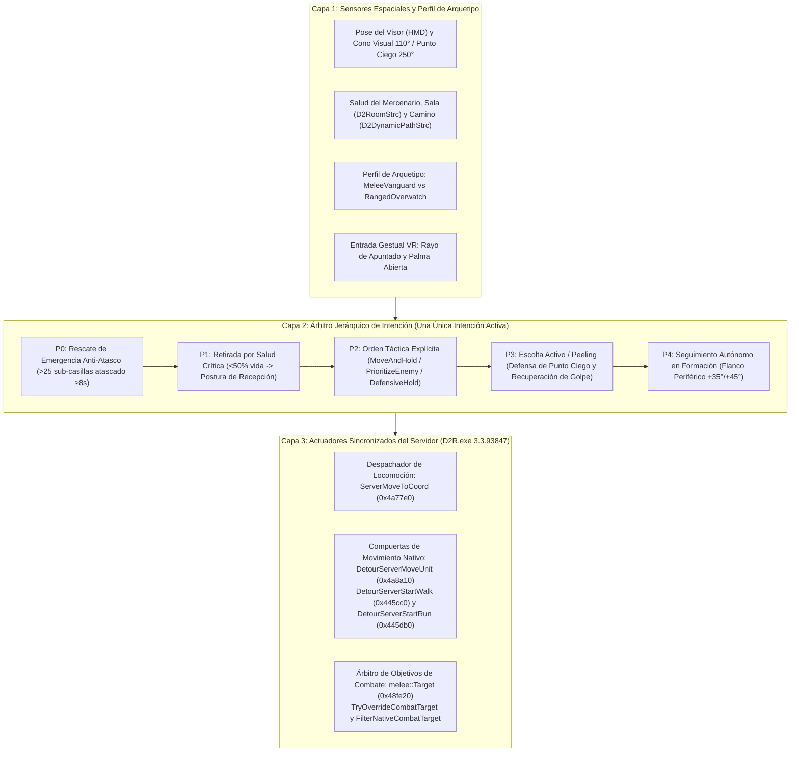

# IA de Compañero en VR: Arquitectura Unificada, Comportamiento de Aliado y Árbitro Espacial de Combate

> English: [docs/VR_COMPANION_AI.md](../VR_COMPANION_AI.md) | Órdenes Tácticas por Gestos: [docs/es/VR_COMPANION_TACTICAL_COMMANDS.md](VR_COMPANION_TACTICAL_COMMANDS.md)

## 1. Visión General y Motivación

En la versión de escritorio de *Diablo II: Resurrected*, los mercenarios funcionan principalmente como proveedores pasivos de auras que siguen al jugador mediante una rutina de IA rígida y sin memoria táctica (`AITHINK_Fn061_Hireable` en el RVA `0x5c1610`).

En Realidad Virtual (VR), sin embargo, tu mercenario es un **compañero físico a escala humana 1:1** que camina a tu lado en pasillos oscuros y combates caóticos. Cuando un aliado se cruza frente a tu cara, bloquea puertas estrechas, ignora a los enemigos que te flanquean por tu punto ciego trasero de 250°, se suicida contra grupos de élites mientras tienes una poción en la mano, o entra en conflicto oscilando entre tus órdenes tácticas y la IA nativa de seguimiento, la inmersión se rompe por completo.

Este documento especifica la **Arquitectura Unificada de 3 Capas de IA de Compañero** en `d2r-pcvr` ([`steamvr/companion_ai.h`](../../steamvr/companion_ai.h), [`vr/companion_ai.cpp`](../../vr/companion_ai.cpp), [`vr/companion_ai_signatures.h`](../../vr/companion_ai_signatures.h) y [`vr/melee.cpp`](../../vr/melee.cpp)), diseñada tanto para eliminar conflictos de estado/locomoción como para servir de base extensible a futuras capacidades de los mercenarios.

---

## 2. Arquitectura Unificada de 3 Capas

Para evitar que subsistemas independientes (o la propia rutina nativa `AITHINK_Fn061_Hireable`) emitan órdenes de movimiento u objetivos de combate contradictorios en fotogramas alternos, la IA del compañero se estructura en tres capas estrictas:

### Capa 1: Sensores Espaciales y Perfil de Arquetipo (`Archetype`)

Toda decisión táctica o de movimiento está parametrizada según el arquetipo de combate del mercenario (`GetHirelingArchetype(classId)`):

| Arquetipo | Clases de Mercenario (`MonStats` Row) | Rango Óptimo de Combate | Radio de Combate en Posición (`Hold`) | Restricción de la IA Nativa |
| :--- | :--- | :--- | :--- | :--- |
| **`MeleeVanguard`** | Guardia del Desierto Acto 2 (`338`), Bárbaro Acto 5 (`560`, `561`) | `<= 3.5` sub-casillas (contacto cuerpo a cuerpo) | `6.0` sub-casillas desde el ancla | Cierra distancia directamente hacia el enemigo (`moveMode = 15`). |
| **`RangedOverwatch`** | Exploradora Arpía Acto 1 (`271`), Lobo de Hierro Acto 3 (`359`) | `5.0 .. 14.0` sub-casillas (distancia óptima `10.0`) | `24.0` sub-casillas desde el ancla | `AITHINK_Fn061_Hireable` activa una huida de pánico si se le fuerza a `< 4` sub-casillas de un monstruo. Nunca se debe mover a mercenarios a distancia encima del enemigo. |

### Capa 2: Árbitro Jerárquico de Intención

Únicamente **una** intención de alto nivel controla la locomoción y la selección de objetivos en cada instante:

1. **`P0 — EmergencyCatchUp` (`StuckWatchdog`):** Solo interviene cuando el mercenario está en `MONMODE_WALK (2)`, separado a `> 25.0` sub-casillas (`15.0` en retirada) y avanza `< 0.5` sub-casillas durante `8000 ms` (`4000 ms` en retirada) sin ninguna orden táctica activa. Usa `RelocateUnit` (`0x491ca0`) de forma transaccional.
2. **`P1 — SurvivalRetreat` (`TacticalRetreatController`):** Se activa cuando la vida cae por debajo del `50%` (`CriticalHealthRatio = 0.50f`, sincronizado con el tinte rojo de salud baja). Cancela automáticamente cualquier orden táctica activa (`HealthRetreat`), reproduce el grito de auxilio del arquetipo, suprime la adquisición de objetivos de combate y repliega al mercenario a la **Postura de Recepción** (`6.5` sub-casillas delante a `+20°`) para que el jugador pueda lanzarle físicamente una poción desde su cinturón VR.
3. **`P2 — TacticalCommand` (`TacticalOrderController`):** Ejecuta las órdenes tácticas por gestos (`MoveAndHold`, `PrioritizeEnemy`, `DefensiveHold`) hasta que se cancelen por reagrupación (`Regroup`), ruptura de correa elástica (`40` sub-casillas), cambio de nivel, muerte del objetivo o retirada por salud crítica.
4. **`P3 — BodyguardPeel` (`BodyguardController`):** Cuando no hay retirada ni orden táctica activa, evalúa las amenazas cercanas (`EvaluateThreat`) y redirige el objetivo de combate del mercenario (`TryOverrideCombatTarget`) para interceptar monstruos en el punto ciego de 250° del jugador o que estén golpeando al jugador (`PLRMODE_GETHIT`).
5. **`P4 — AutonomousFollow`:** Formación periférica por defecto (`+35°` Vanguardia / `+45°` Retaguardia) con rango de detección dinámico (`ComputeCompanionDetectRange`, escalando `aidist` en `MonStats` de `25` a `48` sub-casillas según `enemy_sight_pct`).

### Capa 3: Actuadores Sincronizados de Locomoción y Objetivos de Combate

La ingeniería inversa sobre `D2R.exe` (`3.3.93847`) demostró que `AITHINK_Fn061_Hireable` (`0x5c1610`) inicia movimientos por **dos** rutas de servidor distintas y adquiere objetivos mediante `0x48fe20`. Sincronizar los tres puntos elimina por completo la oscilación ("intentar volver hacia el jugador y luego regresar a su sitio"):

| Función del Motor | RVA Verificado (`3.3.93847`) | Función en la Arquitectura Unificada |
| :--- | :--- | :--- |
| `ServerMoveToCoord` | `0x4a77e0` | **Despachador Principal de Marcha Comandada:** `int __fastcall(uintptr_t game, uintptr_t unit, int x, int y)`. Construye la estructura de movimiento del servidor (`pathType = 1`) e invoca `0x4a8a10 -> 0x4475c0`, generando un camino A* válido en `D2DynamicPathStrc` y pasando al mercenario a `MONMODE_WALK (2)` sin teletransportarlo. Para destinos lejanos (`> 16` sub-casillas), `DispatchServerMoveToCoord` calcula pasos intermedios de `16` sub-casillas. |
| `ServerMoveUnit` | `0x4a8a10` | **Compuerta de Movimiento de Alto Nivel (`DetourServerMoveUnit`):** Intercepta movimientos por unidad o coordenada que pasan por `0x4a8a10`. Suprime el deambuleo nativo cuando el mercenario está en `Arrived` y redirige movimientos no autorizados hacia el destino táctico. |
| `ServerStartWalk` / `ServerStartRun` | `0x445cc0` / `0x445db0` | **Compuertas de Transición de Modo (`DetourServerStartWalk` / `DetourServerStartRun`):** `AITHINK_Fn061_Hireable` también invoca `0x4a87e0` (`0x4a88fd`), que **omite `0x4a8a10`** y llama directamente a `0x4475c0` para caminar/correr de vuelta hacia el jugador. `0x4475c0` llama a `0x445cc0` (caminar) o `0x445db0` (correr) en `0x4477c9`. Cuando nuestro detour devuelve `0` (`ShouldAllowNativeMoveStruct == false`), `0x4475c0` limpia automáticamente el camino intruso (`call 0x34f430`) y mantiene al mercenario clavado en `MONMODE_NEUTRAL (1)` (`call 0x445b80`) en su posición de guardia. |
| `CombatTarget` | `0x48fe20` | **Árbitro de Objetivos de Combate (`TryOverrideCombatTarget` y `FilterNativeCombatTarget` en `vr/melee.cpp`):** Suprime la adquisición de objetivos (`return 0`) durante `SurvivalRetreat` y mientras `MoveAndHold` está en tránsito (`Moving`); fuerza el enemigo marcado en `PrioritizeEnemy` o `BodyguardPeel`; y filtra los objetivos de `originalTarget` durante `MoveAndHold (Arrived)` y `DefensiveHold (Arrived)` para que el mercenario solo ataque enemigos dentro de su radio de guardia (`6.0` sub-casillas en melé, `24.0` sub-casillas a distancia). |
| `RelocateUnit` y `RoomPoint` | `0x491ca0` y `0x38dfb0` | **Validación de Sala y Reubicación Transaccional:** `RoomPoint` valida que la coordenada sea caminable antes de despachar la orden; `RelocateUnit` se reserva exclusivamente para rescates anti-atasco severos y el repliegue inicial por salud crítica. |

---

## 3. Sistemas Principales de Comportamiento

### 3.1. Supervivencia, Retirada Táctica y Sinergia con Lanzamiento Físico de Pociones
- **Activación por Salud Crítica (`< 50%` HP):** Sincronizada con `MercLowHealth` (`0.50f`). Al bajar del 50% de vida, `TacticalRetreatController` entra en retirada, cancela cualquier orden táctica activa y reproduce el grito de auxilio nativo del arquetipo (`2937` Amazona, `3171` Paladín, `3093` Nigromante, `3015` Bárbaro).
- **Postura de Recepción (`CalculateReceivingStancePosition`):** Coloca al compañero `6.5` sub-casillas (~2.6m) frente al jugador en un ángulo suave de `+20°` y desactiva la adquisición de objetivos de combate mediante `TryOverrideCombatTarget`, ofreciendo un blanco estable para lanzar pociones físicamente desde el cinturón 3D.
- **Recuperación Instantánea por Poción (`OnPotionReceived`):** Al impactar una poción en el mercenario (`Action::FeedMerc`), sale inmediatamente de la retirada y retoma el combate.

### 3.2. Instinto de Escolta Activo ("Peeling" y Cobertura de Punto Ciego)
- **Puntuación de Amenazas en Punto Ciego (`EvaluateThreat`):** Los enemigos fuera del cono frontal de 110° del visor (`cosAngle < 0.5735764f`) o que golpean al jugador durante `PLRMODE_GETHIT` (`mode == 4 || mode == 18`) reciben prioridad máxima (`Score 500..1000`).
- **Enrutamiento de Objetivo de Combate:** El ID de la amenaza principal se almacena en `g_activePeelTargetId` y se inyecta en el hook de selección de objetivo del servidor (`0x48fe20`), logrando que el mercenario intercepte al flanqueador con locomoción y animaciones 100% nativas.

### 3.3. Órdenes Tácticas Basadas en Gestos
Consulta [docs/es/VR_COMPANION_TACTICAL_COMMANDS.md](VR_COMPANION_TACTICAL_COMMANDS.md) para la especificación detallada de los gestos `MoveAndHold`, `PrioritizeEnemy`, `DefensiveHold` y `Regroup`, la máquina de estados y las distancias por arquetipo.

---

## 4. Hoja de Ruta de Extensibilidad para Futuras Mejoras de Mercenarios

Gracias a que todo el comportamiento fluye por el **Árbitro de 3 Capas** (`Capa 1 Sensores -> Capa 2 Árbitro de Intención -> Capa 3 Actuadores de Locomoción y Objetivos`), las futuras mejoras sobre IA y capacidades de los mercenarios se integran de forma modular sin modificar los hooks base:

1. **Activación Táctica de Habilidades y Auras (Habilidades Comandadas):**
   - Añadir un slot `TacticalSkillRequest` en la Capa 2 (por ejemplo, ordenar *Vista Interior / Misiles Lentos* a la Arpía del Acto 1, *Pulso de Aura / Estocada* al Guardia del Acto 2, *Encantar / Campo Estático* al Lobo de Hierro del Acto 3, o *Grito de Batalla / Provocar* al Bárbaro del Acto 5) ejecutado en el hilo del juego al alcanzar `TacticalCommandState::Arrived`.
2. **Anclaje Inteligente en Coberturas y Cuellos de Botella (Puertas/Pasillos):**
   - Extender los sensores espaciales de la Capa 1 (`RoomPoint`) para ajustar automáticamente el punto de `MoveAndHold` al centro exacto de un umbral estrecho para `MeleeVanguard` (muro de escudos) o tras cobertura lateral para `RangedOverwatch`.
3. **Combos Cooperativos Jugador-Mercenario:**
   - Usar `TryOverrideCombatTarget` (`0x48fe20`) para detectar enemigos congelados, aturdidos o derribados por los hechizos/golpes en VR del jugador y priorizar ataques de remate.
4. **Coordinación Multi-Compañero e Invocaciones (Summons):**
   - Generalizar `g_lastHirelingId` a una tabla `CompanionContext` indexada por `unitId`, permitiendo que los mismos actuadores `DetourServerStartWalk`/`Run` y `FilterNativeCombatTarget` coordinen Gólems, Osos Druidas, Valquirias y Sombras junto con el mercenario.

---

## 5. Garantías de Seguridad y Verificación

- **Exclusividad Offline en VR:** Todos los hooks y ajustes de tablas se ejecutan estrictamente cuando `mode() == 0` (partida local offline).
- **Cero Modificación de Partidas Guardadas:** Los archivos `.d2s` y los archivos del juego en disco permanecen intactos.
- **Pruebas Automatizadas:** Verificado mediante [`steamvr/companion_ai_test.cpp`](../../steamvr/companion_ai_test.cpp) (`ctest -R companion-ai`), cubriendo escalado de `MonStats`, watchdog anti-atasco, histéresis de retirada, puntuación de amenazas, máquina de estados de órdenes tácticas, distancias de combate por arquetipo, compuertas de locomoción (`0x4a77e0`, `0x4a8a10`, `0x445cc0`, `0x445db0`) y filtrado de objetivos (`0x48fe20`).

