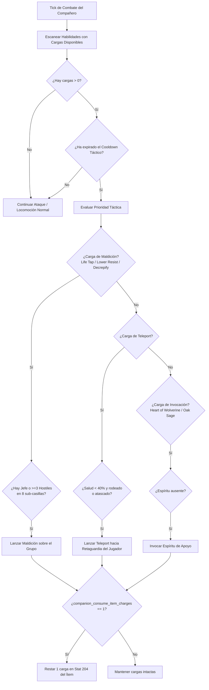
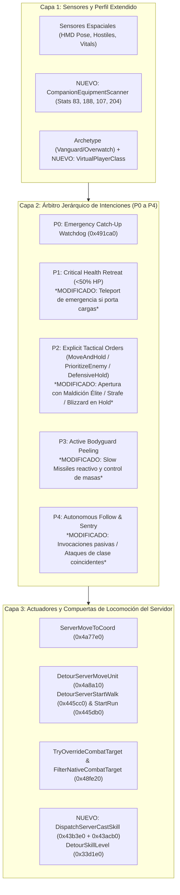
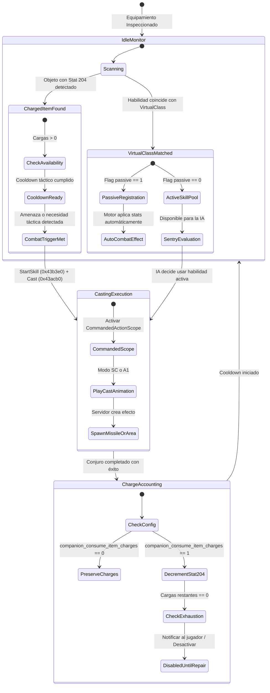
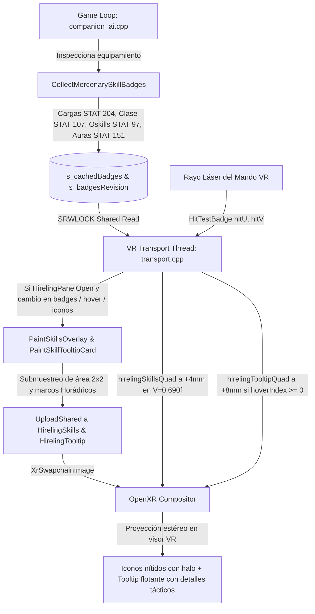

# IA de Compañero en VR: Clases Virtuales, Habilidades de Clase Coincidentes y Uso de Cargas de Objetos

> English: [docs/VR_COMPANION_CLASSES_AND_CHARGES.md](../VR_COMPANION_CLASSES_AND_CHARGES.md) | Referencias del Sistema de Compañeros: [docs/es/VR_COMPANION_AI.md](VR_COMPANION_AI.md) | Órdenes Tácticas: [docs/es/VR_COMPANION_TACTICAL_COMMANDS.md](VR_COMPANION_TACTICAL_COMMANDS.md)

---

## 1. Visión General y Motivación

En *Diablo II: Resurrected*, los mercenarios (compañeros contratados) adolecen de severas limitaciones técnicas heredadas del diseño original del año 2000:
1. **Aislamiento de Clase:** Internamente son entidades de tipo monstruo (`dwType == 1`, `UNIT_MONSTER`) y carecen de una clase de jugador asignada (`pPlayerData == nullptr`). Como consecuencia, no se benefician de bonificadores específicos de clase en objetos (por ejemplo, `+2 a habilidades de Amazona` en un arco equipado por una Pícara, o `+3 a habilidades de Hechicera` en una espada/escudo equipado por un Lobo de Hierro) ni pueden aprender ni ejecutar habilidades de clase procedentes de *staffmods* u *oskills*.
2. **Incapacidad Absoluta para Usar Cargas:** Aunque un mercenario lleve equipado un objeto con habilidades cargadas (por ejemplo, un bastón o tiara con cargas de *Teleport*, varitas con *Life Tap* o *Lower Resist*, o anillos con *Heart of Wolverine*), la IA nativa del juego (`AITHINK_Fn061_Hireable` en RVA `0x5c1610`) es 100% ciega a las cargas. Jamás las evalúa ni las lanza.

En Realidad Virtual (VR), donde el compañero es una presencia física interactiva a escala 1:1 que combate codo con codo con el jugador, estas restricciones merman drásticamente la profundidad táctica y la personalización del equipo.

Esta especificación detalla la arquitectura completa para:
* **Asignar clases de forma virtual en memoria** a cada mercenario sin alterar tablas de datos (`.txt`), permitiendo que el compañero desbloquee y potencie habilidades pasivas y activas que coincidan con su arquetipo.
* **Dotar a la IA del compañero de la capacidad de usar cargas de objetos equipados**, tanto de forma autónoma con criterio táctico como configurable mediante directiva de consumo de cargas (`consume_charges = 0 | 1`).
* **Integrar armónicamente estas capacidades dentro de la Arquitectura Unificada de IA de 3 Capas** descrita en [`docs/VR_COMPANION_AI.md`](../VR_COMPANION_AI.md) y en el sistema de órdenes tácticas por gestos de [`docs/VR_COMPANION_TACTICAL_COMMANDS.md`](../VR_COMPANION_TACTICAL_COMMANDS.md).

---

## 2. Reglas de Oro del Proyecto y Principio "Zero Data Table Mutation"

Siguiendo las directrices estrictas de arquitectura y colaboración de `d2r-pcvr`:
1. **Sin modificación de archivos `.txt` ni datos de tablas:** No se tocan ni redistribuyen `hireling.txt`, `skills.txt`, `itemstatcost.txt` ni `monstats.txt`. Toda la lógica se implementa dinámicamente en tiempo de ejecución mediante lectura de estructuras nativas e interceptores de bajo nivel.
2. **Cero corrupción de archivos de guardado (`.d2s`):** No se alteran las estructuras persistidas en disco del personaje ni del mercenario. Si el usuario desinstala el mod o juega en modo escritorio, el juego continúa siendo 100% compatible con el cliente vanilla.
3. **Exclusividad Offline y Modo Seguro:** Todos los hooks operan exclusivamente cuando `mode() == 0` (partida local en solitario).
4. **Respeto a las animaciones nativas del motor:** No se fuerza ninguna habilidad cuya animación (`anim` en `Skills.txt`) no esté presente en el esqueleto 3D del mercenario, garantizando fluidez visual absoluta sin bloqueos de animación (*T-pose* o crasheos de esqueleto).

---

## 3. Pilar 1: Asignación Virtual de Clase de Jugador

### 3.1. Mapeo de Clase Virtual por Arquetipo

Cada mercenario posee un identificador de fila en `MonStats.txt` (`dwClassId` en la cabecera de la unidad). Asignamos en C++ una clase virtual (`VirtualPlayerClass`) que refleja fielmente su trasfondo, sus animaciones de combate y el conjunto de habilidades base que Blizzard les asignó en el juego original:

```cpp
namespace framevr::companionai {

enum class VirtualPlayerClass : int8_t {
    None = -1,
    Amazon = 0,     // Pícara del Acto 1 (MonStats 271)
    Sorceress = 1,  // Lobo de Hierro del Acto 3 (MonStats 359)
    Paladin = 3,    // Guardia del Desierto del Acto 2 (MonStats 338)
    Barbarian = 4   // Bárbaro del Acto 5 (MonStats 560, 561)
};

inline VirtualPlayerClass GetVirtualPlayerClass(uint16_t monStatsClassId) {
    switch (monStatsClassId) {
        case MonStatsIndex::Rogue:      return VirtualPlayerClass::Amazon;
        case MonStatsIndex::Desert:     return VirtualPlayerClass::Paladin;
        case MonStatsIndex::IronWolf:   return VirtualPlayerClass::Sorceress;
        case MonStatsIndex::Barbarian1:
        case MonStatsIndex::Barbarian2: return VirtualPlayerClass::Barbarian;
        default:                        return VirtualPlayerClass::None;
    }
}

} // namespace framevr::companionai
```

### 3.2. Mecánica de Bonificación de Habilidades en Objetos

En *Diablo II*, los modificadores de objetos operan con los siguientes identificadores estadísticos (`ItemStatCost.txt`):
* **`Stat 83` (`item_addclassskills`):** Añade `+X` a todas las habilidades de una clase (`param = ClassId`).
* **`Stat 188` (`item_addskill_tab`):** Añade `+X` a una rama de habilidades específica (`param = TabId`).
* **`Stat 107` (`item_singleskill`):** Añade `+X` a una habilidad específica restringida a clase (*staffmods* de varas, orbes, arcos, yelmos).
* **`Stat 97` (`item_nonclassskill`):** Añade `+X` a una habilidad utilizable por cualquier clase (*oskills*, ej. *Teleport* de *Enigma*).

En vanilla, el motor descarta estos bonos en mercenarios porque evalúa `unit->pPlayerData->nPlayerClass == targetClass`. Al ser un monstruo, esta comprobación falla inmediatamente.

#### Intercepción en `SKILLS_GetSkillLevel` (`SkillLevelRva 0x33d1e0`):
En [`vr/spell_signatures.h`](../../vr/spell_signatures.h), disponemos de la función nativa de consulta de nivel:
```cpp
// SkillLevelRva = 0x33d1e0;
using SkillLevelFn = int(*)(uintptr_t unit, uintptr_t skillNode, int bIncludeBonuses, int unk);
```
Al interceptar esta llamada para unidades mercenarias:
1. Comprobamos si la unidad es un mercenario mediante `IsHireling(header[1])`.
2. Obtenemos su `VirtualPlayerClass`.
3. Leemos el `skillId` del nodo de habilidad (`skillNode->row->id`).
4. Si el mercenario tiene equipados objetos con `Stat 83` para su clase virtual, `Stat 188` para la rama de dicha habilidad o `Stat 107` para la habilidad concreta, sumamos dichos bonos al nivel efectivo devuelto.
5. **Resultado:** Un arco con `+2 a habilidades de Amazona` incrementa inmediatamente el nivel de *Flecha de Fuego* o *Flecha de Hielo* de la Pícara; una espada con `+3 a habilidades de Fuego` potencia directamente la *Bola de Fuego* del Lobo de Hierro.

### 3.3. Habilidades Pasivas y Activas Coincidentes Otorgadas por Objetos

Cuando un objeto equipado otorga una habilidad que coincide con la clase virtual del mercenario:

#### A. Habilidades Pasivas (Passives)
Las habilidades pasivas poseen el flag `passive = 1` en `Skills.txt`. Al vincularlas en memoria en la lista de habilidades del mercenario (`hireling + 0x100`), el motor nativo del juego aplica automáticamente sus efectos durante los cálculos de daño y defensa:

| Mercenario / Clase Virtual | Habilidad Pasiva Otorgada | Efecto Mecánico Nativo en Combate |
| :--- | :--- | :--- |
| **Pícara (Amazona)** | *Critical Strike* (ID 9) | Comprobación en `SUnitDmg.cpp`: probabilidad de **duplicar el daño físico total** de sus flechas. |
| **Pícara (Amazona)** | *Penetrate* (ID 23) | Otorga un bono pasivo de Attack Rating porcentual masivo (`tohit_percent`). |
| **Pícara (Amazona)** | *Pierce* (ID 33) | Comprobación en `MissileDmg.cpp`: las flechas físicas y mágicas atraviesan grupos enteros de enemigos. |
| **Lobo de Hierro (Hechicera)** | *Warmth* (ID 37) | Regeneración acelerada de maná nativo (`mana_recovery_bonus`). |
| **Lobo de Hierro (Hechicera)** | *Fire Mastery* (ID 61) | Bonificación porcentual directa al daño de sus ataques y hechizos de fuego. |
| **Lobo de Hierro (Hechicera)** | *Cold Mastery* (ID 65) | Perforación porcentual de la resistencia al frío de los enemigos. |
| **Lobo de Hierro (Hechicera)** | *Lightning Mastery* (ID 63) | Aumento porcentual masivo del daño de sus rayos y relámpagos. |
| **Guardia (Paladín)** | Auras Pasivas Adicionales | Activación de auras secundarias en combate al portar escudos o armas de Paladín. |
| **Bárbaro (Bárbaro)** | *Iron Skin* / *Masteries* | Incremento pasivo de defensa base y probabilidad de impacto crítico con espadas. |

#### B. Habilidades Activas y Compatibilidad de Animaciones
Para ejecutar habilidades activas, el modelo 3D del mercenario debe disponer de los fotogramas de animación requeridos en `MonStats2.txt`:
* **Pícara del Acto 1 (Modo `A1` - Disparo con Arco):**
  * Habilidades 100% compatibles: *Multiple Shot* (ID 12), *Guided Arrow* (ID 22), *Strafe* (ID 26), *Immolation Arrow* (ID 27).
  * Todas disparan la animación `A1` ya existente en su rig, permitiendo lanzar ráfagas de flechas o proyectiles teledirigidos.
* **Lobo de Hierro del Acto 3 (Modo `SC` - Special Cast):**
  * Habilidades 100% compatibles: *Blizzard* (ID 59), *Meteor* (ID 56), *Nova* (ID 48), *Chain Lightning* (ID 53), *Hydra* (ID 62).
  * Todos estos hechizos utilizan el modo de lanzamiento `SC` que el Lobo de Hierro ya utiliza para lanzar sus bolas de fuego y picos glaciares.

---

## 4. Pilar 2: Uso de Cargas de Objetos Equipados (Charged Skills)

### 4.1. Estructura Interna de las Cargas (`Stat 204`)

El `Stat 204` (`item_charged_skill`) codifica en un entero de 32 bits:
* Bits `0..8`: `SkillId` (0 a 511).
* Bits `9..14`: `Level` (Nivel del conjuro, 1 a 63).
* Bits `15..22`: `CurrentCharges` (Cargas disponibles, 0 a 255).
* Bits `23..30`: `MaxCharges` (Capacidad máxima de cargas).

### 4.2. Inspección del Equipamiento del Compañero

Utilizando las rutinas ya verificadas en [`vr/combat.cpp`](../../vr/combat.cpp):
* `InventoryRva (0x34a360)`: Obtiene el puntero `pInventory` del mercenario.
* `EquippedRva (0x3886d0)`: Obtiene el ítem en la ranura correspondiente:
  * Ranura `1`: Casco / Tiara.
  * Ranura `2`: Armadura de Torso.
  * Ranura `4`: Arma Principal (Mano Derecha).
  * Ranura `5`: Escudo / Arma Secundaria (Mano Izquierda).

El componente `CompanionEquipmentScanner` indexa las cargas activas en cada ciclo del hilo del juego:

```cpp
struct CompanionChargedSkill {
    uint32_t itemId = 0;
    int bodyLocation = 0;
    uint16_t skillId = 0;
    uint8_t level = 0;
    uint8_t currentCharges = 0;
    uint8_t maxCharges = 0;
    uint64_t lastCastMs = 0;
};
```

### 4.3. Criterio Táctico y Lógica de Decisión de la IA

Para evitar que el mercenario consuma todas las cargas en pocos segundos de combate, la IA evalúa desencadenantes basados en la situación táctica con **cooldowns internos rigurosos**:



#### Reglas de Selección de Objetivos para Cargas:
1. **Maldiciones de Supervivencia y Asistencia (*Life Tap*, *Decrepify*, *Lower Resist*):**
   * Desencadenante: Presencia de un monstruo Élite/Jefe (`IsBoss || IsChampion`) o densidad de enemigos $\ge 3$ en un radio de 8 sub-casillas sin esa maldición activa.
   * Cooldown mínimo: `20.0 segundos`.
2. **Movilidad de Emergencia (*Teleport*):**
   * Desencadenante: Salud del compañero $< 40\%$ (`CriticalHealthRatio`), acorralado por $\ge 2$ enemigos a distancia cuerpo a cuerpo (`< 2.5` sub-casillas), o bloqueo de navegación prolongado.
   * Coordenada de destino: Punto de anclaje de recepción en la retaguardia del jugador (`CalculateReceivingStancePosition`).
   * Cooldown mínimo: `12.0 segundos`.
3. **Invocaciones de Apoyo (*Heart of Wolverine*, *Oak Sage*, *Spirit Wolf*):**
   * Desencadenante: No existe una invocación viva vinculada al compañero al entrar en estado de combate.
   * Cooldown mínimo: `45.0 segundos`.
4. **Defensa contra Proyectiles (*Slow Missiles*):**
   * Desencadenante: Detección de arqueros o monstruos de proyectiles (*Gloams*, *Burning Souls*, arqueras) a más de 12 sub-casillas apuntando al jugador o al mercenario.
   * Cooldown mínimo: `15.0 segundos`.

### 4.4. Despacho Técnico de Ejecución Nativa

La invocación del conjuro se realiza en el hilo del juego (`runOnGameThread`) utilizando las firmas del servidor nativo:
* `StartRva (0x43b3e0)`: `SKILLS_StartSkill(game, hireling, skillId, level, 0)`.
* `DispatchRva (0x43acb0)`: `SKILLS_Cast(game, hireling, skillId, level, 1, targetX, targetY)`.
* Para ataques físicos con armas o arco: `AttackRva (0x42feb0)`.

Ambas funciones admiten a la unidad mercenaria como ejecutor válido, desencadenando los efectos visuales, los sonidos nativos y la creación de los misiles o áreas de efecto en el servidor local.

### 4.5. Configuración de Usuario y Parámetros de Desarrollo

La configuración se organiza en dos niveles limpios:

#### 1. Conmutador Maestro en VR Settings (Gobernanza Global de la Característica):
Permite a los jugadores desactivar toda la característica si prefieren el comportamiento clásico del mercenario:
* **Sección INI:** `[gameplay]` en `d2r_pcvr.ini`
* **Clave:** `companion_item_skills = 1` (por defecto `1` = Activado, `0` = Desactivado).
* **Fila en VR Settings:** En el menú **Combate** (sección *"Habilidades y lanzamientos"*):
  * **Etiqueta:** *"Mercenary item skills"*
  * **Texto de Ayuda:** *"Permite al mercenario beneficiarse de habilidades de clase coincidentes en su equipo y lanzar habilidades tácticas con cargas. Desactivado: el mercenario opera solo con sus habilidades base."*
  * **Comportamiento Desactivado (`0`):**
    * La IA omite el escaneo y lanzamiento de habilidades con cargas.
    * El hook de `SkillLevelRva` no añade bonificaciones de equipo.
    * El mercenario se comporta de forma 100% idéntica a la versión original de Blizzard.

#### 2. Parámetro Interno de Desarrollo (`[dev]`, Oculto de la UI de VR Settings):
Controla si el lanzamiento descuenta cargas del objeto. **Nunca se muestra en la interfaz de VR Settings**:
* **Sección INI:** `[dev]` en `d2r_pcvr.ini`
* **Clave:** `companion_consume_item_charges = 0`
* **Valor por Defecto:** **Siempre `0`** (Modo Sin Desgaste: el mercenario lanza el hechizo sin descontar cargas del ítem).
* **Modo Consumo Realista (`1`):** Cuando el desarrollador lo activa manualmente a `1`, cada lanzamiento exitoso descuenta 1 carga en `Stat 204`. Al llegar a 0, la habilidad se desactiva hasta repararse en herrero o con fórmulas del Cubo Horádrico.

```ini
; d2r_pcvr.ini

[gameplay]
; Conmutador maestro visible en VR Settings (1 = Activado por defecto, 0 = Desactivado por completo)
companion_item_skills = 1

[dev]
; Parámetro interno de desarrollo (oculto en VR Settings UI)
; 0 = Modo Sin Desgaste (por defecto)
; 1 = Modo Consumo Realista (descuenta cargas en Stat 204)
companion_consume_item_charges = 0
```

### 4.6. Reconocimiento de Cadáveres y Habilidades de Detonación (*Corpse Skills*)

En *Diablo II*, ciertas habilidades de daño y soporte del Nigromante y del Bárbaro no operan sobre coordenadas arbitrarias ni sobre monstruos vivos, sino que **exigen estrictamente un cadáver de monstruo válido en el suelo** (`TargetCorpse`). Si el motor nativo del juego (`SKILLS_StartSkill` en RVA `0x43b3e0`) recibe una petición de lanzamiento sin un objetivo que sea un cadáver en estado válido (`dwMode == 12`), la comprobación nativa `srvstfunc` aborta de inmediato con código de rechazo `startRes = 0`.

Para garantizar que objetos con cargas como la *Esfera de Radament* (*Explosión de Veneno*), *Mortaja de Cadáveres* / *Corpsemourn* (*Explosión de Cadáveres*), *Tótem Nefasto*, etc., funcionen de manera orgánica:

#### 1. Indexación de Habilidades Dependientes de Cadáveres
En [`steamvr/companion_charges.h`](../../steamvr/companion_charges.h) se incorpora la función `SkillRequiresCorpse(skillId)`:
* **Skill 74:** *Corpse Explosion* (Explosión de Cadáveres - Nigromante).
* **Skill 83:** *Poison Explosion* (Explosión de Veneno - Nigromante, ej. *Radament's Sphere*).
* **Skill 95:** *Revive* (Revivir - Nigromante, ej. *Tomb Reaver*).
* **Skill 131:** *Find Potion* (Buscar Pociones - Bárbaro).
* **Skill 138:** *Find Item* (Buscar Objeto - Bárbaro).
* **Skill 150:** *Grim Ward* (Tótem Nefasto - Bárbaro).

El predicado auxiliar `HasCorpseSkills(skills)` evalúa si el conjunto de cargas equipadas contiene alguna de estas habilidades. Si el mercenario no tiene equipada ninguna habilidad de cadáver, el escaneo de cadáveres se omite por completo (cero sobrecoste de CPU en combate ordinario).

#### 2. Sensor y Escaneo de Cadáveres Válidos (`melee::CorpsesAround`)
En [`vr/melee.h`](../../vr/melee.h) y [`vr/melee.cpp`](../../vr/melee.cpp), la función `melee::CorpsesAround` recorre las 128 cubetas de unidades del servidor local (`game + 0x4c6*8`) identificando cuerpos que cumplan:
1. `dwType == 1` (`UNIT_MONSTER`) y `dwMode == 12` (`MONMODE_DEATH`).
2. Descarte de residentes de ciudad y PNJs (`MonsterFlags & (kMonNpc | kMonInTown)`).
3. Descarte de cadáveres ya consumidos o explotados comprobando estados de unidad nativos vía `CheckStateRva (0x3351b0)`:
   * `STATE_CORPSE_NODRAW (102)` (cadáver consumido o destrozado).
   * `STATE_REVIVE (103)` (resucitado).
   * `STATE_CORPSE_EXPLODE (108)` (previamente detonado).
4. **Selección Óptima del Cadáver:** De entre los cadáveres válidos dentro de un radio de 24 sub-casillas, la IA selecciona el cadáver **más próximo al grupo enemigo o al objetivo principal hostil**, garantizando que la nube de veneno o la explosión física impacte de lleno sobre los monstruos vivos.

#### 3. Ejecución Transaccional con Sobreescritura de Objetivo Cadáver
Al lanzar una habilidad indexada en `SkillRequiresCorpse`:
* **Coordenadas de Destino:** `(destX, destY)` se fijan exactamente en la posición del cadáver elegido (`closestCorpseX`, `closestCorpseY`), en lugar de la posición del enemigo vivo.
* **Sobreescritura de Unidad Objetivo (`Target(game, unit)`):** Durante la ejecución de `CommandedActionScope`, el puntero de unidad del cadáver se asigna a `g_commandedActionTargetUnit`. Cuando `SKILLS_StartSkill` consulta el objetivo del mercenario a través del hook `0x48fe20` (`TryOverrideCombatTarget`), este devuelve la unidad cadáver. El motor valida el prerrequisito satisfactoriamente (`startRes = 1`) y ejecuta el daño en el área.

#### 4. Penalización de Enfriamiento por Fallo (*Failed Cast Backoff*)
Si por cualquier factor dinámico del motor (como un cadáver consumido en el mismo fotograma o línea de visión bloqueada) una habilidad devuelve `startRes == 0 && castRes == 0`, la IA actualiza inmediatamente `s.lastCastMs = nowMs`. Esto evita que la máquina de estados entre en un bucle repetitivo de reintentos cada 400 ms, aplicando el tiempo de enfriamiento táctico y permitiendo que otras habilidades ofensivas (como *Hidra*) sigan rotando sin demoras.

---

### 4.7. Integración de Habilidades Activas de Equipamiento (Staffmods e Oskills)

Más allá de las cargas (Stat 204), los mercenarios pueden portar objetos que confieren habilidades directas de clase (Stat 107, *single skill* / *staffmod*, como +3 a Bombardeo en arcos de Amazona) u otorgadas para todas las clases (Stat 97, *oskill*, como +1 a Teletransporte de Enigma o +1 a Ráfaga de Fuego).

En el juego original, la IA de los mercenarios ignora completamente estas habilidades porque solo ejecuta la lista prefijada en hireling.txt.

#### Mecánica de Integración en la Rotación de Combate:
1. **Detección y Clasificación (ScanCompanionChargedSkills & CollectMercenarySkillBadges):**
   * El escáner detecta Stat 107 y Stat 97, instanciando un descriptor de habilidad con la bandera isEquipmentSkill = true, maxCharges = 0 y currentCharges = 255 (ilimitado).
   * **Filtro Estricto de Pasivas (IsSkillPassive):** Las habilidades pasivas (como *Golpe Crítico*, *Esquivar*, *Calor*, o *Maestrías de Armas*) quedan excluidas del despachador activo para evitar intentos anómalos de lanzamiento, operando pasivamente en el motor de combate.
   * **Compatibilidad de Clase Virtual (IsSkillUsableByCompanion):** Para Stat 107, solo se autorizan habilidades compatibles con la clase virtual del mercenario y su conjunto de animaciones nativas (e.g. *Bombardeo / Strafe* (ID 26), *Disparo Múltiple* (ID 12) o *Flecha Inmoladora* (ID 27) para la Pícara del Acto 1 / Amazona).
2. **Rotación Táctica y Cooldowns:**
   * Al ser habilidades ilimitadas de equipo, su uso no se agota por cargas, sino que se gobierna mediante la cadencia táctica (DamageSpell cooldown de ~4.0 s para hechizos/flechas ofensivas).
   * Esto previene el spam continuo de animaciones y permite intercalar ataques básicos de arma con ráfagas devastadoras de *Bombardeo* (*Strafe*).
3. **Exención de Desgaste (companion_consume_item_charges):**
   * La rutina de descuento comprueba if (consumeCharges && !s.isEquipmentSkill && s.maxCharges > 0), asegurando que las habilidades de equipo jamás decrementen estadísticas ni requieran reparaciones.

---

## 5. Integración y Modificaciones en la Arquitectura de IA Existente

La incorporación de clases virtuales y lanzamiento de cargas/habilidades no es un sistema aislado: **se inserta de forma armónica dentro de la Arquitectura Unificada de 3 Capas de [`docs/VR_COMPANION_AI.md`](../VR_COMPANION_AI.md)** y en la **Máquina de Estados de Órdenes Tácticas de [`docs/VR_COMPANION_TACTICAL_COMMANDS.md`](../VR_COMPANION_TACTICAL_COMMANDS.md)**.

A continuación se detalla cómo interactúa con cada subsistema existente y cómo se gestionan los cambios en el código de [`vr/companion_ai.cpp`](../../vr/companion_ai.cpp):



### 5.1. Integración en la Pila de Intenciones de la Capa 2 (P0 a P4)

1. **`P0 — EmergencyCatchUp` (Sin cambios):**
   * El perro guardián transversal (`StuckWatchdog`) preserva su prioridad absoluta. Si el mercenario sufre un bloqueo de geometría severo (`dist > 25.0` durante $\ge 8\text{ s}$), `RelocateUnit (0x491ca0)` lo rescata de inmediato.
2. **`P1 — SurvivalRetreat` (Modificación para Movilidad con Cargas):**
   * *Comportamiento actual:* Al caer a $<50\%$ de vida, cancela la orden activa (`HealthRetreat`), emite un grito de auxilio y camina hacia la postura de recepción (`ReceivingStance` a 6.5 sub-casillas en $+20^\circ$) para recibir una poción arrojadiza.
   * *Ampliación con Cargas:* Si el mercenario lleva equipado un objeto con cargas de **Teleport** y está acorralado cuerpo a cuerpo por $\ge 2$ atacantes, la IA ejecuta un `Teleport` instantáneo hacia la postura de recepción en lugar de correr a pie entre la masa de enemigos, evitando la muerte inmediata por desincronización de hitbox.
3. **`P2 — TacticalCommand` (Sinergia con `PrioritizeEnemy` y `MoveAndHold`):**
   * **En `PrioritizeEnemy`:** Si el objetivo fijado por el jugador mediante *Grip Raycast* es un Jefe o Campeón (`isBoss == true`):
     * La IA evalúa prioritariamente lanzar una maldición cargada (*Life Tap*, *Decrepify*, *Lower Resist*) en el primer fotograma de contacto antes de iniciar los golpes físicos.
     * Si la Pícara dispone de *Guided Arrow* o *Strafe*, mantiene la distancia óptima de `10.0` sub-casillas (`RangedOptimalStandOff`) y descarga ráfagas de proyectiles mágicos en lugar del ataque básico de arco.
   * **En `MoveAndHold` / `DefensiveHold` (Centinela Activo):**
     * En el commit `9128f5f`, se resolvió el bloqueo de combate mediante `g_activeHoldTargetId` y `originalServerMoveUnit(game, hireling, enemy, 4, ...)` (modo 4 = `MONMODE_ATTACK1`).
     * *Ampliación:* El centinela de guardia ahora puede alternar entre el ataque básico de modo 4 y el casteo de habilidades de clase o cargas (`DispatchServerCastSkill`):
       - Un Lobo de Hierro en guardia puede canalizar *Blizzard*, *Meteor* o *Chain Lightning* sobre los enemigos que ingresen a su radio de vigilancia de 24 sub-casillas, manteniendo su posición de anclaje intacta sin oscilar.
       - Una Pícara en guardia puede lanzar *Multiple Shot* o *Guided Arrow* contra cualquier enemigo en línea de visión directa.
4. **`P3 — BodyguardPeel` (Defensa Reactiva de Puntos Ciegos):**
   * Al detectar enemigos que emboscan al jugador por la espalda (sector ciego de $250^\circ$) o durante recuperación de impacto (`PLRMODE_GETHIT`):
     * Si el mercenario dispone de habilidades de ralentización (*Slow Missiles*, *Frost Nova*, *Glacial Spike*), las lanza inmediatamente sobre el grupo emboscador, neutralizando la amenaza antes de cerrar a melee.
5. **`P4 — AutonomousFollow` (Gestión Pasiva de Invocaciones):**
   * Fuera de combate o al aproximarse a una refriega, si el compañero tiene cargas de invocaciones de apoyo (*Heart of Wolverine*, *Oak Sage*), las activa automáticamente para garantizar que los auras de daño y vida estén presentes para todo el escuadrón.

### 5.2. Coexistencia con las Compuertas de Locomoción y Antioscilación

El análisis de bajo nivel de `D2R.exe 3.3.93847` demostró que la IA nativa `AITHINK_Fn061_Hireable` (`0x5c1610`) provoca regresiones de movimiento hacia el jugador si no se arbitran sus rutas del servidor:
* `DetourServerMoveUnit (0x4a8a10)`
* `DetourServerStartWalk (0x445cc0)` y `DetourServerStartRun (0x445db0)`

#### ¿Cómo evitamos conflictos al lanzar habilidades y cargas?
1. **Ámbito de Acción Autorizada (`CommandedActionScope`):**
   * Al igual que se utiliza `CommandedMoveScope` para el movimiento explícito, todo lanzamiento de habilidad o carga se ejecuta dentro de un centinela RAII:
     ```cpp
     struct CommandedActionScope {
         CommandedActionScope() noexcept { g_inCommandedAction = true; }
         ~CommandedActionScope() noexcept { g_inCommandedAction = false; }
     };
     ```
   * Esto previene que `DetourServerMoveUnit` o las compuertas de transición de modo interpreten el cambio a `MONMODE_CAST (5)` o la llamada de ataque como una desviación no autorizada de la orden de guardia.
2. **Protección de la Cadencia de Animación y Modos:**
   * La IA nativa se desincroniza si se le ordena una acción mientras se encuentra en medio de otra animación (`MONMODE_GETHIT = 3`, `MONMODE_ATTACK1 = 4`, `MONMODE_CAST = 5`).
   * La evaluación de casteo en `CompanionGameThreadTick` verifica estrictamente:
     $$\text{hirelingMode} == 1 \ (\text{MONMODE\_NEUTRAL}) \quad \land \quad (\text{nowMs} - \text{s\_lastCastMs} \ge 400\text{ ms})$$
   * Una vez completada la animación de casteo, la unidad regresa suavemente a `MONMODE_NEUTRAL (1)` en su anclaje de guardia o formación, sin saltos ni tirones visuales.
3. **Arbitraje de Blancos en `CombatTarget` (`0x48fe20`):**
   * `TryOverrideCombatTarget` y `FilterNativeCombatTarget`: Para habilidades con proyectiles dirigidos (como *Fireball* o *Guided Arrow*), se alimenta el objetivo al interceptor de blancos. Para conjuros de área (*Blizzard*, *Meteor*, *Life Tap*), se pasa la coordenada espacial `{targetX, targetY}` directamente a `SKILLS_Cast (0x43acb0)`, evitando desviar el objetivo fijado de las armas físicas.

### 5.3. Modificaciones Específicas en el Código Fuente

| Archivo Fuente | Componente | Modificación Requerida |
| :--- | :--- | :--- |
| [`steamvr/companion_ai.h`](../../steamvr/companion_ai.h) | `VirtualPlayerClass` | Enumerador de clases virtuales y función `GetVirtualPlayerClass(classId)`. |
| [`steamvr/companion_ai.h`](../../steamvr/companion_ai.h) | `CompanionEquipmentScanner` | Escáner de ranuras de inventario (`1, 2, 4, 5`) para `Stat 83`, `Stat 188`, `Stat 107` y `Stat 204`. |
| [`steamvr/companion_ai.h`](../../steamvr/companion_ai.h) | `TacticalCastPolicy` | Estructura de reglas de decisión (cooldowns, densidad de enemigos, umbrales de vida) para cargas y habilidades de clase. |
| [`vr/companion_ai_signatures.h`](../../vr/companion_ai_signatures.h) | Firmas de Habilidad | Exportación e inclusión de `SkillLevelRva (0x33d1e0)`, `StartRva (0x43b3e0)`, `DispatchRva (0x43acb0)`. |
| [`vr/companion_ai.cpp`](../../vr/companion_ai.cpp) | `DetourSkillLevel` | Hook sobre `0x33d1e0` para calcular el nivel efectivo de habilidades sumando bonificadores de clase coincidentes. |
| [`vr/companion_ai.cpp`](../../vr/companion_ai.cpp) | `CompanionGameThreadTick` | Inserción de la evaluación táctica de habilidades y cargas en el ciclo de sentinela (`g_activeHoldTargetId`) y en combate general. |
| [`vr/companion_ai.cpp`](../../vr/companion_ai.cpp) | `Accounting & INI` | Lógica de descuento en `Stat 204` condicionado por `companion_consume_item_charges`. |

---

## 6. Diagrama de Estados del Ciclo de Vida y Flujo Táctico Completo



---

## 7. Plan de Implementación por Fases y Verificación

### Fase 1: Mapeo Virtual de Clases e Intercepción de Niveles (`companion_skills.h`)
* Definición de `VirtualPlayerClass` y correspondencia determinista con `MonStatsIndex`.
* Hook en `SkillLevelRva (0x33d1e0)` para sumar bonos de clase (`Stat 83`), ramas (`Stat 188`) y habilidades individuales (`Stat 107`) cuando coincidan con la clase virtual del mercenario.
* Tests unitarios CTest verificando el cálculo de niveles para Pícara (Amazona), Lobo de Hierro (Hechicera), Guardia (Paladín) y Bárbaro.

### Fase 2: Escáner de Cargas de Objetos Equipados (`companion_charges.h`)
* Implementación de `CompanionEquipmentScanner` que recorre las ranuras de equipo (`1, 2, 4, 5`) leyendo el `Stat 204`.
* Registro de habilidades cargadas activas, nivel, cargas restantes y estampas de tiempo de último lanzamiento.
* Verificación de persistencia de cargas y lectura correcta en items mágicos, raros y únicos.

### Fase 3: Orquestación Táctica en la IA (`companion_ai.cpp`)
* Integración del selector táctico de cargas y habilidades de clase en `CompanionGameThreadTick`.
* Implementación de compuertas de cooldown anti-despilfarro y reglas de selección por amenaza (jefes, turbas, emergencia por baja salud).
* Despacho transactional en el servidor local mediante `StartRva` y `DispatchRva` protegido con `CommandedActionScope`.

### Fase 4: Política de Consumo y Configuración VR Settings
* Integración de `companion_consume_item_charges` en `d2r_pcvr.ini` y en el menú de ajustes en VR.
* Lógica de actualización atómica del `Stat 204` para consumo realista vs. modo sin coste.
* Batería de pruebas automatizadas con CTest (`companion_skills_test.cpp` y `companion_charges_test.cpp`).

---

## 8. Garantías de Seguridad e Invariantes

1. **Invariante de Formato de Guardado:** Las modificaciones ocurren 100% en la representación en memoria del servidor local en tiempo de ejecución. Ningún byte modificado de datos se guarda en el archivo `.d2s` que pueda invalidar la partida fuera del mod.
2. **Aislamiento de Hilos:** Toda consulta o alteración de inventario y despacho de conjuros se ejecuta estrictamente en el hilo del juego (`runOnGameThread`), evitando condiciones de carrera de memoria o bloqueos concurrentes.
3. **Compatibilidad Visual y Antioscilación:** No se permite la ejecución de habilidades cuyo modo de animación entre en conflicto con el esqueleto del mercenario, y todo casteo respeta las compuertas de locomoción (`DetourServerMoveUnit`, `DetourServerStartWalk`), evitando que el mercenario oscile o rompa sus anclajes de guardia.

---

## 9. Guía de Pruebas en el Juego y Botones de Desarrollo (DEV)

Para facilitar la verificación práctica de esta funcionalidad sin necesidad de buscar o farmear objetos específicos en partidas largas, se han incorporado dos botones dedicados en la pestaña **DEV** (Página **HERO**) del menú de interacción de realidad virtual:

### 9.1 Botones de Desarrollo en el Menú DEV

1. **`Merc charged item` (Ranura 9 de la página HERO):**
   * **Función:** Inspecciona en tiempo real al mercenario contratado y genera de forma rotativa en el inventario del jugador objetos únicos con cargas verificadas (`Stat 204`) que corresponden exactamente a las ranuras y tipos de armas/armaduras que **ese mercenario en concreto puede equipar**:
     * **Si tienes contratado al Lobo de Hierro del Acto 3 (Hechicera):**
       - **Escudo:** *Esfera de Radament / Radament's Sphere (`xts`)* con cargas de *Nova de Veneno (Nivel 5, 86/86 cargas)*.
       - **Yelmo:** *Yelmo de la Visión Oscura / Darksight Helm (`xh9`)* con cargas de *Manto de Sombras / Cloak of Shadows (Nivel 5, 30/30 cargas)*.
       - **Espada de 1 mano:** *Viento de Escarcha / Frostwind (`7ls`)* con cargas de *Ráfaga Ártica / Arctic Blast (Nivel 14, 75/75 cargas)*.
       - **Armadura:** *Mortaja de Cadáveres / Corpse Mourn (`xar`)* con cargas de *Explosión de Cadáveres (Nivel 5, 40/40 cargas)*.
     * **Si tienes contratado al Guardia del Desierto del Acto 2 (Paladín):**
       - **Arma de asta / Lanza:** *Trinchador de Huesos / Bonehew (`7sp`)* con cargas de *Explosión de Cadáveres (Nivel 14, 30/30 cargas)* y *Púa de Festín de Almas / Soulfeast Tine (`9pa`)* con cargas de *Decrepitud / Decrepify (Nivel 7, 45/45 cargas)*.
       - **Yelmo y Armadura:** *Darksight Helm (`xh9`)* y *Corpse Mourn (`xar`)*.
     * **Si tienes contratado al Bárbaro del Acto 5 (Bárbaro):**
       - **Espada:** *Frostwind (`7ls`)* con *Arctic Blast (Nivel 14)*.
       - **Yelmo y Armadura:** *Darksight Helm (`xh9`)* y *Corpse Mourn (`xar`)*.
     * **Si tienes contratada a la Pícara del Acto 1 (Amazona):**
       - **Arco:** *Asesino del Acantilado / Cliffkiller (`8cb`)* con cargas de *Debilitamiento / Weaken (Nivel 10, 65/65 cargas)*.
       - **Yelmo y Armadura:** *Darksight Helm (`xh9`)* y *Corpse Mourn (`xar`)*.
   * Cada pulsación cicla por las piezas disponibles para equipar al mercenario de inmediato.

2. **`Merc class gear` (Ranura 10 de la página HERO):**
   * **Función:** Inspecciona en tiempo real al mercenario que el jugador tiene contratado y genera en el inventario un kit completo de equipo único de nivel 99 con bonificaciones a habilidades de su clase virtual (`+ClassSkills`, `+TabSkills`, `+SingleSkill`):
     * **Si tienes contratada a la Pícara del Acto 1 (Amazona):** Genera arco con bonificaciones de Amazona (*Lycander's Aim* con +2 Amazona y +2 Arco), yelmo (*Valkyrie Wing* con +1-2 Amazona) y armadura (*Skin of the Vipermagi* con +1 a todas las habilidades).
     * **Si tienes contratado al Guardia del Desierto del Acto 2 (Paladín):** Genera lanza (*Arioc's Needle* con +2-4 a todas las habilidades), yelmo (*Harlequin Crest* con +2 a todas las habilidades) y armadura (*Guardian Angel* con +1 a habilidades de Paladín).
     * **Si tienes contratado al Lobo de Hierro del Acto 3 (Hechicera):** Genera espada de 1 mano (*Hexfire* con +3 a Fuego), escudo (*Lidless Wall* con +1 a todas las habilidades), yelmo (*Harlequin Crest* con +2 a todas las habilidades) y armadura (*Skin of the Vipermagi* con +1 a todas las habilidades).
     * **Si tienes contratado al Bárbaro del Acto 5 (Bárbaro):** Genera espada de 2 manos (*The Grandfather* con +2 a todas las habilidades), yelmo (*Arreat's Face* con +2 Bárbaro y +2 Combate) y armadura (*Arkaine's Valor* con +2 a todas las habilidades).

---

### 9.2 Protocolo Idóneo de Pruebas Paso a Paso

#### Paso 1: Configuración de la Sesión de Pruebas
1. Inicia D2R con el cargador D2RLoader en modo mod aislado `pcvr-dev` (partida offline local).
2. Abre el menú DEV en la rueda de interacción VR (pestaña `DEV` -> página `HERO`).
3. Si lo deseas, pulsa `Unlock Quests & Waypoints` y `Level 90` para tener acceso total a todos los actos y mercenarios.

#### Paso 2: Prueba de Bonificaciones de Clase Virtual (Fase 1)
1. Contrata al mercenario deseado en el campamento o ciudad (Pícara en Acto I, Guardia en Acto II, Lobo de Hierro en Acto III, Bárbaro en Acto V).
2. Abre la rueda de interacción, pulsa `Merc class gear`. Recibirás en tu inventario las piezas de equipo optimizadas para esa clase.
3. Abre el inventario del mercenario (tecla nativa `O` o interacción VR) y equípale las armas, yelmos y armaduras recibidas.
4. Sal a una zona de combate exterior (e.g. *Blood Moor* o *River of Flame*):
   * Comprueba en el registro de depuración (`framevr.log`) cómo `DetourSkillLevel (0x33d1e0)` intercepta la consulta de nivel y añade los bonos de clase/rama:
     `Frame companion AI: computed effective skill level for companion...`
   * Observa el aumento visible de potencia y daño elemental en los proyectiles de la Pícara, los hechizos del Lobo de Hierro o las auras/golpes del Guardia y Bárbaro.

#### Paso 3: Prueba de Lanzamiento Táctico de Cargas (Fases 2 y 3)
1. Con el mercenario contratado, pulsa el botón `Merc charged item` repetidamente hasta obtener objetos con cargas clave:
   * Por ejemplo, *Spellsteel* (con cargas de *Teleport* y *Decrepify*), *Darksight Helm* (con cargas de *Cloak of Shadows*), o *Corpsemourn* (cargas de *Corpse Explosion*).
2. Equipa el objeto cargado en el mercenario.
3. Realiza las siguientes pruebas situacionales en combate:
   * **Prueba de Teletransporte de Emergencia (P1):** Permite que la salud del mercenario baje del 40% o que sea rodeado por varios enemigos cuerpo a cuerpo. En el registro se confirmará el casteo táctico (`P1 Emergency Teleport retreat`) y el mercenario se teletransportará instantáneamente junto a tu posición en VR.
   * **Prueba de Supresión de Proyectiles (P2):** Enfréntate a enemigos a distancia (arqueras, fuegos fatuos/gloams a más de 12 sub-tiles). El mercenario casteará *Manto de Sombras* o *Lentitud de Proyectiles* para proteger al escuadrón.
   * **Prueba de Maldición Asistencial (P3):** Entabla combate contra un monstruo Jefe, Campeón o grupo denso (>3 enemigos). El mercenario lanzará *Decrepitud*, *Grifo de la Vida* o *Baja Resistencia*.
   * **Prueba de Invocación / Apoyo (P5):** Si equipas un item con *Corazón del Lobezno* o *Sabio del Roble*, el mercenario invocará el espíritu en cuanto empiece el combate.

#### Paso 4: Prueba del Desgaste de Cargas (Modo Cero Desgaste vs. Desgaste Real)
1. Por defecto, en `d2r_pcvr.ini` (`[dev]`), el parámetro interno `companion_consume_item_charges = 0` mantiene el modo **Zero-Wear**:
   * Tras múltiples lanzamientos de hechizos por parte del mercenario, inspecciona el objeto en su inventario. Comprueba que las cargas se mantienen intactas (e.g. 20/20).
2. Si deseas comprobar el modo de consumo realista:
   * Establece `companion_consume_item_charges = 1` en la sección `[dev]` del archivo `d2r_pcvr.ini` y reinicia la sesión.
   * Tras cada casteo confirmado, comprueba que el contador de cargas decrece unitariamente (20 -> 19 -> 18) vía `SetStatRva (0x2f7d10)`.

#### Paso 5: Prueba del Interruptor Maestro
1. En el menú de VR Settings, entra en la pestaña **GAMEPLAY** y desmarca la opción `Companion Item Skills` (o pon `companion_item_skills = 0` en `d2r_pcvr.ini`).
2. Verifica que:
   * El mercenario deja de castear habilidades de cargas inmediatamente.
   * Los niveles de habilidad vuelven a sus valores básicos de `hireling.txt` sin bonos de clase.

---

## 10. Interfaz de Usuario en Realidad Virtual: Superposición de Habilidades y Cargas en el Panel del Mercenario

### 10.1 Limitación de la Interfaz Nativa de D2R (`HirelingInventoryPanel`)

En la versión nativa de *Diablo II: Resurrected*, cuando el jugador abre la ventana de inventario/estadísticas del mercenario (pulsando la tecla `O` o mediante la interacción táctil en VR):
1. El controlador C++ nativo de la interfaz (`HirelingInventoryPanel` / `HireMenuPanel`) lee estrictamente las habilidades base definidas en `hireling.txt` y crea un número fijo de widgets (`HirelingSkillIconWidget`).
2. El motor del juego **no enlaza dinámicamente** los atributos de los objetos equipados (cargas, habilidades de clase, auras o habilidades no nativas) con los widgets de habilidades de la interfaz. Los archivos JSON de interfaz nativa (`.json`) no disponen de enlaces de datos ejecutables para inspeccionar el inventario de forma reactiva.

Para solventar esta limitación visual sin alterar archivos del juego ni corromper el cliente vanilla, se implementa una **superposición gráfica en tiempo real mediante una capa de composición OpenXR dedicada (`XrCompositionLayerQuad`)**, siguiendo el mismo patrón de alta nitidez que el botón de estadísticas avanzadas (`statsbutton` / `statsQuad`).

---

### 10.2 Arquitectura de Superposición Gráfica e Interacción en VR



La arquitectura consta de 6 componentes de alta fidelidad:
1. **Detección del Panel Activo (`gamestate::HirelingPanelOpen`):** El módulo `vr/gamestate.cpp` monitoriza los mensajes de apertura y cierre de ventanas modales del juego (`HirelingInventoryPanel`, `HirelingInventory`, `HireMenuPanel`). Cuando la ventana está activa, se activa la capa de superposición.
2. **Recolección en Tiempo Real (`CollectMercenarySkillBadges`):** En `steamvr/companion_item_skills_ui.h`, recorre las ranuras de equipo del mercenario e indexa todas las habilidades de objetos según su naturaleza.
3. **Almacenamiento de Estado y Sincronización Multihilo:** `vr/companion_ai.cpp` mantiene `s_cachedBadges` protegido por un bloqueo ligero de lectura/escritura (`SRWLOCK`). Se actualiza exclusivamente cuando los identificadores de los objetos equipados cambian o cuando se consume una carga en combate.
4. **Renderizado de Alta Nitidez y Anti-Shimmering (`PaintSkillsOverlay`):** En `steamvr/companion_item_skills_ui.cpp`, se compone dinámicamente un lienzo RGBA de 512x64 píxeles con celdas de 48x48 píxeles e iconos de 40x40 píxeles. Los iconos nativos se filtran mediante promediado de área 2x2 (`DrawIconDownsampled`), eliminando por completo el pixelado irregular y el parpadeo de bordes (*shimmering*). Además, sincroniza con `interaction::icons::Revision()` para repintar automáticamente tan pronto como los iconos PNG se decodifican asíncronamente en segundo plano.
5. **Detección de Apuntado Láser (*Raycast Hit Testing*):** `companionui::HitTestBadge(canvasW, canvasH, count, hitU, hitV)` calcula con precisión métrica la insignia a la que apunta el puntero VR. Al posarse el rayo, la celda emite un halo brillante resplandeciente (dorado para cargas/auras, cian para habilidades).
6. **Cuadro Informativo Flotante D2R (`PaintSkillTooltipCard` & `hirelingTooltipQuad`):** Al apuntar a cualquier icono, emerge una tarjeta flotante tridimensional a **+8 mm** de profundidad (`panelatlas::HirelingTooltip`, 440x220 px) situada 1.5 cm por encima de la barra de habilidades. Muestra el título en oro Diablo (`Georgia`), subtítulo de nivel/cargas, ranura del objeto equipado y la descripción táctica del comportamiento de la IA en combate en perfecto español.

---

### 10.3 Tipos de Insignias y Codificación Visual

Cada habilidad añadida por equipamiento se clasifica en una de las cuatro categorías de `SkillBadgeType`:

| Tipo de Insignia (`SkillBadgeType`) | Origen de Atributo | Marco de Celda | Halo al Apuntar (Laser Hover) | Texto / Contador Mostrado | Color del Texto |
| :--- | :--- | :--- | :--- | :--- | :--- |
| **ChargedSkill** | STAT 204 (Cargas de objeto) | Dorado / Bronce (`#D4AF37`) o Ceniza si 0 | Halo dorado radiante (`#FFEBAA`) | Cargas restantes (e.g. `20`) | Dorado (`#FFEBAA`) o Rojo si agotada |
| **VirtualClassSkill** | STAT 107 (Habilidad de clase virtual) | Azul Zafiro (`#508CDC`) | Halo cian brillante (`#7BE6FF`) | Nivel efectivo añadido (e.g. `+3`) | Azul Claro (`#96DCFF`) |
| **Oskill** | STAT 97 (Habilidad no de clase) | Azul Zafiro (`#508CDC`) | Halo cian brillante (`#7BE6FF`) | Nivel efectivo añadido (e.g. `+1`) | Azul Claro (`#96DCFF`) |
| **Aura** | STAT 151 (Aura conferida por objeto) | Ámbar / Fuego (`#E6A032`) | Halo ámbar radiante (`#FFD778`) | Nivel de aura activa (e.g. `L12`) | Ámbar Cálido (`#FFD778`) |

---

### 10.4 Atlas Compartido, Ubicación Natural y Cuadro Flotante

Para garantizar la mejor ergonomía visual en VR y evitar saturación en VRAM:
* **Ubicación Vertical Integrada (`V = 0.690f`):** En lugar de proyectarse en el bisel inferior de la ventana (`V = 0.755f`), la tira se ubica en el compartimento natural de habilidades (`Y = 745 px` en 1080p), armonizando perfectamente con la disposición visual nativa del panel del mercenario.
* **Células Ampliadas a Escala VR:** 48x48 px por celda, icono de 40x40 px y separación de 8 px, permitiendo una lectura instantánea y sin esfuerzo incluso con el visor puesto a distancia natural de lectura (0.7m).
* **Atlas Compartido (`sharedChain`):**
  - Barra de insignias: `panelatlas::HirelingSkills` (`x = 1288, y = 0, w = 512, h = 64`).
  - Tarjeta de información emergente: `panelatlas::HirelingTooltip` (`x = 1288, y = 72, w = 440, h = 220`).
* **Jerarquía de Profundidad sin Z-Fighting:**
  - Base del menú nativo: `z = 0.000 m`.
  - Tira de insignias de habilidades (`hirelingSkillsQuad`): `z = +0.004 m` (+4 mm).
  - Cuadro informativo flotante (`hirelingTooltipQuad`): `z = +0.008 m` (+8 mm).

---

### 10.5 Cuadro Informativo de Habilidad con Formato Nativo D2R y Multilenguaje Dinámico

En lugar de textos prefijados en código que colisionan con el idioma del jugador o paneles con exceso de texto:
1. **Extracción Dinámica y Multilenguaje 100% Nativo:** El nombre oficial de cada habilidad se obtiene en tiempo real a través del servicio de localización nativo de D2R (`D2RL::LocalizationService::getStringByKey` / `getStringById` e índices de `skills.txt` / `skilldesc.txt`). Esto garantiza que los nombres aparezcan en el idioma exacto configurado en el juego (Español, Inglés, Alemán, Francés, etc.) sin cadenas estáticas en el binario.
2. **Geometría Cuadrada 1:1 sin Deformación Lateral:** El escalado métrico se calcula de manera uniforme mediante el factor de metros por píxel derivado de la altura de referencia (`mpp = canvasHeight / 1080.0f`) aplicado idénticamente a anchura y altura, asegurando que tanto las celdas como los sprites de habilidad se proyecten con proporción cuadrada 1:1 perfecta independientemente del ratio de aspecto del lienzo (16:9, 16:10 o 21:9).
3. **Formato y Estilismo Nativo de Inspección D2R:**
   - **Fondo:** Caja compacta de obsidiana oscura (`#0A0807`) con borde sutil de bronce/latón de 1 píxel (`#554630`) y bisel sombreado interior (`#282016`), idéntico al marco de inspección de habilidades del juego base.
   - **Línea 1 (Título):** Nombre de la habilidad en tipografía estilizada *Diablo Gold* (`#E5C88A`) con sombra de caída negra para máxima legibilidad en VR.
   - **Línea 2 (Nivel y Cargas):** Nivel y estado de cargas en color plata nativo (`#DCDCDC`), e.g. `Nivel 5  •  Cargas: 20 / 20` o `Nivel de habilidad: +3`.
   - **Línea 3 (Origen de Equipo):** Ranura de equipamiento que confiere la habilidad en bronce tenue (`#A59173`), e.g. `Conferido por: Yelmo`, `Arma principal`, `Armadura` o `Escudo`.

---

### 10.6 Cero Sobrecoste y Reactividad Dinámica

* **Cero sobrecoste en reposo:** Si el inventario no se altera, no se lanzan hechizos y no se apunta a una nueva insignia, la comprobación de memoria dura menos de **0.02 microsegundos** por fotograma (simple comparación de IDs de 4 ítems y del índice de hover) y el atlas no se re-renderiza ni se sube a GPU.
* **Reactividad instantánea:** En cuanto el jugador equipa un nuevo objeto, se consume una carga en combate, se completan de cargar los iconos PNG asíncronos en segundo plano o el rayo láser entra/sale de una insignia, la interfaz se actualiza de forma reactiva e instantánea.


---

## 11. Ejecución Nativa de Habilidades de Equipo y Resincronización al Revivir

### 11.1 Resolución del Bug de Invalidez de Caché en Resurrección

Cuando el mercenario fallece en combate y el jugador lo revive en la ciudad hablando con el NPC correspondiente (ej. Kashya, Greiz, Ormus, Qual-Kehk):
1. **El Problema Original:** La función `InvalidateTacticalContextOnMissingUnit` limpiaba la lista de insignias de la UI (`ClearCachedSkillBadges()`), pero las variables estáticas locales que recordaban los IDs de objetos equipados (`s_lastItemIds`, `s_lastSlotCount` y `s_lastHirelingUnitId`) conservaban los valores previos al fallecimiento. Dado que el mercenario reaparecía con el mismo equipo y la misma cantidad de ranuras, la comprobación `hirelingChanged || itemsChanged` evaluaba a `false`. Esto provocaba que no se reconstruyeran las habilidades ni las insignias de UI hasta que el jugador desequipaba y reequipaba manualmente algún objeto.
2. **La Solución Implementada:**
   - Se introdujo `ResetCompanionEquipmentCache()` a nivel de archivo, invocada automáticamente cada vez que se detecta la pérdida de la unidad mercenaria y se vacían las insignias.
   - Se añadió la condición de guarda reactiva `const bool cacheEmpty = s_cachedBadges.empty() && slotCount > 0;`. De este modo, tan pronto como el mercenario revive y se detecta equipo presente, el sistema realiza de inmediato un escaneo fresco y completo sin intervención del jugador.

---

### 11.2 Puente de Ejecución Nativa de Habilidades de Equipamiento (Caso Bombardeo / Strafe)

En el motor vanilla de *Diablo II: Resurrected*:
1. `ITEM_EquipItem` únicamente añade estadísticas `STAT 107` (habilidades individuales) a la lista de nodos de habilidad (`unit->pSkills` en `offset 0x100`) si la unidad es un jugador (`unit->dwType == 0`). Para mercenarios y monstruos (`dwType == 1`), el motor omite esta inserción.
2. Como consecuencia, cuando `SKILLS_StartSkill` (RVA `0x43b3e0`) y `SKILLS_Cast` / `Dispatch` (RVA `0x43acb0`) intentan ejecutar una habilidad táctica otorgada por equipo (como *Bombardeo / Strafe*, ID 26 en arcos para la Pícara del Acto 1), invocan internamente `SKILLS_GetSkillNodeById` (RVA `0x33dcd0`). Al no encontrar ningún nodo de habilidad en la lista enlazada del mercenario, la función devolvía `nullptr`, abortando el lanzamiento con códigos de resultado `startRes = 0, castRes = 0`.
3. Adicionalmente, las rutinas de combate de D2R requieren que el puntero a la habilidad en uso esté presente en `unit->pSkills + 0x18` (`pUsedSkill`), y que las habilidades de proyectiles dirigidos cuenten con una unidad objetivo válida (`targetUnit`).

Para habilitar la ejecución completa de habilidades de equipo sin alterar el binario original ni invalidar firmas de memoria:
* **Nodo Sintético Limpio sin Hook Inline:** En lugar de instalar un hook inline MinHook en `SKILLS_GetSkillNodeById` (0x33dcd0) —lo cual alteraba el prólogo de la función en memoria y hacía fallar la verificación de firmas `d2rsig::Check(SkillRva)` requerida por `native_ui.cpp` y `spells.cpp`—, el sistema consulta primero la lista nativa mediante `SkillLookupFn`. Si la habilidad no existe en la lista enlazada del mercenario y proviene de equipo (`decision.isEquipmentSkill`), se construye de forma puramente no intrusiva el nodo sintético (`SyntheticCompanionSkillNode`) con el puntero compilado a `Skills.txt` (`nativeui::GetSkillRow`) y su nivel efectivo.
* **Contexto de Selección Temporal (`SelectionScope`):** Se escribe temporalmente el nodo sintético en `hireling->pSkills + 0x18` durante la ventana de invocación de `StartRva` y `DispatchRva` (exactamente como hacen los sistemas nativos de lanzamiento de hechizos y combate en VR), restaurando el valor anterior inmediatamente al concluir la llamada.
* **Resolución de Objetivo de Combate (`CommandedActionScope`):** Se suministra la entidad del enemigo principal hostil (`primaryTargetUnit = melee::ServerUnit(game, 1, primaryTargetId)`) en lugar de pasar `target = 0`, permitiendo que el motor valide los ángulos de tiro y las trayectorias de proyectil de habilidades dirigidas como Strafe.

---

### 11.3 Estructura de Nodo Sintético (Offset de Nivel 0x40) y Ráfaga Multidisparo de Combate

#### Por qué Strafe no era perceptible inicialmente a pesar de `startRes=1 castRes=1`:
1. **Desalineación del Layout de `SkillNode` (Offset 0x40 vs 0x48):**
   - En la estructura nativa de D2R (`native_ui.cpp:418`), `dwSkillLevel` se ubica exactamente en el offset `0x40`, seguido de `dwBonus` en `0x44`, `dwBaseLevel` en `0x48` y `dwOwner` en `0x4c` (`static_assert(offsetof(Node, owner) == 0x4c)`).
   - En la primera versión de `SyntheticCompanionSkillNode`, el campo `level` se colocó erróneamente en el offset `0x48`. Por tanto, el offset `0x40` contenía `0`, provocando que los cálculos internos del motor evaluaran la habilidad como **Nivel 0**.
   - Se reestructuró `SyntheticCompanionSkillNode` con 7 directivas `static_assert` en tiempo de compilación para garantizar a nivel de compilador que `hitCount` esté en `0x24`, `targetType = 1` (`UNIT_MONSTER`) en `0x2c`, `targetId` en `0x30`, `level` en `0x40`, `bonus` en `0x44`, `base` en `0x48` y `owner = -1` (universal/objeto) en `0x4c`.
2. **Naturaleza de Ráfaga / Volley (`Action::Volley`):**
   - Strafe no es un hechizo de proyectil único, sino una habilidad de salva física clasificada como `Action::Volley`. A nivel 4, la fórmula de proyectiles de D2R dispara $\min(lvl + 4, 10) = 8$ flechas.
   - Dado que el ciclo de IA táctica se ejecuta una vez cada 4 segundos, una única llamada a `dispatchFn` emitía únicamente 1 sola flecha física estándar (indistinguible visual y sonoramente de un ataque básico con arco).
   - Se implementó un bucle de disparo secuencial que despacha las 8 flechas de la ráfaga repartidas entre los monstruos hostiles detectados en la escena (`hostiles[a % hCount]`), con objetivo individual por flecha y contador decreciente `hitCount`.
3. **Interrupción por Locomoción de Protección (*Peeling*):**
   - El sistema de protección corporal (*Bodyguard Peeling*) reaccionaba tan pronto como la Pícara quedaba fuera del rango de intercepción ideal, emitiendo una orden de movimiento al servidor (`DispatchServerMoveToCoord`) en modo correr apenas 500 ms después de la orden táctica, interrumpiendo la postura de disparo.
   - Se añadió la guarda `recentlyCast = (nowMs - s_lastTacticalCastMs < 800)` para suprimir el movimiento forzado inmediatamente tras una acción táctica, permitiendo que la mercenaria complete la secuencia completa de disparo.

#### Comportamiento en Otras Habilidades Adquiridas (No de Cargas):
- **Hechizos de casteo individual (ej. Bola de Fuego, Teletransporte, Ventisca, Nova, Decrepitud):** Se lanzan en una sola invocación de `dispatchFn`. Al estar corregido el offset `0x40`, el motor calcula su daño y radio con su nivel real (ej. nivel 4 o 5 en lugar de nivel 0).
- **Habilidades pasivas (ej. Golpe Crítico, Penetrar, Perforar):** No se envían al motor vía `dispatchFn`; sus bonos se consultan dinámicamente mediante `DetourSkillLevel` / `ComputeEffectiveCompanionSkillLevel` y aplican sus efectos estadísticos automáticamente en cada ataque.
- **Habilidades de ráfaga y ataques múltiples (ej. Strafe, Fervor/Zeal, Furia/Fury):** Quedan perfectamente operativas gracias al nuevo bucle multidisparo secuencial.
